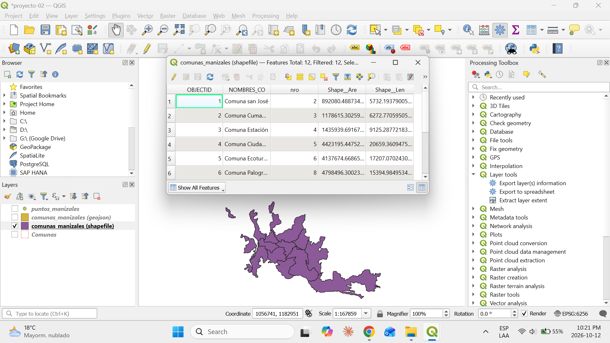
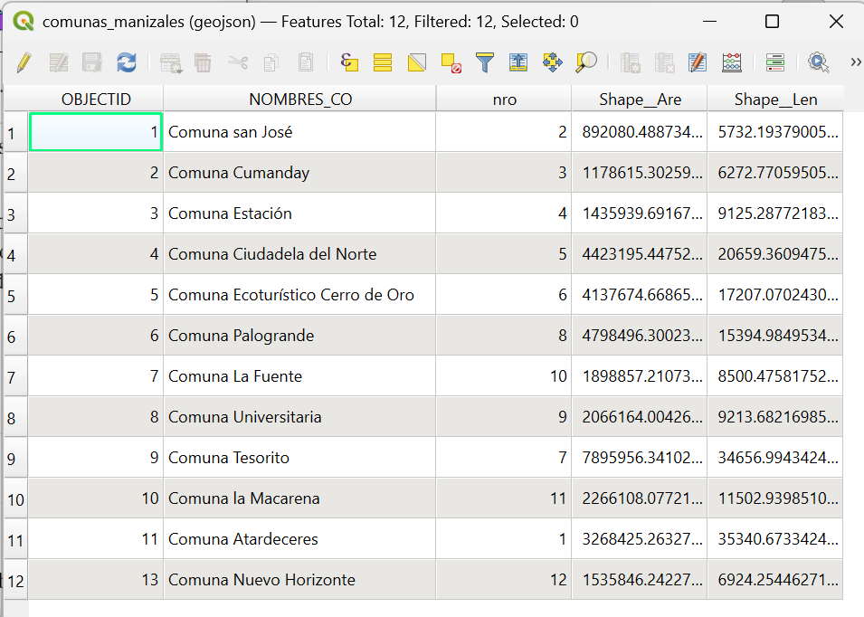
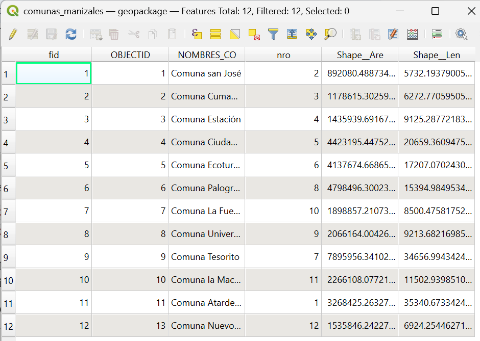
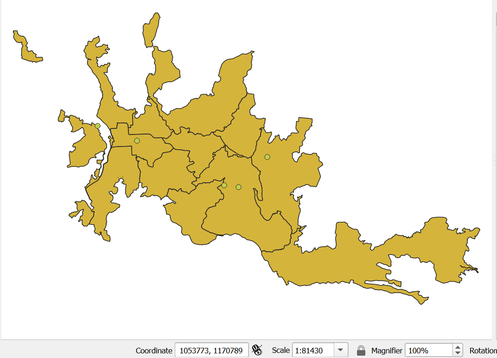
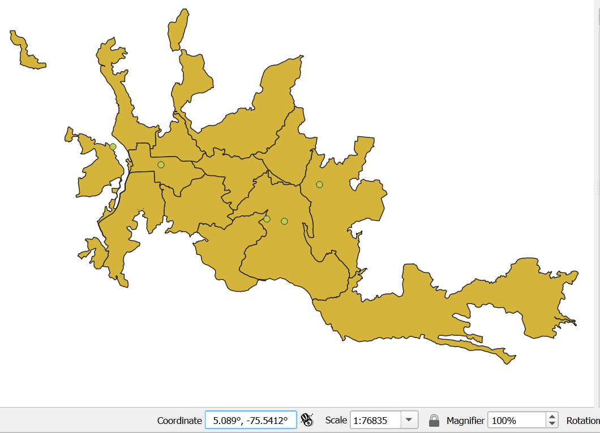
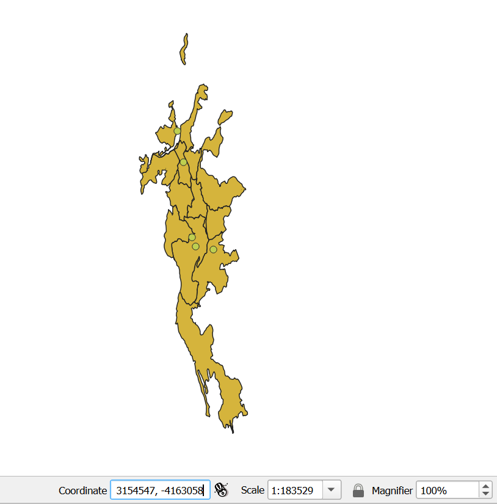

# Proyecto 3 — Hallazgos

## 3.1 — Interfaz de QGIS

- **Barra de herramientas** (arriba): accesos rápidos a abrir, guardar, zoom y selección.
- **Browser** (izquierda arriba): explorador de archivos y conexiones; sirve para buscar datos.
- **Layers** (izquierda abajo): capas cargadas. La de arriba se dibuja encima de las demás.
- **Lienzo del mapa** (centro): donde se dibujan las capas.
- **Barra de estado** (abajo): coordenadas del cursor, escala y CRS del proyecto.
- **Tabla de atributos**: no está a la vista; se abre con clic derecho sobre la capa → *Open Attribute Table* (o `F6`).
- Una capa encendida puede no verse si la vista está en otro lugar; *Zoom to Layer(s)* la ubica.

## 3.2 — Tablas de atributos

- Las 3 capas tienen 12 entidades, una por comuna.
- Comparten los campos `OBJECTID`, `NOMBRES_CO`, `nro`, `Shape__Are` y `Shape__Len`. La tabla del shapefile es idéntica a la del GeoJSON.
- Los nombres de campo están cortados a 10 caracteres en los 3 formatos: el límite es del shapefile, pero el GeoJSON y el GeoPackage se generaron a partir de él y lo heredaron. El límite aplica a los nombres de campo, no a los valores.
- El GeoPackage agrega el campo `fid`, su identificador propio.
- `OBJECTID` es un identificador interno y no coincide con el número de la comuna (`nro`).

## 3.3 — Cambio del CRS del proyecto

| CRS | Coordenadas del centro | Qué se observa |
|---|---|---|
| EPSG:6256 (Manizales urban grid) | 1051834, 1175098 (metros) | Forma real de la ciudad |
| EPSG:4326 (WGS 84) | 5.0641°, -75.4968° (grados) | Forma casi igual: cerca del ecuador la deformación es mínima |
| EPSG:3035 (LAEA Europe) | — | Comunas estiradas verticalmente y apretadas a los lados |

- Cambiar el CRS del proyecto no modifica los datos; QGIS los reproyecta al vuelo para dibujarlos.
- LAEA Europe conserva el área pero no la forma; lejos de su centro (Europa) estira en una dirección y aprieta en la otra.
- Al pasar a 3035, QGIS pidió elegir la transformación de datum (WGS 84 → ETRS89); se dejó la opción por defecto, porque la diferencia es menor a 1 m.
