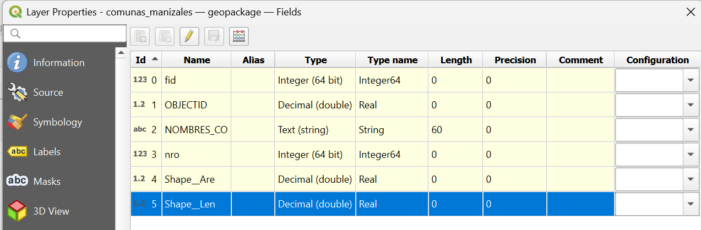
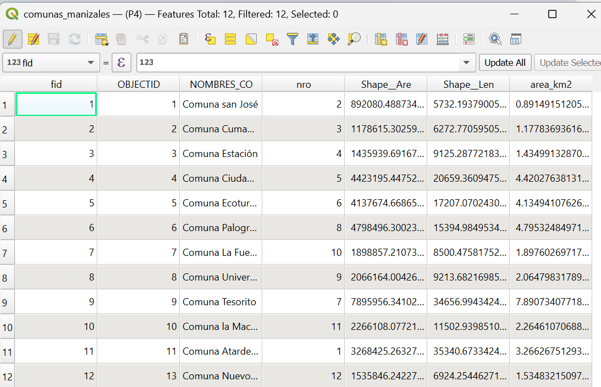
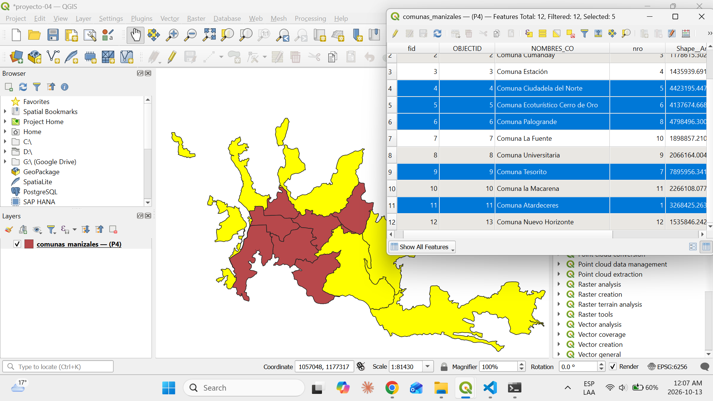
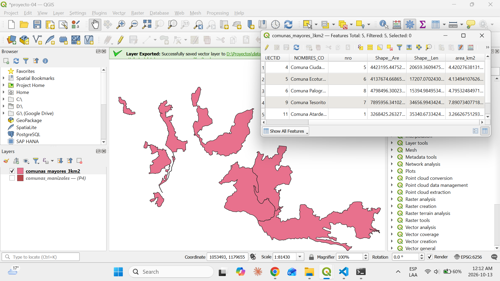

# Proyecto 4 — Hallazgos

## 4.1 — Tipos de dato

| Tipo | Qué guarda | Ícono en QGIS |
|---|---|---|
| Integer | Números sin decimales | 123 |
| Real / Double | Números con decimales | 1.2 |
| String / Text | Texto | abc |
| Date / DateTime | Fechas y horas | — |
| Boolean | Verdadero o falso | — |

| Campo | Tipo |
|---|---|
| `fid` | Integer (64 bit) |
| `OBJECTID` | Decimal (double) |
| `NOMBRES_CO` | Text (string), longitud 60 |
| `nro` | Integer (64 bit) |
| `Shape__Are` | Decimal (double) |
| `Shape__Len` | Decimal (double) |

- El tipo de dato define qué operaciones admite un campo.
- `OBJECTID` quedó como decimal aunque es un identificador: los tipos pueden cambiar al convertir entre formatos.

## 4.2 — Campo calculado `area_km2`

- Expresión: `$area / 1000000` (`$area` devuelve m² en un CRS métrico; 1 km² = 1.000.000 m²).
- `area_km2` resulta un 0,07 % menor que `Shape__Are` en todas las comunas.
- Causa: `Shape__Are` se midió sobre el plano de Manizales, ubicado a 2.100 m de altura, y `$area` mide por defecto sobre el elipsoide (nivel del mar). Ambas son correctas; dependen de la superficie de referencia.
- Comuna más grande: Tesorito (7,89 km²). Más pequeña: San José (0,89 km²).

## 4.3 — Selección por expresión

- Expresión: `"area_km2" > 3` (las comillas dobles indican un nombre de campo).
- Resultado: 5 de 12 comunas — Tesorito (7), Palogrande (8), Ciudadela del Norte (5), Ecoturístico Cerro de Oro (6) y Atardeceres (1).
- Seleccionar resalta las entidades sin ocultar las demás; equivale a un `SELECT ... WHERE` en SQL.

## 4.4 — Exportar la selección

- Se exportaron solo las entidades seleccionadas (*Save Selected Features As*) a `data/comunas_mayores_3km2.gpkg`.
- La capa nueva tiene 5 entidades y conserva todos los campos, incluido `area_km2`.
- Es el equivalente a guardar el resultado de una consulta como tabla nueva.