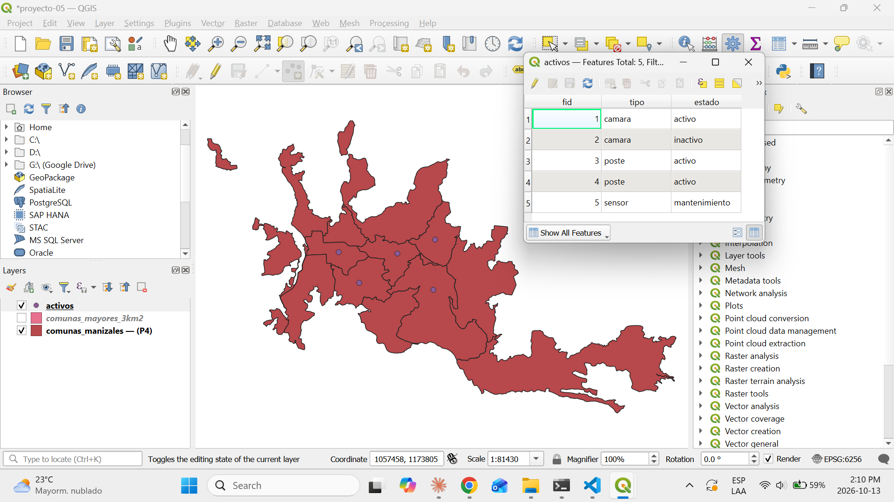
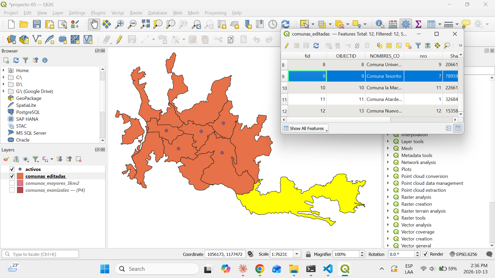
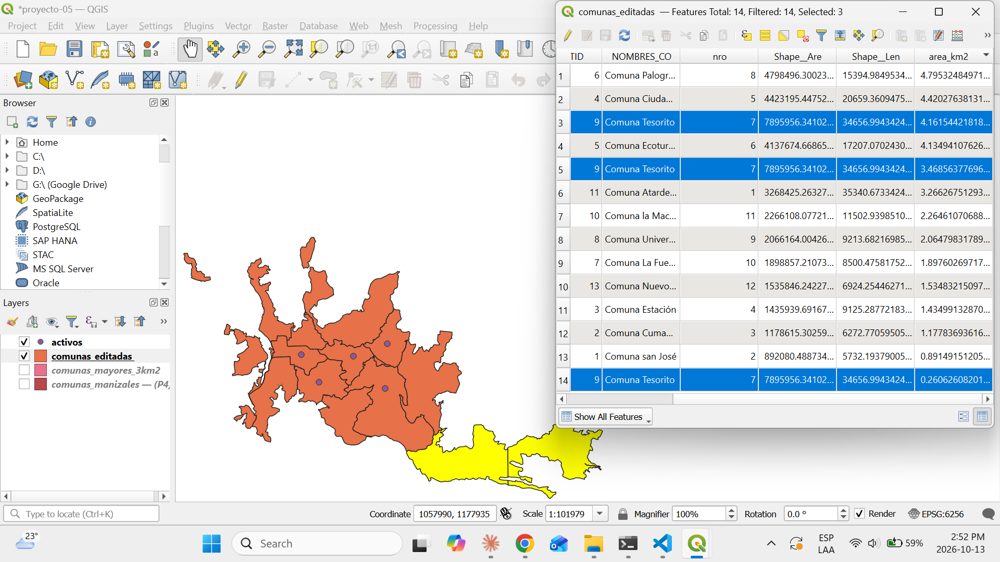

# Proyecto 5 — Hallazgos

## 5.1 — Herramientas de edición en QGIS

### Modo edición
QGIS protege las capas contra cambios accidentales: para modificar geometrías o atributos hay que activar el **modo edición** con el lápiz amarillo (*Toggle Editing*). Mientras está activo, los cambios quedan en memoria y solo se escriben en el archivo al hacer clic en **Save Layer Edits** (disquete). Si se sale del modo edición sin guardar, QGIS pregunta si se quieren descartar. Al activarlo aparece la barra de herramientas *Digitizing*.

### Herramientas
| Herramienta | Qué hace | Cómo se usa |
|---|---|---|
| **Add Point Feature** | Crea un punto nuevo | Un clic en el mapa y luego llenar sus atributos |
| **Add Line / Polygon Feature** | Crea una línea o un polígono nuevo | Clic en cada vértice y clic derecho para terminar; el polígono se cierra solo |
| **Vertex Tool** | Edita los vértices de una entidad existente | Arrastrar un vértice para moverlo; doble clic sobre un borde para agregar uno; seleccionarlo y presionar `Supr` para eliminarlo |
| **Move Feature** | Mueve una entidad completa sin deformarla | Clic sobre la entidad y clic en la nueva ubicación |
| **Delete Selected** | Elimina entidades | Seleccionarlas y presionar el bote de basura |
| **Split Features** | Corta una línea o polígono en varias partes | Dibujar una línea que cruce la entidad de lado a lado y clic derecho para terminar |
| **Merge Selected Features** | Une varias entidades en una sola | Seleccionarlas y elegir qué valores de atributos conserva la entidad resultante |

### Conceptos clave
- **Vértice:** cada esquina o punto de quiebre de una línea o polígono. El borde de una comuna puede tener cientos.
- **Mover un punto vs. mover un vértice:** un punto es una entidad completa (se mueve con *Move Feature*); un vértice es solo una parte de una línea o polígono (se mueve con *Vertex Tool*).
- **Split vs. Merge:** son operaciones inversas. Al dividir, las partes nuevas copian los atributos de la original; al unir, hay que decidir qué atributos se conservan.

## 5.2 — Capa de puntos desde cero

- Se creó la capa vacía `activos` (GeoPackage, geometría Point, EPSG:6256) con los campos `tipo` y `estado` (texto).
- Se digitalizaron 5 puntos con *Add Point Feature*: 2 cámaras, 2 postes y 1 sensor.
- Los valores se escribieron con un formato uniforme (minúsculas, sin tildes) para que funcionen como categorías en la simbología.
- Los cambios solo se escriben en el archivo al guardar (*Save Layer Edits*).

## 5.3 — Dividir un polígono (Split Features)

| Antes | Después |
|---|---|
|  |  |

- Se dividió la comuna Tesorito en una copia de la capa (`data/comunas_editadas.gpkg`) con *Edit → Edit Geometry → Split Features*.
- La línea de corte cruzó el polígono en más de un tramo, por su forma irregular, y generó **3 partes**: la capa pasó de 12 a 14 entidades.
- La entidad original (fid 9) conserva uno de los pedazos; las nuevas reciben los demás. Las 3 copiaron todos los atributos.
- *Split* **no recalcula** los campos: las 3 partes mostraban `area_km2` = 7,89. Se recalculó con `$area / 1000000`: 4,16 + 3,47 + 0,26 = 7,89 km², igual al área original.
- `Shape__Are` (calculado por ArcGIS) quedó desactualizado en las 3 partes; los campos de área de la fuente no son confiables tras editar geometrías.