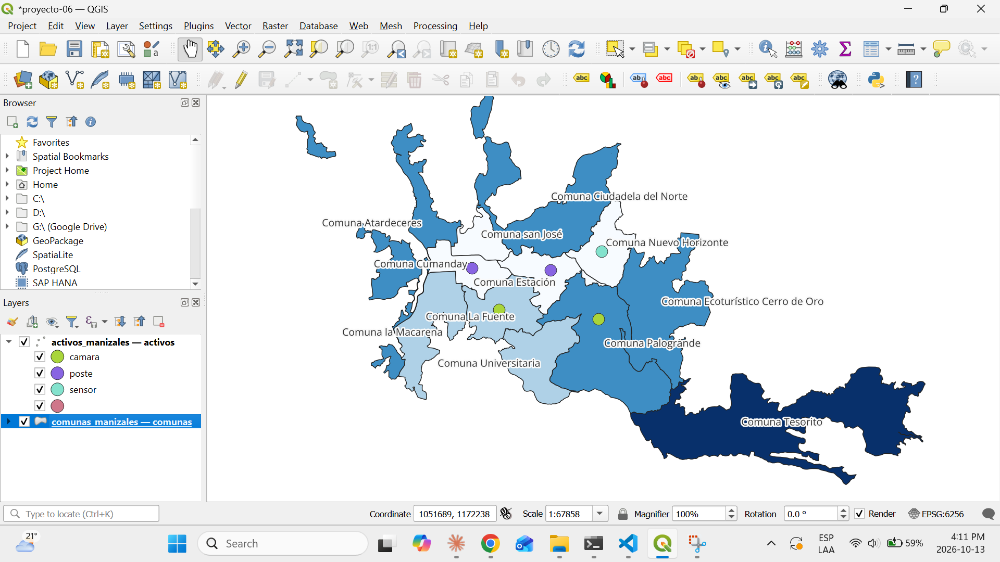
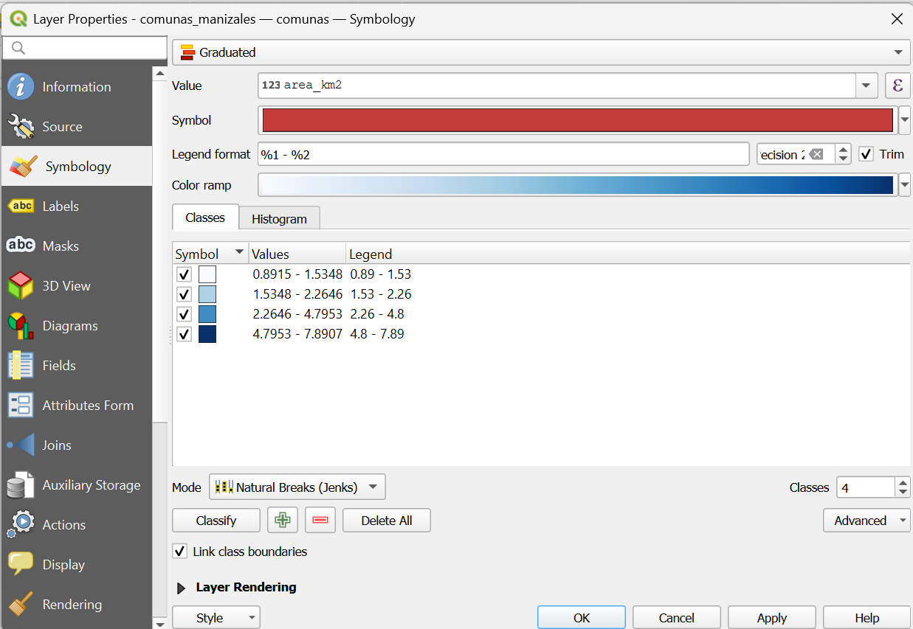
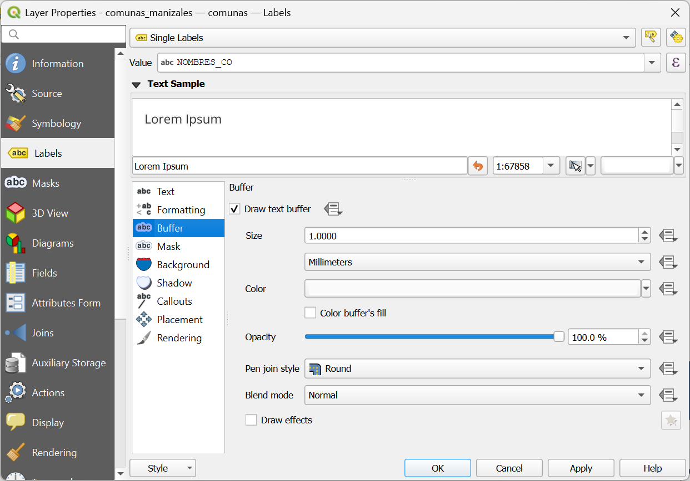
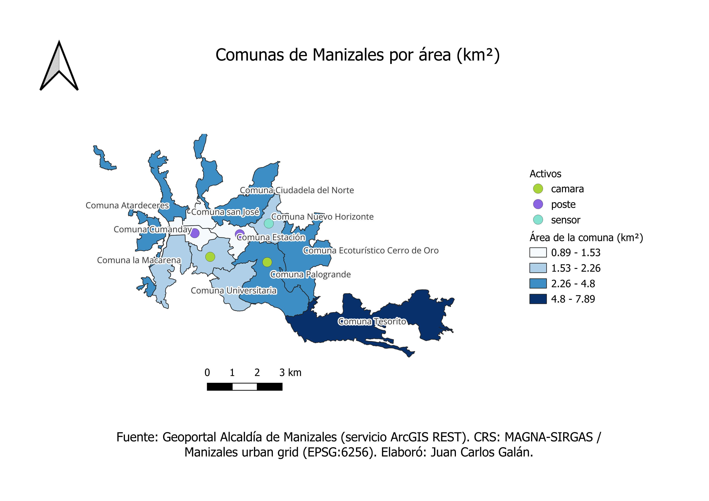

# Proyecto 6 — Hallazgos

## 6.1 — Tipos de simbología en QGIS

La **simbología** define cómo se dibuja cada entidad (color, tamaño, forma). Se configura en *Propiedades de la capa → Symbology*, y el tipo se elige en el desplegable superior. **No modifica los datos**: solo cambia cómo se ven.

| Tipo | Qué hace | Tipo de campo | Ejemplo en este curso |
|---|---|---|---|
| **Símbolo único** (*Single Symbol*) | Todas las entidades con el mismo estilo | Ninguno | Las comunas en un solo color, como hasta ahora |
| **Categorizado** (*Categorized*) | Un color o símbolo por cada **valor distinto** de un campo | Texto o códigos (categorías) | Los activos por `tipo`: cámara, poste, sensor |
| **Graduado** (*Graduated*) | Divide un campo **numérico** en rangos (clases) y asigna un color o tamaño a cada rango | Numérico | Las comunas por `area_km2`, de claro (pequeñas) a oscuro (grandes) |

## 6.2 — Simbología categorizada

*La misma captura de la 6.3 muestra la leyenda de `activos` (panel Layers, arriba a la izquierda), por eso no se tomó una aparte.*

- Capa `activos` simbolizada con *Categorized* sobre el campo `tipo`: 3 categorías (`camara`, `poste`, `sensor`), cada una con un color distinto.
- *Classify* genera una categoría por cada valor único del campo; por eso fue importante escribir los valores de forma uniforme en la 5.2.
- QGIS agrega una leyenda en el panel Layers que explica cada color.

## 6.3 — Simbología graduada y etiquetas

| Clases | Configuración de etiquetas |
|---|---|
|  |  |

- Capa de comunas simbolizada con *Graduated* sobre `area_km2`, rampa *Blues* (un solo tono, de claro a oscuro), modo *Natural Breaks (Jenks)*, 4 clases.

| Rango (km²) | Comunas |
|---|---|
| 0,89 – 1,53 | 4 |
| 1,53 – 2,26 | 3 |
| 2,26 – 4,80 | 4 |
| 4,80 – 7,89 | 1 (Tesorito) |

- Jenks deja a Tesorito sola en la clase más alta porque su área marca un salto grande respecto a la siguiente (7,89 vs 4,80 km²).
- Se descartó una rampa que empezaba en blanco porque las comunas pequeñas se confundían con el fondo del mapa.
- Etiquetas (*Single Labels*) con el campo `NOMBRES_CO` y un borde blanco (*text buffer*) para que se lean sobre los tonos oscuros.

## 6.4 — Diseñador de impresión (layout)

- Layout `Comunas de Manizales` en hoja A4 horizontal (297 × 210 mm), exportado como PNG a 300 dpi.
- Elementos de un mapa profesional: título, mapa, leyenda, flecha de norte, barra de escala en km y fuente de los datos con el CRS.
- Los nombres de la leyenda se cambiaron solo en el layout (desactivando *Auto update*), sin modificar las capas.
- El lienzo de QGIS sirve para trabajar; el layout, para presentar.

### Conceptos clave
- **Categorizado vs. graduado:** categorizado responde "¿de qué tipo es?"; graduado responde "¿cuánto tiene?". Usar graduado con categorías (o al revés) produce un mapa engañoso.
- **Paleta de colores:** en categorizado, colores distintos sin orden (cualitativos); en graduado, una escala de un solo tono de claro a oscuro (secuencial), para que "más oscuro" se lea como "más".
- **Modo de clasificación (graduado):** define cómo se cortan los rangos. Los más comunes son *Equal Interval* (rangos del mismo ancho), *Quantile* (la misma cantidad de entidades en cada rango) y *Natural Breaks (Jenks)* (cortes donde los datos tienen saltos naturales).
- **Etiquetas (*Labels*):** texto que muestra el valor de un campo sobre cada entidad. Se configuran aparte de la simbología, en la pestaña *Labels*.
