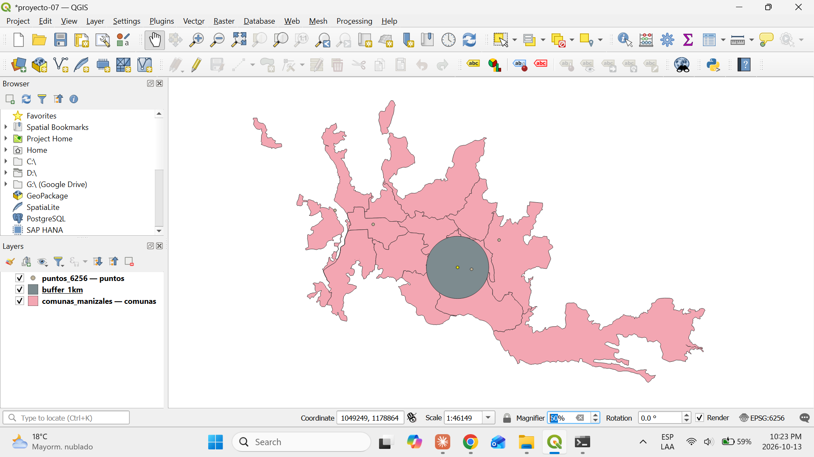
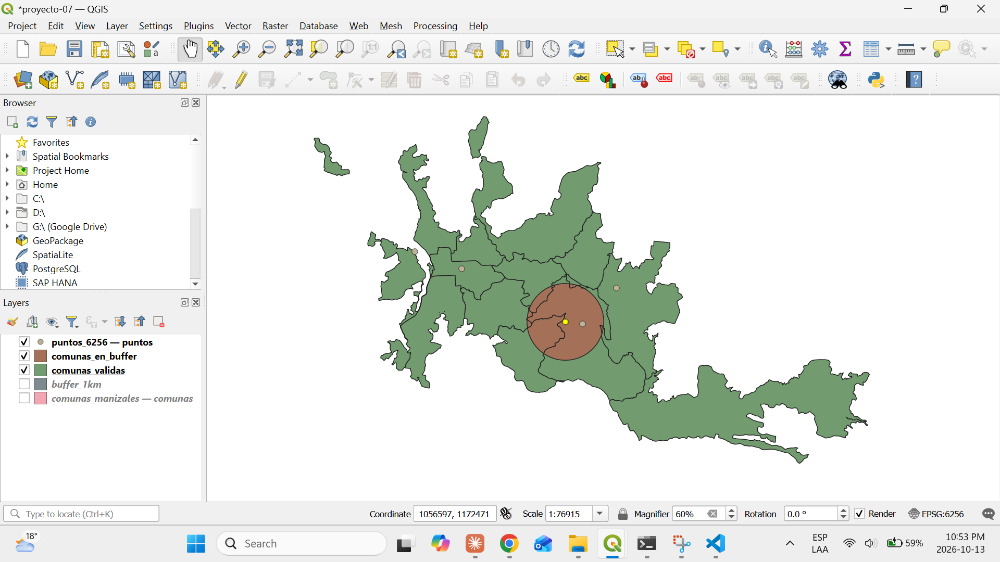
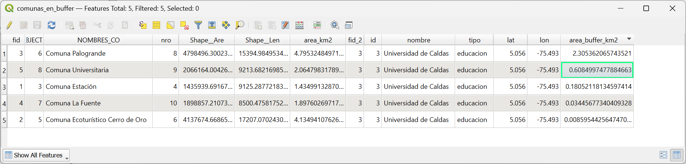

# Proyecto 7 — Hallazgos

## 7.1 — Herramientas de geoprocesamiento

El **geoprocesamiento** crea capas **nuevas** a partir de relaciones espaciales entre capas existentes. Ninguna de estas herramientas modifica las capas de entrada: siempre generan una salida. En QGIS están en el menú *Vector → Geoprocessing Tools* y en la *Processing Toolbox*.

| Herramienta | Qué hace | Ejemplo con datos de Manizales |
|---|---|---|
| **Buffer** | Crea un polígono (zona de influencia) alrededor de cada entidad, a una distancia dada | Área a 1 km de la Universidad de Caldas |
| **Clip** | Recorta una capa usando el contorno de otra; la salida solo conserva los atributos de la capa recortada | Quedarse solo con los activos que caen dentro del buffer |
| **Dissolve** | Fusiona entidades en una sola, opcionalmente agrupando por un atributo, y borra las fronteras internas | Unir las 12 comunas en un solo polígono: el perímetro urbano |
| **Intersect** | Devuelve solo las áreas donde dos capas se superponen, con los atributos de **ambas** | Qué partes de qué comunas quedan dentro del buffer |
| **Union** | Combina dos capas conservando **todas** las áreas, se superpongan o no, con los atributos de ambas | Comunas divididas en "dentro del buffer" y "fuera del buffer" |
| **Spatial join** (*Join attributes by location*) | Copia atributos de una capa a otra según su relación espacial, **sin cambiar la geometría** | Agregar a cada activo el nombre de la comuna en la que está |

## 7.2 — Buffer de 1 km

- Los puntos del CSV estaban en WGS 84 (grados); se exportaron a `data/puntos_6256.gpkg` en EPSG:6256 (metros) para que la distancia del buffer tuviera sentido.
- Buffer de 1 km alrededor de la Universidad de Caldas, usando *Selected features only* para no generar un círculo por cada punto. 25 segmentos.
- Resultado en `data/buffer_1km.gpkg`. Se verificó con la herramienta *Measure Line*: 2 km de diámetro, es decir, 1 km de radio.

## 7.2 — Buffer de 1 km

- Los puntos del CSV estaban en WGS 84 (grados); se exportaron a `data/puntos_6256.gpkg` en EPSG:6256 (metros) para que la distancia del buffer tuviera sentido.
- Buffer de 1 km alrededor de la Universidad de Caldas, usando *Selected features only* para no generar un círculo por cada punto. 25 segmentos.
- Resultado en `data/buffer_1km.gpkg`. Se verificó con la herramienta *Measure Line*: 2 km de diámetro, es decir, 1 km de radio.

## 7.3 — Intersección del buffer con las comunas

- La primera ejecución falló: dos comunas (Estación y Nuevo Horizonte) tenían geometría inválida por autointersección del borde. Se corrigieron con *Fix geometries* en una copia (`data/comunas_validas.gpkg`).
- *Intersection* (comunas válidas × buffer) devolvió 5 pedazos, uno por cada comuna que toca el buffer, con los atributos de ambas capas.
- `area_km2` heredó el área de la comuna completa; se creó `area_buffer_km2` (`$area / 1000000`) con el área real dentro del buffer.

| Comuna | Área en el buffer (km²) |
|---|---|
| Estación | 2,3054 |
| Ecoturístico Cerro de Oro | 0,6085 |
| Palogrande | 0,1805 |
| La Fuente | 0,0345 |
| Universitaria | 0,0086 |
| **Total** | **3,1375** |

- Validación: π·1² = 3,1416 km². La diferencia se explica porque el buffer es un polígono de 100 lados (3,1395 km²) y `$area` mide sobre el elipsoide (−0,07 %): 3,1373 ≈ 3,1375. Todo el buffer cae dentro de la ciudad.
- El 73 % del buffer cae en Estación; las coordenadas del CSV (2.5) son aproximadas.

### Conceptos clave
- **Clip vs. Intersect:** las dos devuelven solo la zona común, pero Clip usa la segunda capa como "molde" y descarta sus atributos; Intersect conserva los atributos de las dos.
- **Intersect vs. Union:** Intersect se queda con lo común; Union se queda con todo y lo parte donde las capas se cruzan.
- **Spatial join vs. el resto:** es el único que no crea geometrías nuevas, solo agrega columnas. Es el equivalente espacial de un `JOIN` en SQL.
- **La distancia del buffer usa las unidades del CRS:** en un CRS en grados (EPSG:4326), un buffer de "1000" serían 1000 grados. Por eso hay que trabajar en un CRS métrico, como EPSG:6256.
