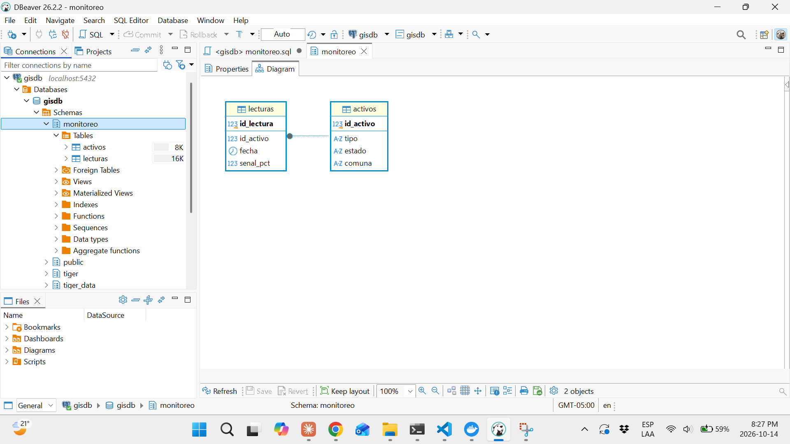
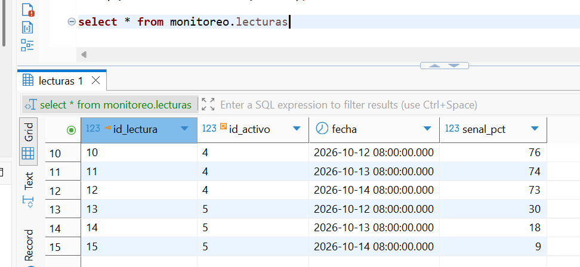
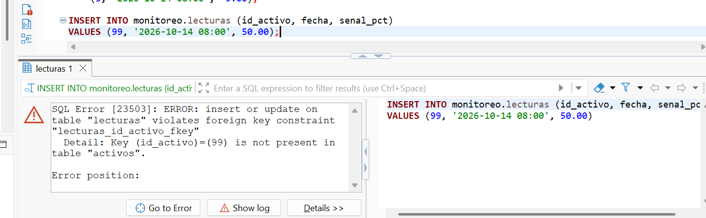
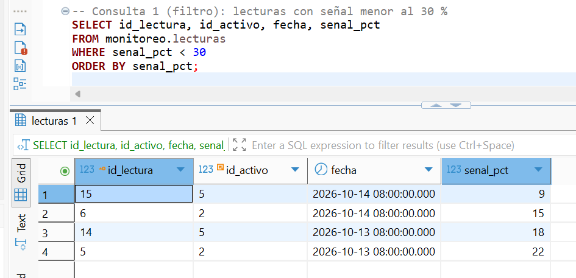
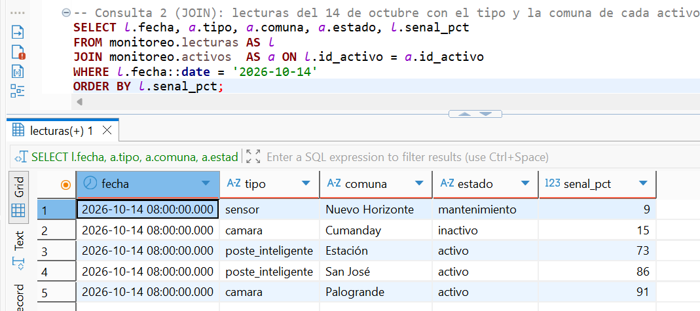
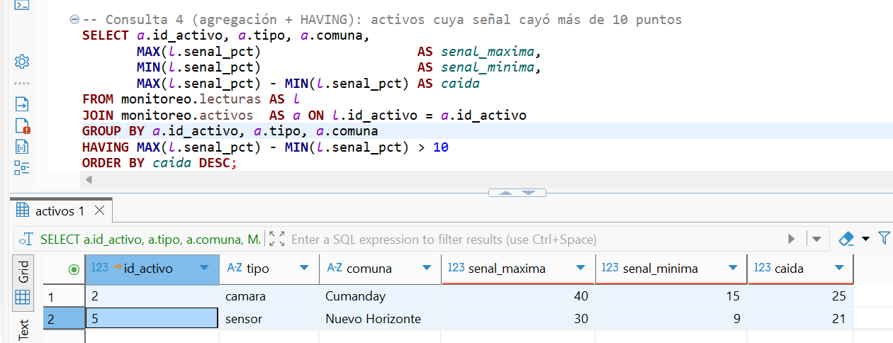
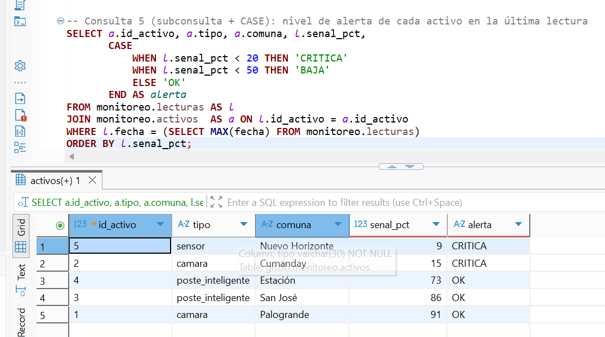

# Proyecto 8 — Hallazgos

## 8.1 — Conceptos de bases de datos relacionales

Una base de datos relacional guarda los datos en **tablas relacionadas entre sí**. Es la misma idea de la tabla de atributos de QGIS, pero pensada para muchos usuarios, muchos datos y consultas con SQL.

La jerarquía en PostgreSQL es: **servidor → base de datos → esquema → tabla → filas y columnas**.

| Concepto | Qué es | En este curso |
|---|---|---|
| **Base de datos** | Contenedor de todos los datos de un sistema; cada conexión entra a una base de datos | `gisdb`, en el contenedor Docker `gis-postgres` |
| **Esquema** | Carpeta lógica dentro de una base de datos que agrupa tablas relacionadas; `public` es el esquema por defecto | `monitoreo`, para las tablas de este proyecto |
| **Tabla** | Filas (registros) y columnas (campos con un tipo de dato fijo) | `activos` y `lecturas` |
| **Llave primaria (PK)** | Columna que identifica cada fila de forma única; no se repite ni puede estar vacía | `activos.id_activo` |
| **Llave foránea (FK)** | Columna que apunta a la PK de otra tabla; crea la relación e impide referenciar algo que no existe | `lecturas.id_activo` → `activos.id_activo` |
| **Índice** | Estructura que acelera las búsquedas por una columna, a cambio de espacio y escrituras algo más lentas | Índice sobre `lecturas.fecha` para consultar por fechas |

### Relación entre las dos tablas
Un activo (por ejemplo, una cámara) tiene **muchas** lecturas a lo largo del tiempo; cada lectura pertenece a **un solo** activo. Es una relación **uno a muchos** (1:N):

```
activos (1) ──────< lecturas (N)
id_activo  PK        id_lectura  PK
tipo                 id_activo   FK → activos.id_activo
estado               fecha
comuna               senal_pct
```

### Por qué separar en dos tablas
Si todo estuviera en una sola tabla, el tipo, el estado y la comuna de cada activo se repetirían en cada lectura. Separarlas evita duplicados y errores de digitación: el dato del activo vive en un solo lugar (**normalización**).

### SQL básico
| Comando | Para qué | Equivalente en QGIS |
|---|---|---|
| `CREATE TABLE` | Crear una tabla con sus columnas y tipos | *New GeoPackage Layer* (5.2) |
| `INSERT` | Agregar filas | Digitalizar puntos (5.2) |
| `SELECT ... WHERE` | Consultar filas que cumplen una condición | Selección por expresión (4.3) |
| `JOIN` | Combinar filas de dos tablas por una columna común | *Join attributes* (7.1) |
| `GROUP BY` | Agrupar y resumir (contar, promediar, sumar) | Estadísticas por categoría |

## 8.2 — Esquema y tablas relacionadas



- Esquema `monitoreo` dentro de `gisdb`, creado con `CREATE SCHEMA IF NOT EXISTS` para que el script se pueda ejecutar varias veces sin error (idempotente).
- Tabla `activos` (PK `id_activo`, tipo `SERIAL`: PostgreSQL asigna el número).
- Tabla `lecturas` (PK `id_lectura`), con la FK `id_activo` → `activos.id_activo`: una lectura no puede apuntar a un activo inexistente.
- Índice `idx_lecturas_fecha` sobre `lecturas.fecha` para acelerar consultas por fecha.
- Tablas e índice también usan `IF NOT EXISTS`, así la parte de estructura del script es idempotente.
- El diagrama ER muestra la relación uno a muchos: un activo, muchas lecturas.
- Script completo en `sql/monitoreo.sql`.

## 8.3 — Datos de prueba



- 5 activos: 2 cámaras, 2 postes inteligentes y 1 sensor. Se usó `poste_inteligente` porque un poste común no tiene electrónica que reporte datos.
- 15 lecturas de señal de conexión (`senal_pct`), 3 por activo, del 12 al 14 de octubre. Los activos 2 y 5 pierden señal día a día.
- `id_activo` no se escribe al insertar activos (`SERIAL` lo asigna); sí se escribe en las lecturas, porque es la FK que indica a qué activo pertenecen.
- Los activos se insertaron antes que las lecturas: la FK exige que el activo exista primero.
- La columna se creó como `bateria_pct` y se renombró a `senal_pct` con `ALTER TABLE`, porque la batería no aplicaba a todos los tipos de activo.

### Prueba de la FK



- Insertar una lectura del activo 99, que no existe, fue rechazado por PostgreSQL (*foreign key violation*). La FK impide datos huérfanos.
- Los `INSERT` no son idempotentes: ejecutarlos dos veces duplica las filas. Se ejecutaron una sola vez.

## 8.4 — Consultas

| # | Pregunta | Técnica | Resultado |
|---|---|---|---|
| 1 | ¿Qué lecturas tienen señal menor al 30 %? | `WHERE`, `ORDER BY` | 4 lecturas, de los activos 2 y 5 |
| 2 | ¿Qué activo y en qué comuna, el 14 de octubre? | `JOIN`, conversión `::date` | Peor señal: sensor de Nuevo Horizonte (9 %) |
| 3 | ¿Qué tipo de activo tiene peor señal en promedio? | `JOIN` + `GROUP BY`, `AVG`, `MIN`, `COUNT` | sensor 19,00 · cámara 59,33 · poste inteligente 80,67 |
| 4 | ¿Qué activos están perdiendo señal? | `GROUP BY` + `HAVING` | Cámara Cumanday (−25) y sensor Nuevo Horizonte (−21) |
| 5 | ¿Qué nivel de alerta tiene cada activo hoy? | Subconsulta + `CASE` | 2 CRITICA, 3 OK |

### Consulta 1 — Filtro


### Consulta 2 — JOIN


### Consulta 3 — Agregación


### Consulta 4 — Agregación con HAVING


### Consulta 5 — Subconsulta y CASE


### Observaciones
- El promedio de las cámaras (59 %) esconde que una está bien (91–95 %) y otra casi caída (15–40 %); por eso la consulta 3 también muestra el mínimo.
- `WHERE` filtra filas antes de agrupar; `HAVING` filtra grupos después de agrupar.
- La consulta 5 usa una subconsulta para encontrar la última fecha sin escribirla a mano: sirve igual mañana con datos nuevos, lo que la hace apta para automatizar con n8n.

## 8.5 — Script

- Todo el proyecto está en [`sql/monitoreo.sql`](../sql/monitoreo.sql): estructura (8.2), datos (8.3) y consultas (8.4), en orden y comentado.
- La parte de estructura es idempotente (`IF NOT EXISTS`); los `INSERT` no lo son, así que el script completo solo debe ejecutarse sobre una base vacía.
