# Proyecto 9 — Hallazgos

## 9.1 — geometry, geography y SRID

PostGIS agrega a PostgreSQL dos **tipos de dato** para guardar ubicaciones y formas. Se usan igual que `INTEGER` o `VARCHAR` al crear una columna.

| | `geometry` | `geography` |
|---|---|---|
| Superficie | Un **plano** (como una hoja de papel) | La **Tierra curva** (elipsoide) |
| Unidades | Las del CRS: metros en EPSG:6256, grados en EPSG:4326 | Siempre **metros**, con coordenadas en grados (WGS 84) |
| Cálculo de distancia | Pitágoras: rápido y simple | Geodésico, sobre la curvatura: más lento |
| Funciones disponibles | Todas (más de mil) | Un subconjunto |
| Cuándo usarlo | Áreas pequeñas (una ciudad) con una proyección local adecuada | Distancias largas (países, rutas aéreas) o datos de todo el mundo |

**Decisión para este curso:** `geometry` con **SRID 6256** (MAGNA-SIRGAS / Manizales urban grid). Es la proyección oficial de la ciudad, mide en metros y es la misma que se usó en QGIS desde el Proyecto 2. En una ciudad de unos 10 km, la curvatura de la Tierra no cambia los resultados.

### SRID
El **SRID** (*Spatial Reference System Identifier*) es el número que indica en qué sistema de referencia están las coordenadas de una geometría. En PostGIS coincide con el código **EPSG**: SRID 6256 = EPSG:6256, SRID 4326 = WGS 84.

- Cada geometría guarda su SRID. Sin él, `(1175734, 1051047)` serían solo dos números: no se sabría si son metros de Manizales, grados o pies.
- PostGIS **no deja comparar geometrías con SRID distintos**: hay que reproyectar primero con `ST_Transform`. Es la misma lección del Proyecto 2, donde los puntos del CSV cayeron lejos por un CRS mal definido.
- La tabla del sistema `spatial_ref_sys` contiene la definición de cada SRID que PostGIS conoce.

## 9.2 — Funciones espaciales

Todas empiezan por `ST_` (*spatial type*) y se usan dentro de un `SELECT` o un `WHERE` normal.

| Función | Qué hace | Devuelve | Equivalente en QGIS |
|---|---|---|---|
| `ST_MakePoint(x, y)` | Crea un punto a partir de dos coordenadas (x = este, y = norte). Se combina con `ST_SetSRID(..., 6256)` para indicar el sistema | Geometría | Digitalizar un punto (5.2) |
| `ST_Distance(a, b)` | Distancia mínima entre dos geometrías, en las unidades del CRS | Número | Herramienta *Measure Line* (7.2) |
| `ST_DWithin(a, b, d)` | ¿Están a una distancia menor o igual que `d`? Usa el índice espacial, así que es más rápida que comparar `ST_Distance(a, b) <= d` | Verdadero / falso | Seleccionar lo que cae dentro de un buffer |
| `ST_Contains(a, b)` | ¿La geometría `a` contiene completamente a `b`? (por ejemplo, ¿la comuna contiene al punto?) | Verdadero / falso | *Select by location* |
| `ST_Intersects(a, b)` | ¿Las geometrías se tocan o se cruzan en algún punto? | Verdadero / falso | Condición previa de *Intersection* (7.3) |
| `ST_Buffer(g, d)` | Crea un polígono a una distancia `d` alrededor de la geometría | Geometría | *Buffer* (7.2) |

### Conceptos clave
- **Funciones que responden vs. funciones que crean:** `ST_DWithin`, `ST_Contains` e `ST_Intersects` responden sí o no y sirven para filtrar en el `WHERE`. `ST_MakePoint` e `ST_Buffer` crean geometrías nuevas.
- **`ST_Contains` vs. `ST_Intersects`:** `ST_Contains(comuna, punto)` exige que el punto esté dentro; `ST_Intersects` acepta cualquier contacto, incluso un borde compartido.
- **El orden importa en `ST_Contains`:** el contenedor va primero. `ST_Contains(comuna, punto)` puede ser verdadero; `ST_Contains(punto, comuna)` nunca lo es.
- **Índice espacial (GiST):** igual que el índice por fecha del Proyecto 8, pero en dos dimensiones. Guarda el rectángulo que envuelve cada geometría y descarta rápido las que están lejos, antes de calcular con precisión.

## 9.3 — Columna geométrica en `monitoreo.activos`

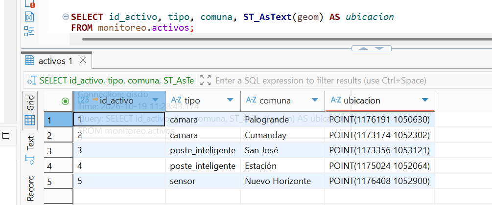

- `PostGIS_Version()` confirmó PostGIS 3.4 activo en `gisdb`, con GEOS (motor de geometría) y PROJ (motor de proyecciones), los mismos que usa QGIS.
- Se agregó la columna `geom geometry(Point, 6256)` a la tabla existente con `ALTER TABLE ... ADD COLUMN IF NOT EXISTS`. El tipo restringe la columna a puntos en SRID 6256: cualquier otra geometría o SRID se rechaza.
- Índice espacial `idx_activos_geom` (`USING GIST`).
- Cada activo recibió su ubicación con `UPDATE ... SET geom = ST_SetSRID(ST_MakePoint(x, y), 6256) WHERE id_activo = n`. En `ST_MakePoint` va primero el este (x) y luego el norte (y).
- Las coordenadas se calcularon como un punto interior de cada comuna (capa corregida del Proyecto 7), para que cada activo caiga dentro de la comuna registrada en su columna `comuna`; se verifica en la 9.5.
- `UPDATE` sin `WHERE` modificaría todas las filas; con `WHERE` por PK, cada actualización es segura y se puede repetir sin cambiar el resultado.
- `ST_AsText` muestra la geometría en formato legible (WKT), por ejemplo `POINT(1176191 1050630)`.

## 9.4 — Distancias a la Universidad de Caldas

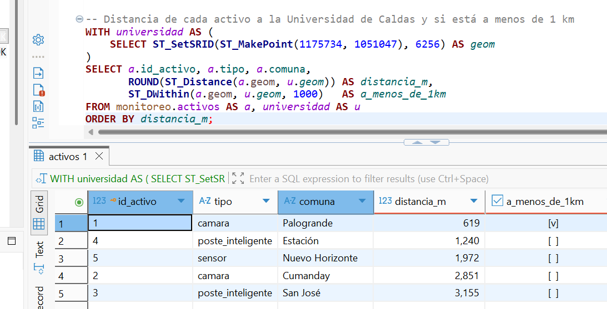

- Consulta con `WITH` (CTE) que define una sola vez el punto de la universidad (`1175734, 1051047`, EPSG:6256, el mismo de `07-geoprocessing/data/puntos_6256.gpkg`).
- `ST_Distance` devuelve la distancia en metros, porque el SRID 6256 está en metros; `ST_DWithin(..., 1000)` responde si está a 1 km o menos.

| Activo | Comuna | Distancia | ¿< 1 km? |
|---|---|---|---|
| Cámara | Palogrande | ~619 m | sí |
| Poste inteligente | Estación | ~1.240 m | no |
| Sensor | Nuevo Horizonte | ~1.972 m | no |
| Cámara | Cumanday | ~2.851 m | no |
| Poste inteligente | San José | ~3.155 m | no |

- Coincide con el Proyecto 7: el 73 % del buffer de 1 km cae en Palogrande, y el único activo a menos de 1 km es el de Palogrande. `ST_DWithin` llega al mismo resultado que el buffer, sin crear ninguna geometría nueva.

## 9.5 — Comunas en PostGIS y verificación espacial

### Problema 1: QGIS mostraba los activos sin CRS

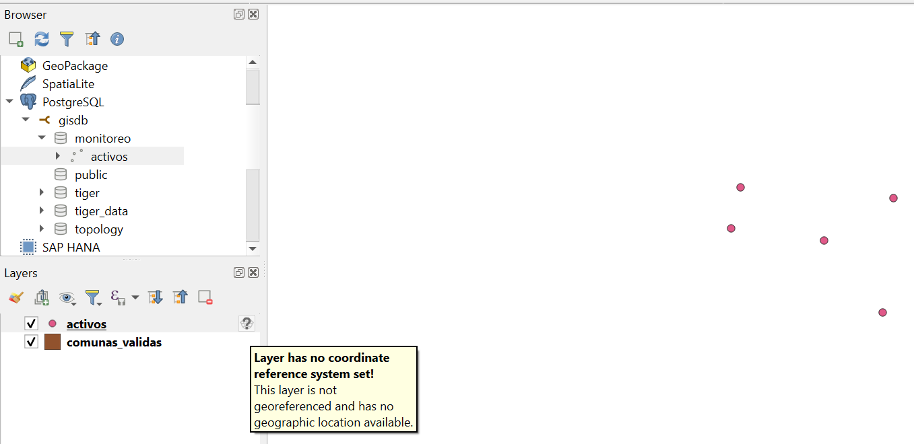

| Paso | Consulta | Resultado | Evidencia |
|---|---|---|---|
| Diagnóstico 1 | `SELECT DISTINCT ST_SRID(geom) FROM monitoreo.activos` | 6256 (correcto) | 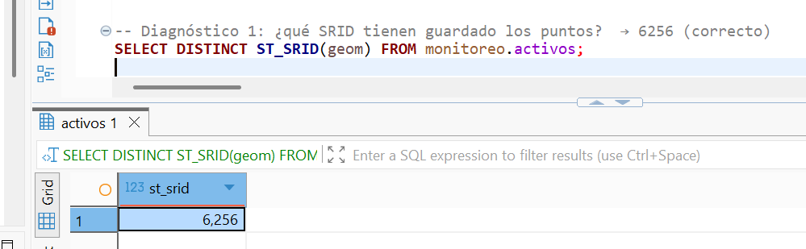 |
| Diagnóstico 2 | `spatial_ref_sys WHERE srid = 6256` | Sin filas: PostGIS no conoce el 6256 | 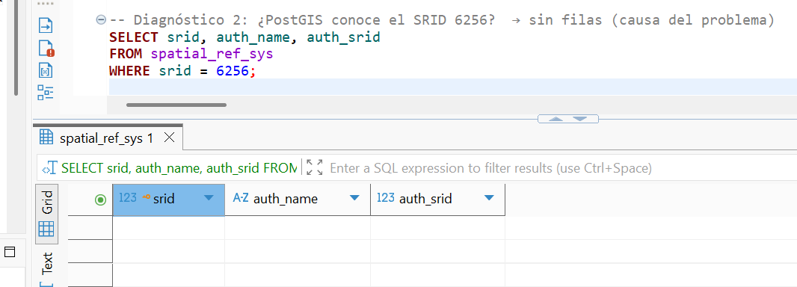 |
| Solución | `INSERT INTO spatial_ref_sys ...` (WKT2 + PROJ) | 1 fila insertada | 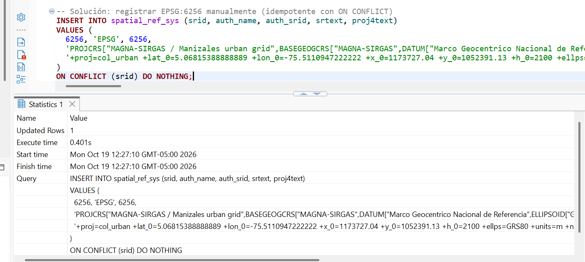 |
| Comprobación | `spatial_ref_sys WHERE srid = 6256` | 1 fila: `6256, EPSG, 6256` | 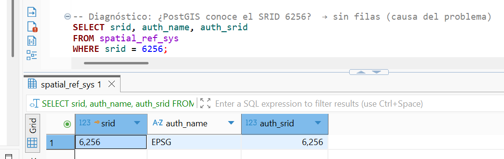 |
| Verificación | `ST_Transform` de la universidad a EPSG:4326 | `POINT(-75.493 5.056)`, igual al CSV del Proyecto 2 | 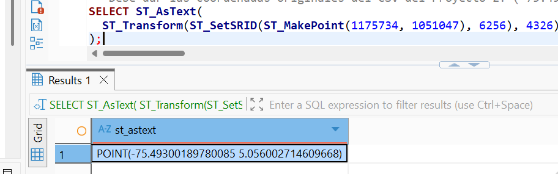 |

- Causa: EPSG:6256 usa el método *Colombia Urban*, que no se puede escribir en WKT1. Por eso PostGIS no lo incluye en `spatial_ref_sys`, y QGIS no podía interpretar el SRID.
- Tras registrarlo y volver a cargar la capa, los activos quedaron alineados con las comunas:

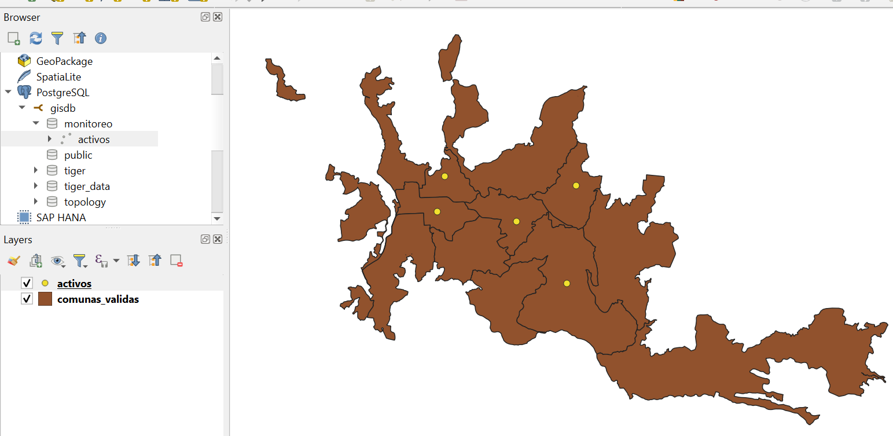

### Problema 2: DB Manager no pudo importar las comunas

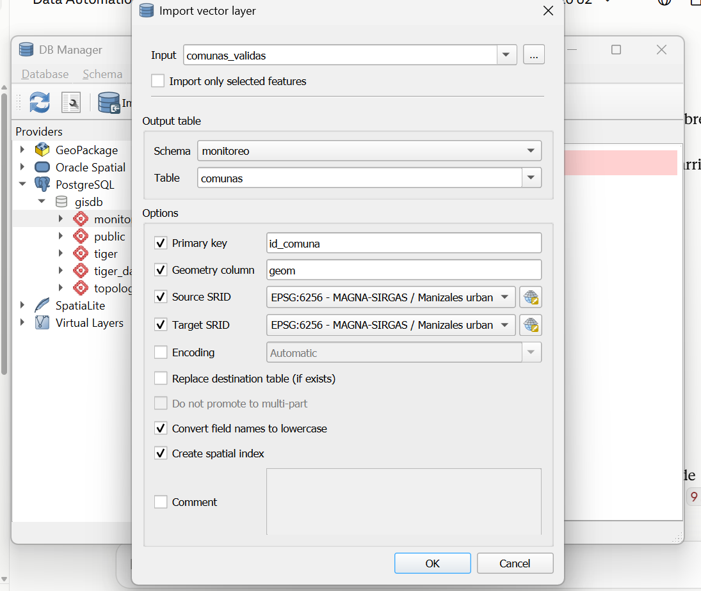

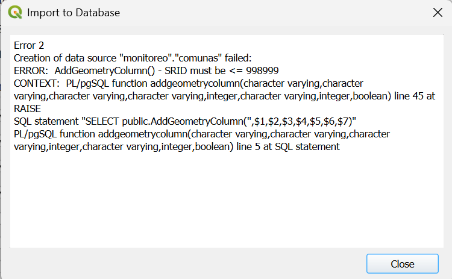

- Error `SRID must be <= 998999`: el GeoPackage guarda EPSG:6256 con la definición vacía (GDAL tampoco puede escribirla en WKT1), así que QGIS lo trató como un CRS personalizado con un número interno. Asignar el CRS de la capa no lo resolvió.
- Solución: cargar las comunas con un script SQL generado a partir de `comunas_validas.gpkg` (`sql/comunas.sql`), con `ST_GeomFromText(..., 6256)`. La carga queda reproducible.

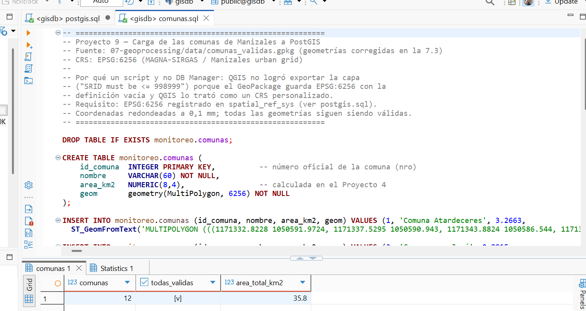

- 12 comunas, todas válidas, 35,80 km² (área plana; 35,77 km² con `$area` de QGIS, que mide sobre el elipsoide).

### Verificación con `ST_Contains`

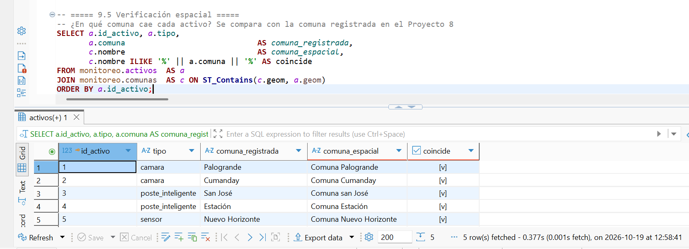

- *Spatial join*: `JOIN monitoreo.comunas ON ST_Contains(c.geom, a.geom)` une cada activo con la comuna que lo contiene.
- Las 5 comunas obtenidas espacialmente coinciden con las registradas a mano en el Proyecto 8.
- La tabla `monitoreo.comunas` queda lista como zonas para el geofencing del Proyecto 12.
