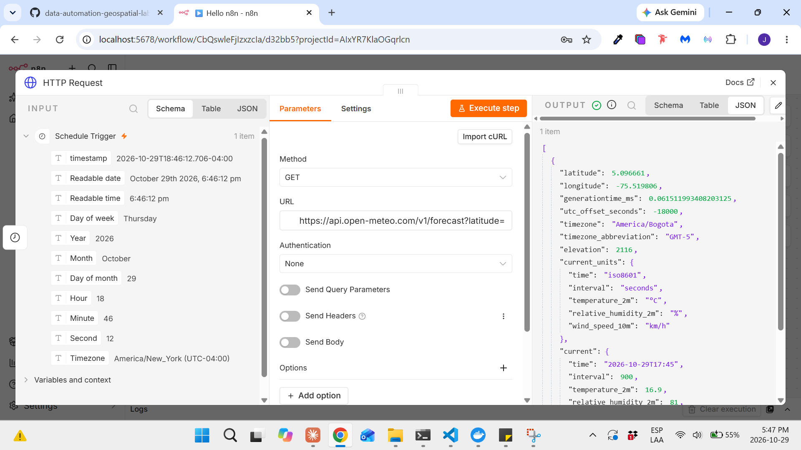
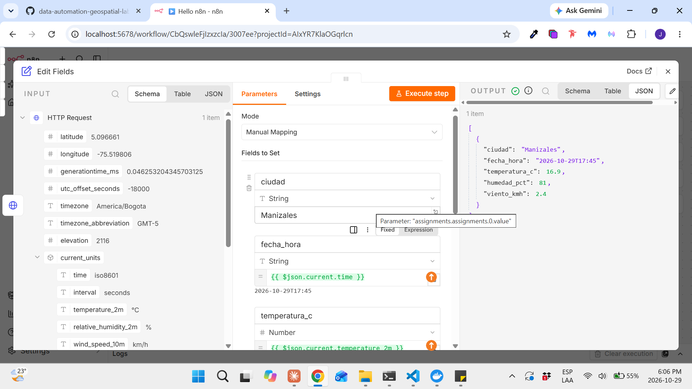
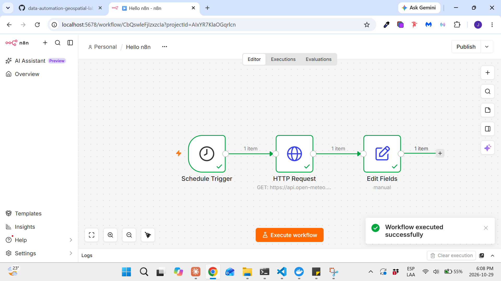
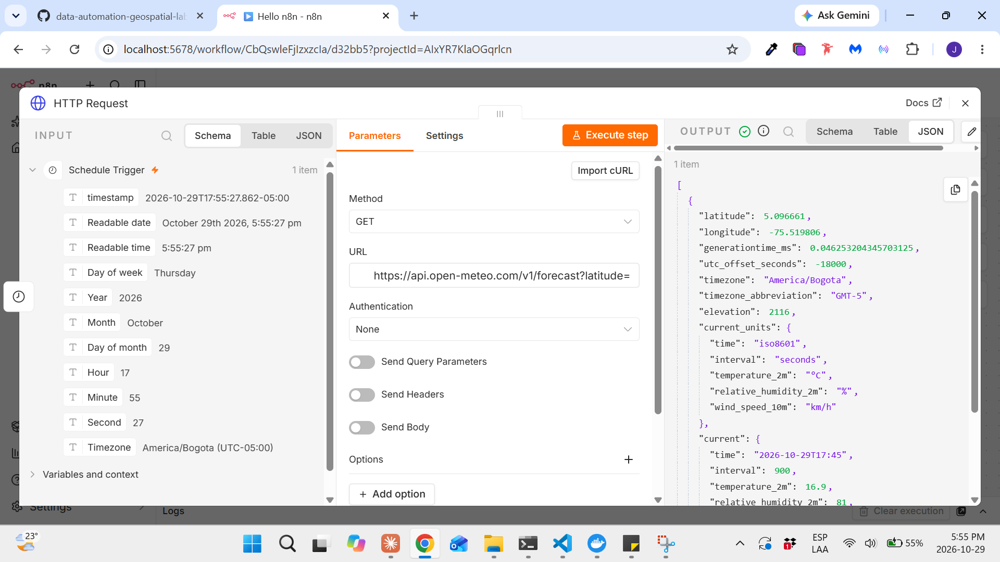
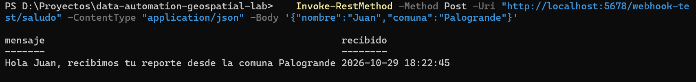
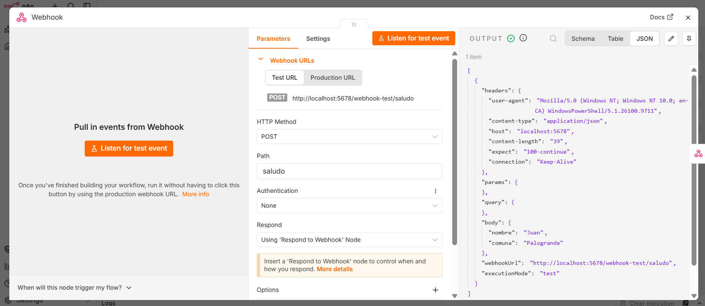

# Proyecto 10 — Hallazgos

## 10.1 — Conceptos de n8n

**n8n** es una herramienta de automatización por nodos: en vez de escribir un programa, se conectan bloques visuales que traen, transforman y envían datos. En este curso corre en el contenedor Docker `gis-n8n` (http://localhost:5678).

| Concepto | Qué es | Ejemplo en este curso |
|---|---|---|
| **Workflow** | El flujo completo de automatización: nodos conectados que se ejecutan de izquierda a derecha | "Hello n8n" (10.2): traer el clima de Manizales cada hora |
| **Node (nodo)** | Cada bloque del workflow; hace una sola tarea (traer, transformar, decidir, guardar) | *HTTP Request*, *Edit Fields*, *IF*, *Postgres* |
| **Trigger** | El nodo que **inicia** el workflow; siempre va primero y no recibe datos de otro nodo | *Schedule Trigger* (por tiempo) o *Webhook* (por una petición) |
| **HTTP Request** | Nodo que llama a una **API** externa por internet y recibe su respuesta, normalmente en JSON | Pedir la temperatura actual a Open-Meteo |
| **Webhook** | Una **URL** que n8n expone y que, al recibir una petición, dispara el workflow; puede devolver una respuesta | Recibir una coordenada y responder si está dentro de Manizales (Proyecto 12) |
| **Expression** | Fórmula entre `{{ }}` que lee datos de un nodo anterior dentro de la configuración de otro nodo | `{{ $json.current.temperature_2m }}` |
| **Nodo IF** | Divide el workflow en dos salidas, **true** y **false**, según una condición | Si la señal < 30 % → rama de alerta (Proyecto 12) |

### Cómo viajan los datos
- Entre nodos viaja **JSON**: texto con pares `"campo": valor`, como una fila de una tabla. Ejemplo de una respuesta de Open-Meteo:
  ```json
  { "latitude": 5.06, "longitude": -75.5, "current": { "temperature_2m": 18.4 } }
  ```
- n8n agrupa los datos en **items**: cada item es un registro (como una fila). Un nodo se ejecuta **una vez por cada item** que recibe.
- `$json` en una expression es el item actual; `$('Nombre del nodo')` permite leer la salida de un nodo anterior específico.

### Schedule vs. webhook
| | Schedule Trigger | Webhook |
|---|---|---|
| Se dispara | Por **tiempo** (cada hora, todos los días a las 7 a.m.) | Cuando **alguien llama** a su URL |
| Modelo | *Pull*: n8n va a buscar los datos | *Push*: otro sistema le envía los datos |
| Uso típico | Reportes, sincronizaciones periódicas | Formularios, eventos en tiempo real, integraciones |

### Conceptos clave
- **Ejecución manual vs. activa:** mientras se construye, el workflow se prueba a mano (*Execute workflow*). Para que corra solo (por schedule o webhook de producción) hay que **activarlo**; en la versión usada en este curso, el botón se llama **Publish**.
- **URL de prueba vs. de producción del webhook:** la de prueba solo escucha mientras se está probando en el editor; la de producción funciona cuando el workflow está publicado (activo).
- **Relación con lo anterior:** n8n será el "pegamento" del curso. En el Proyecto 11 escribirá en PostgreSQL y en el 12 consultará PostGIS (`ST_Contains`) para validar coordenadas.

## 10.2 — Workflow "Hello n8n"

Flujo: **Schedule Trigger → HTTP Request → Edit Fields (Set)**. Trae el clima actual de Manizales cada hora y lo deja listo para guardarlo en PostgreSQL (Proyecto 11).

| Nodo | Configuración | Qué hace |
|---|---|---|
| Schedule Trigger | Cada 1 hora | Dispara el workflow por tiempo |
| HTTP Request | `GET` a `https://api.open-meteo.com/v1/forecast?latitude=5.07&longitude=-75.52&current=temperature_2m,relative_humidity_2m,wind_speed_10m&timezone=America/Bogota` | Pide el clima actual a la API de Open-Meteo (gratis, sin clave) |
| Edit Fields (Set) | 5 campos con expressions | Deja solo los datos útiles, en una estructura plana |

### Respuesta de la API


- Lo que va después del `?` en la URL son los **parámetros**: coordenadas, datos pedidos y zona horaria.
- La respuesta trae `current_units` (unidades) y `current` (valores). La elevación que reporta Open-Meteo para el punto es **2116 m**, casi la altura del plano de proyección de EPSG:6256 (2100 m, Proyecto 9).

### Transformación con Edit Fields


| Campo | Tipo | Expression |
|---|---|---|
| `ciudad` | String | `Manizales` (valor fijo) |
| `fecha_hora` | String | `{{ $json.current.time }}` |
| `temperatura_c` | Number | `{{ $json.current.temperature_2m }}` |
| `humedad_pct` | Number | `{{ $json.current.relative_humidity_2m }}` |
| `viento_kmh` | Number | `{{ $json.current.wind_speed_10m }}` |

- Antes: un JSON anidado con datos técnicos que no se necesitan (`generationtime_ms`, `utc_offset_seconds`…). Después: un item plano con 5 campos, la misma forma que tendrá una fila de la tabla en PostgreSQL.
- Al arrastrar un campo desde el INPUT, n8n escribe la expression automáticamente. Hay que verificar el resultado: en la primera prueba `humedad_pct` quedó con la ruta de la temperatura (16.9 en vez de 81) y se corrigió.

### Workflow completo


- *Execute workflow* ejecuta todos los nodos en orden; *Execute step* prueba solo un nodo.
- n8n guarda los cambios automáticamente. El workflow **no se publicó** (*Publish*): por ahora solo se ejecuta a mano, para no generar ejecuciones cada hora.

### Problema: zona horaria de n8n


- El Schedule Trigger mostraba `America/New_York`, la zona por defecto de n8n, mientras Open-Meteo respondía en `America/Bogota` porque así se pidió en la URL. Era el mismo momento expresado en dos zonas, con una hora de diferencia.
- Solución: en `docker-compose.yml` se agregaron las variables de entorno `GENERIC_TIMEZONE=America/Bogota` (zona de n8n) y `TZ=America/Bogota` (zona del contenedor), y se recreó el contenedor con `docker compose up -d`. El workflow y la cuenta se conservaron porque viven en el volumen `n8n-data`.
- Lección: al integrar sistemas, fijar la zona horaria en cada uno; si no, las horas guardadas en la base de datos pueden quedar desfasadas.

## 10.3 — Workflow con webhook

Flujo: **Webhook → Respond to Webhook**. Recibe un nombre y una comuna, y responde con un mensaje. Es la base del geofencing del Proyecto 12 (recibir una coordenada y responder si está dentro de Manizales).

| Nodo | Configuración |
|---|---|
| Webhook | Método `POST`, path `saludo`, sin autenticación, *Respond: Using 'Respond to Webhook' Node* |
| Respond to Webhook | *Respond With: JSON*, cuerpo con expressions |

Cuerpo de la respuesta:
```
{
  "mensaje": "Hola {{ $json.body.nombre }}, recibimos tu reporte desde la comuna {{ $json.body.comuna }}",
  "recibido": "{{ $now.toFormat('yyyy-MM-dd HH:mm:ss') }}"
}
```

### Prueba desde PowerShell


```powershell
Invoke-RestMethod -Method Post -Uri "http://localhost:5678/webhook-test/saludo" -ContentType "application/json" -Body '{"nombre":"Juan","comuna":"Palogrande"}'
```

- `Invoke-RestMethod` hace una petición HTTP desde la terminal (lo mismo que el nodo HTTP Request, pero en sentido contrario: aquí es PowerShell quien llama a n8n).
- Respuesta: *"Hola Juan, recibimos tu reporte desde la comuna Palogrande"*, con la hora en zona de Bogotá gracias al ajuste del 10.2.

### Lo que recibió n8n


- El webhook entrega un item con `headers` (datos técnicos de la petición), `params`, `query` y **`body`** (los datos enviados). Por eso las expressions usan `$json.body.nombre` y no `$json.nombre`.

### Conceptos clave
- **GET vs. POST:** GET pide datos (10.2, Open-Meteo); POST envía datos (10.3, PowerShell → n8n).
- **URL de prueba:** `/webhook-test/saludo` solo escucha después de pulsar *Execute workflow* y acepta **una** llamada. La de producción, `/webhook/saludo`, queda escuchando siempre cuando el workflow está publicado.
- **Respond to Webhook** permite decidir qué y cuándo se responde (por ejemplo, después de consultar PostGIS), en vez de responder automáticamente al recibir la petición.
