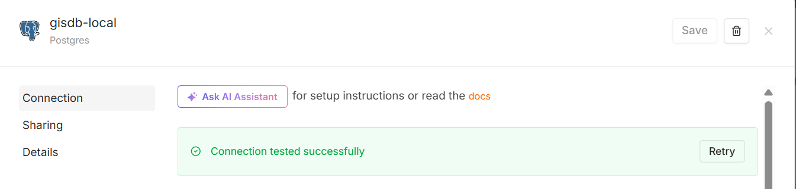
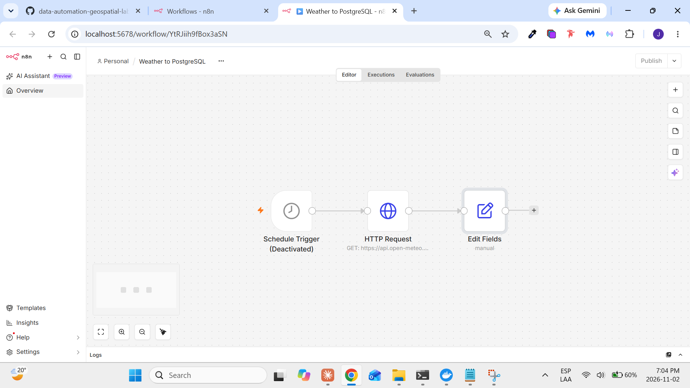
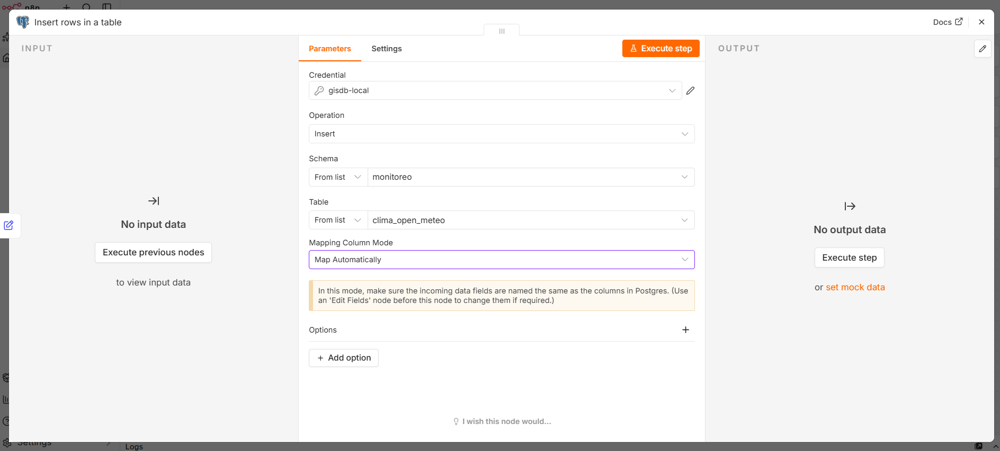
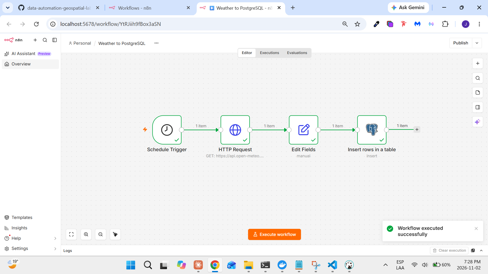
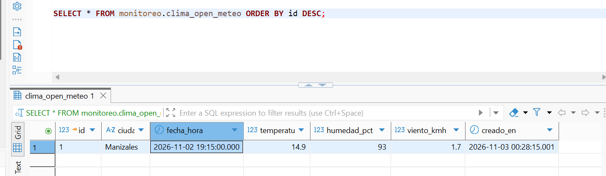
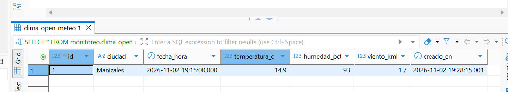

# Proyecto 11 — Hallazgos

## 11.1 — Credenciales de PostgreSQL en n8n

Una **credencial** en n8n es un conjunto guardado de datos de conexión (host, puerto, usuario, contraseña) que los nodos reutilizan. n8n la guarda **cifrada en su propia base de datos interna**, no en el JSON del workflow: al exportar el workflow solo queda el nombre e id de la credencial.



| Campo | Valor | Por qué |
|---|---|---|
| Host | `postgis` | Nombre del **servicio** de PostgreSQL en `docker-compose.yml` |
| Database | `gisdb` | Base de datos del curso |
| User / Password | Los de `.env` | Nunca se escriben en el repo |
| Port | `5432` | Puerto **interno** del contenedor |
| SSL | `disable` | Conexión local entre contenedores |
| Nombre de la credencial | `gisdb-local` | |

### Conceptos clave
- **`localhost` no sirve desde n8n:** cada contenedor tiene su propia red; dentro de `gis-n8n`, `localhost` es el propio contenedor de n8n. Docker Compose crea una red compartida en la que cada servicio se resuelve por su nombre (`postgis`).
- **DBeaver sí usa `localhost`:** se conecta desde la laptop, a través del puerto publicado (`127.0.0.1:5432:5432`).
- Al guardar, n8n prueba la conexión: *Connection tested successfully*.

## 11.2 — Duplicar el workflow "Hello n8n"

En vez de reconstruir el flujo del 10.2, se duplicó (menú ⋯ → *Duplicate*) con el nombre **Weather to PostgreSQL**. El original queda intacto como referencia del Proyecto 10.



El nodo *Edit Fields* entrega 5 campos: `ciudad`, `fecha_hora`, `temperatura_c`, `humedad_pct`, `viento_kmh`. Esos nombres se usaron tal cual como columnas de la tabla.

### Conceptos clave
- **Desactivar un nodo vs. no publicar el workflow:** un nodo desactivado (*Deactivated*, atajo `D`) se salta en la ejecución; si es el trigger, el workflow no tiene desde dónde arrancar. No publicar (*Publish*) solo evita que el workflow corra solo según el horario; la ejecución manual sigue funcionando.
- El workflow se dejó **sin publicar**, con el trigger activo, para ejecutarlo a mano.

## 11.3 — Nodo PostgreSQL que inserta los datos

### Tabla destino
Script: [`sql/create_table.sql`](../sql/create_table.sql)

| Columna | Tipo | Origen |
|---|---|---|
| `id` | `SERIAL PRIMARY KEY` | PostgreSQL |
| `ciudad` | `TEXT NOT NULL` | n8n |
| `fecha_hora` | `TIMESTAMPTZ NOT NULL` | n8n (hora de la medición) |
| `temperatura_c`, `humedad_pct`, `viento_kmh` | `NUMERIC(5,2)` | n8n |
| `creado_en` | `TIMESTAMPTZ DEFAULT now()` | PostgreSQL (hora de inserción) |

Mapeo de tipos: `String` de n8n → `TEXT`; `Number` → `NUMERIC`. `fecha_hora` llega como texto ISO y PostgreSQL lo convierte a fecha.

### Nodo Postgres


| Campo | Valor |
|---|---|
| Acción | *Insert rows in a table* (sección **Actions**, no el trigger *On new Postgres event*) |
| Credential | `gisdb-local` |
| Schema / Table | `monitoreo` / `clima_open_meteo` |
| Mapping Column Mode | *Map Each Column Automatically* |

- El **mapeo automático** empareja cada campo del JSON con la columna del mismo nombre. `id` y `creado_en` no vienen en el JSON, así que PostgreSQL usa sus valores por defecto.

## 11.4 — Ejecutar y verificar en DBeaver

### Ejecución


Flujo: **Schedule Trigger → HTTP Request → Edit Fields → Insert rows in a table**, ejecutado con *Execute workflow*.

### Primera inserción: problema de zona horaria


| Columna | Valor | Zona |
|---|---|---|
| `fecha_hora` | `2026-11-02 19:15` | Colombia (la URL de Open-Meteo pide `timezone=America/Bogota`) |
| `creado_en` | `2026-11-03 00:28` | **UTC**: el contenedor de PostgreSQL no tiene `TZ` configurado y `now()` usa su zona |

Las dos columnas eran `TIMESTAMP` (sin zona), así que parecían horas de días distintos sin ninguna marca. Los 13 minutos de diferencia real (19:15 vs. 19:28) son normales: Open-Meteo actualiza el dato `current` cada 15 minutos.

### Corrección 1: columnas a `TIMESTAMPTZ`
```sql
ALTER TABLE monitoreo.clima_open_meteo
  ALTER COLUMN fecha_hora TYPE TIMESTAMPTZ USING fecha_hora AT TIME ZONE 'America/Bogota',
  ALTER COLUMN creado_en  TYPE TIMESTAMPTZ USING creado_en  AT TIME ZONE 'UTC';
```



- `TIMESTAMP` guarda fecha y hora **sin zona** (ambiguo); `TIMESTAMPTZ` guarda un **instante absoluto** y lo muestra en la zona de quien consulta.
- El `USING ... AT TIME ZONE` le indica a PostgreSQL en qué zona estaba cada valor ya guardado, para no desplazar la hora.
- Ahora las dos columnas son coherentes: 19:15 y 19:28, hora de Colombia. *Updated Rows: 0* es normal en un comando DDL.

### Corrección 2: enviar la fecha con zona desde n8n
n8n enviaba `2026-11-02T19:15`, sin zona; en una columna `TIMESTAMPTZ`, PostgreSQL lo interpretaría en la zona de la sesión (UTC) y las filas nuevas quedarían 5 horas corridas. Se cambió la expression de `fecha_hora` en *Edit Fields* para usar **Luxon** (la librería de fechas de n8n) y el campo `timezone` que devuelve Open-Meteo:

```
{{ DateTime.fromISO($json.current.time, { zone: $json.timezone }).toISO() }}
```

Resultado: `2026-11-02T19:30:00.000-05:00`, con la zona explícita.


La fila `id = 2` quedó correcta desde el origen: medición a las 19:30 e inserción a las 19:39.

### Workflow exportado
- [`workflows/weather-to-postgresql.json`](../workflows/weather-to-postgresql.json), exportado desde el menú ⋯ → *Download*.
- Se revisó antes de subirlo: el nodo Postgres solo guarda la referencia a la credencial (`gisdb-local` y su id), sin contraseña.
