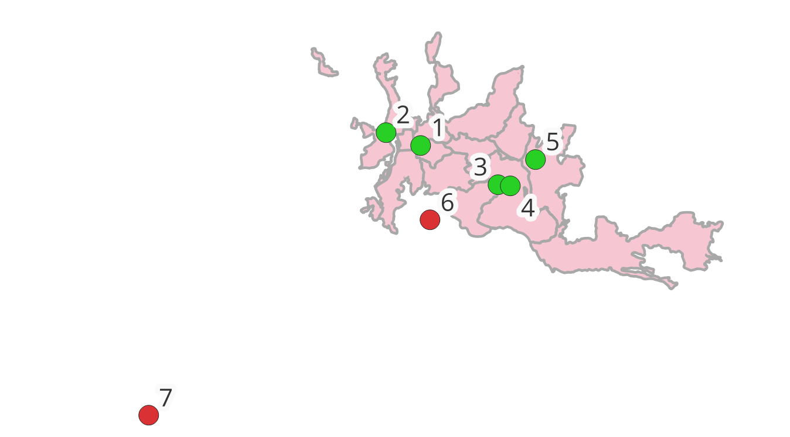
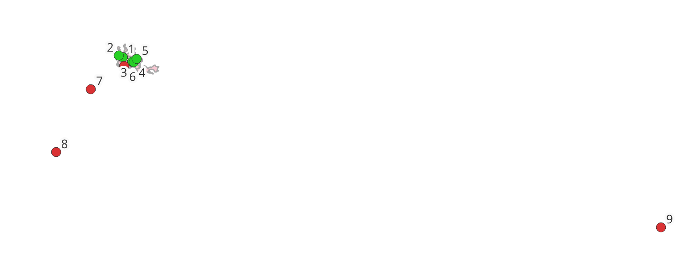

# Proyecto 12 — Hallazgos

## 12.1 — Coordenadas de prueba

Un sistema de geofencing se prueba con puntos que deben quedar **dentro** y puntos que deben quedar **fuera** de la zona. Entre los de afuera conviene incluir casos **de borde** (muy cerca del límite), no solo puntos lejanos: si el sistema solo acierta con Bogotá, no está probado de verdad.

Archivo: [`data/coordenadas_prueba.csv`](../data/coordenadas_prueba.csv)

| id | nombre | lat | lon | esperado | Por qué |
|---|---|---|---|---|---|
| 1–5 | Catedral, Monumento a los Colonizadores, U. de Caldas, Estadio Palogrande, Ecoparque Los Yarumos | — | — | dentro | Los mismos 5 puntos de `puntos_manizales.csv` (Proyecto 2) |
| 6 | Villamaría (parque principal) | 5.0447 | -75.5145 | fuera | **Caso de borde:** municipio vecino, pegado al sur de Manizales |
| 7 | Chinchiná | 4.9826 | -75.6036 | fuera | Municipio cercano |
| 8 | Pereira | 4.8133 | -75.6961 | fuera | Otra ciudad del Eje Cafetero |
| 9 | Bogotá | 4.6097 | -74.0817 | fuera | Caso lejano, obvio |

- La columna `esperado` es el resultado que debe dar el workflow; sirve para verificar el 12.3.
- Las coordenadas están en **WGS 84 (EPSG:4326)**, lo que envía un GPS. Las comunas están en **EPSG:6256**: en el 12.3 hay que transformar el punto antes de usar `ST_Contains`.

### Verificación en QGIS
Las comunas se cargaron desde PostGIS (`monitoreo.comunas`, del 9.5) y el CSV como capa de texto delimitado (X = `lon`, Y = `lat`, CRS EPSG:4326; QGIS reproyecta al vuelo). Simbología categorizada por `esperado`: verde = dentro, rojo = fuera.

- Resultado visual: **5 dentro y 4 fuera**, igual que la columna `esperado`. Villamaría queda fuera, justo al borde sur de las comunas.

### Conceptos clave
- **Cargar desde PostGIS no modifica archivos del repo:** los datos viven en la base de datos (volumen de Docker). La capa de texto delimitado es de solo lectura.
- **Credencial de PostgreSQL en QGIS:** se guardó con el gestor de autenticación (pestaña *Authentication*, configuración `gisdb-local`), cifrada en `qgis-auth.db` y protegida por la contraseña maestra (integrada con el administrador de credenciales de Windows). Guardarla en la pestaña *Basic* la deja en texto plano y la copia dentro de las capas y del proyecto `.qgz`.

### Problema: el CSV se leía como una sola columna
QGIS mostraba `id,nombre,lat,lon,esperado` como un único campo. Causa probable: el archivo se guardó desde Excel, que en español agrega comillas a cada línea o usa `;` como separador. Solución: volver a crear el CSV con un editor de texto plano (Bloc de notas / VS Code) en UTF-8.
