# Proyecto 12 — Hallazgos

## 12.1 — Coordenadas de prueba

Un sistema de geofencing se prueba con puntos que deben quedar **dentro** y puntos que deben quedar **fuera** de la zona. Entre los de afuera conviene incluir casos **de borde** (muy cerca del límite), no solo puntos lejanos: si el sistema solo acierta con Bogotá, no está probado de verdad.

Archivo: [`data/coordenadas_prueba.csv`](../data/coordenadas_prueba.csv)

| id | nombre | lat | lon | esperado | Por qué |
|---|---|---|---|---|---|
| 1–5 | Catedral, Monumento a los Colonizadores, U. de Caldas, Estadio Palogrande, Ecoparque Los Yarumos | — | — | dentro | Los mismos 5 puntos de `puntos_manizales.csv` (Proyecto 2) |
| 6 | Villamaría (parque principal) | 5.0447 | -75.5145 | fuera | **Caso de borde:** municipio vecino, pegado al sur de Manizales |
| 7 | Chinchiná | 4.9826 | -75.6036 | fuera | Municipio cercano |
| 8 | Pereira | 4.8133 | -75.6961 | fuera | Otra ciudad del Eje Cafetero |
| 9 | Bogotá | 4.6097 | -74.0817 | fuera | Caso lejano, obvio |

- La columna `esperado` es el resultado que debe dar el workflow; sirve para verificar el 12.3.
- Las coordenadas están en **WGS 84 (EPSG:4326)**, lo que envía un GPS. Las comunas están en **EPSG:6256**: en el 12.3 hay que transformar el punto antes de usar `ST_Contains`.

### Verificación en QGIS
Las comunas se cargaron desde PostGIS (`monitoreo.comunas`, del 9.5) y el CSV como capa de texto delimitado (X = `lon`, Y = `lat`, CRS EPSG:4326; QGIS reproyecta al vuelo). Simbología categorizada por `esperado`: verde = dentro, rojo = fuera.


- Resultado visual: **5 dentro y 4 fuera**, igual que la columna `esperado`. Villamaría queda fuera, justo al borde sur de las comunas.

### Conceptos clave
- **Cargar desde PostGIS no modifica archivos del repo:** los datos viven en la base de datos (volumen de Docker). La capa de texto delimitado es de solo lectura.
- **Credencial de PostgreSQL en QGIS:** se guardó con el gestor de autenticación (pestaña *Authentication*, configuración `gisdb-local`), cifrada en `qgis-auth.db` y protegida por la contraseña maestra (integrada con el administrador de credenciales de Windows). Guardarla en la pestaña *Basic* la deja en texto plano y la copia dentro de las capas y del proyecto `.qgz`.

### Problema: el CSV se leía como una sola columna
QGIS mostraba `id,nombre,lat,lon,esperado` como un único campo. Causa probable: el archivo se guardó desde Excel, que en español agrega comillas a cada línea o usa `;` como separador. Solución: volver a crear el CSV con un editor de texto plano (Bloc de notas / VS Code) en UTF-8.

## 12.2 — Webhook que recibe la coordenada

Workflow nuevo **Geofencing Manizales**. El webhook recibe la coordenada como la enviaría un GPS: una petición **POST** con un JSON.

| Campo | Valor |
|---|---|
| HTTP Method | `POST` (el dispositivo *envía* datos) |
| Path | `geofence` → Test URL `http://localhost:5678/webhook-test/geofence` |
| Authentication | None |
| Respond | `Using 'Respond to Webhook' Node` (se responde al final, cuando ya se sabe si el punto está dentro o fuera) |

Prueba desde PowerShell, con el punto 1 del CSV:
```powershell
Invoke-RestMethod -Method Post -Uri "http://localhost:5678/webhook-test/geofence" -ContentType "application/json" -Body '{"nombre":"Catedral Basilica","lat":5.0685,"lon":-75.5174}'
```

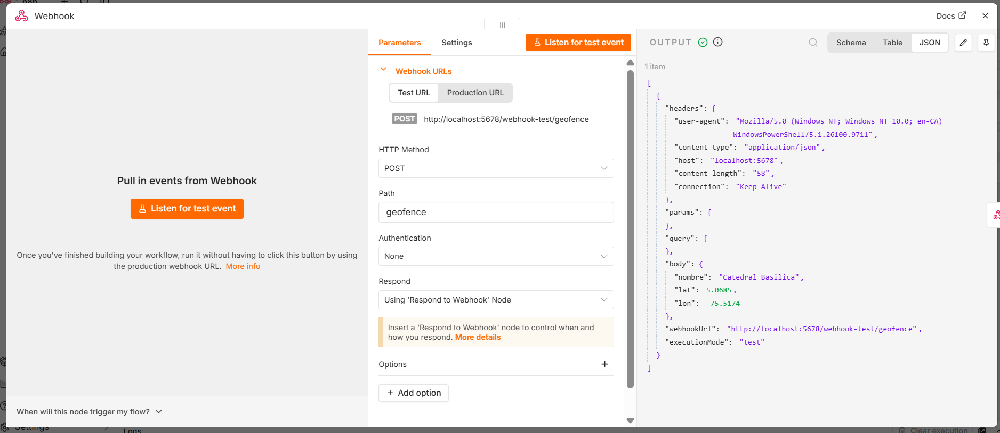

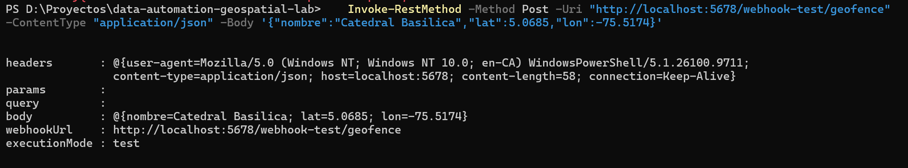

- El item trae `headers`, `params`, `query` y **`body`**: por eso los nodos siguientes usan `$json.body.lat`, no `$json.lat` (igual que en el 10.3).
- `lat` y `lon` llegan como **números** (en verde y sin comillas en n8n) porque en el JSON se enviaron sin comillas.
- En esta etapa el nodo *Respond to Webhook* responde con *First Incoming Item*: devuelve lo que recibe, como un eco.

### Problema: `No Respond to Webhook node found in the workflow`
Con *Respond: Using 'Respond to Webhook' Node*, la primera prueba falló porque ese nodo aún no existía: n8n rechazó la petición y no guardó los datos. Solución: agregar el nodo *Respond to Webhook* antes de probar.

## 12.3 — Validar la coordenada con `ST_Contains`

Script: [`sql/geofencing.sql`](../sql/geofencing.sql). La consulta se probó primero en DBeaver con valores fijos y después se llevó a n8n.

```sql
SELECT
    c.nombre             AS comuna,
    c.nombre IS NOT NULL AS dentro
FROM (
    SELECT ST_Transform(ST_SetSRID(ST_MakePoint($1::float8, $2::float8), 4326), 6256) AS geom
) p
LEFT JOIN monitoreo.comunas c ON ST_Contains(c.geom, p.geom);
```

| Parte | Qué hace |
|---|---|
| `ST_MakePoint(lon, lat)` | Crea el punto. **Primero longitud (x), luego latitud (y)** |
| `ST_SetSRID(..., 4326)` | Indica que las coordenadas son WGS 84 (GPS) |
| `ST_Transform(..., 6256)` | Pasa el punto al CRS de las comunas; sin esto, `ST_Contains` compara geometrías en sistemas distintos |
| `ST_Contains(c.geom, p.geom)` | ¿El polígono de la comuna contiene el punto? El orden importa: (zona, punto) |
| `LEFT JOIN` | Compara el punto contra las 12 comunas y **siempre devuelve una fila**: `comuna = NULL` si ninguna lo contiene. Sin fila, n8n detendría el workflow y no habría alerta |
| `c.nombre IS NOT NULL AS dentro` | Convierte el resultado en un booleano listo para el nodo IF |

### En DBeaver
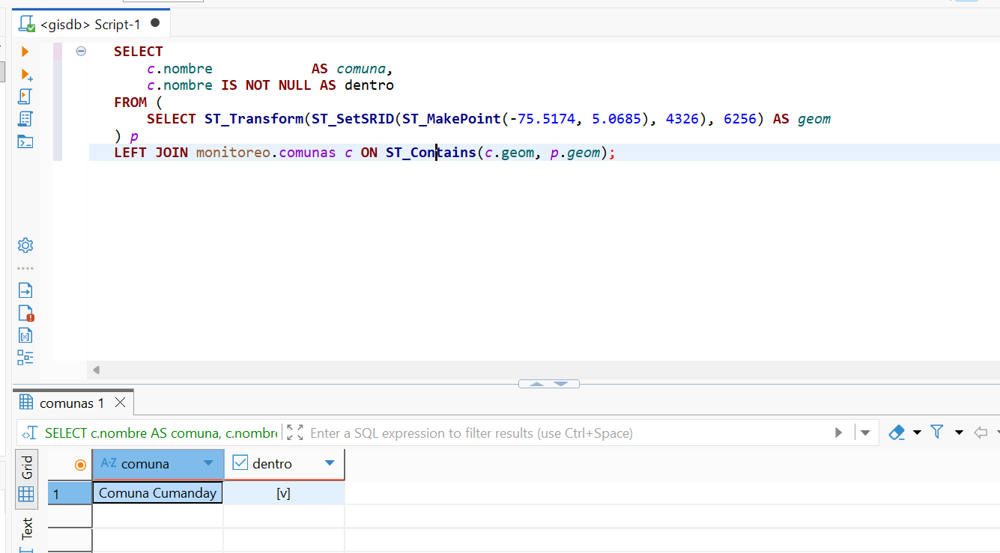

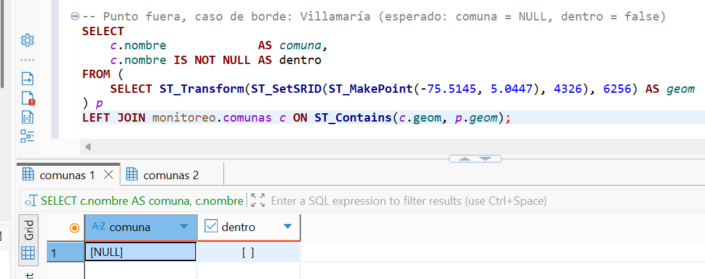

- Catedral → `Comuna Cumanday`, `dentro = true`. Villamaría → `comuna = NULL`, `dentro = false` (una fila, no cero).
- `NULL` en SQL es "sin valor"; se compara con `IS NULL` / `IS NOT NULL`, nunca con `= NULL`.

### Verificación de las 9 coordenadas del 12.1
Con `WITH puntos (...) AS (VALUES ...)` se crea una tabla temporal con los 9 puntos del CSV y se comparan en una sola consulta con la columna `esperado`:

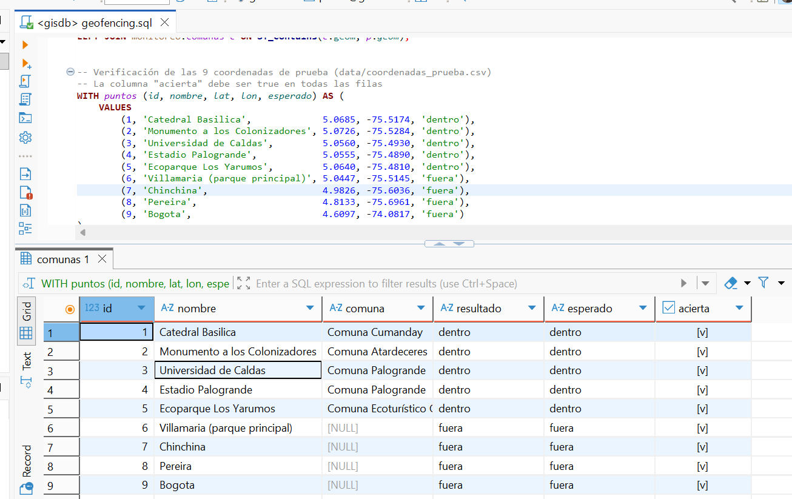

- **Las 9 filas dan `acierta = true`**: la lógica del geofencing quedó probada en SQL antes de llevarla a n8n.

### En n8n: nodo *Validar en PostGIS*
Nodo Postgres → *Execute a SQL query*, credencial `gisdb-local`, con **Query Parameters**: `{{ $json.body.lon }},{{ $json.body.lat }}` (`$1` = lon, `$2` = lat).

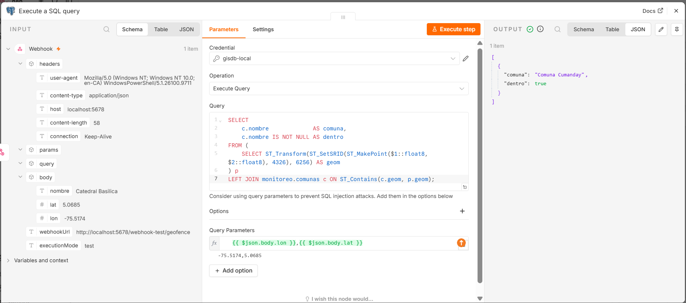

- **Parámetros (`$1`, `$2`) en vez de pegar los valores en el SQL:** la coordenada viene de afuera; si se concatenara en el texto de la consulta, alguien podría enviar código SQL como "latitud" (**inyección SQL**). Con parámetros, PostgreSQL trata los valores siempre como datos.
- `::float8` convierte cada valor a número decimal por si llegara como texto.

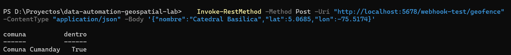

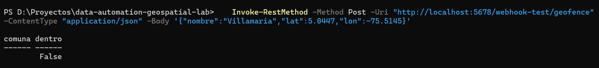

### Problema: la respuesta seguía siendo el eco de la petición
Tras insertar el nodo Postgres, la respuesta a PowerShell siguió trayendo `headers`, `body`, etc. Causa: la prueba se hizo cuando *Respond to Webhook* aún seguía conectado directo al Webhook. Con las flechas en línea (**Webhook → Validar en PostGIS → Respond to Webhook**) y una ejecución nueva, la respuesta pasó a ser `comuna` / `dentro`. Lección: después de cambiar conexiones, volver a ejecutar antes de sacar conclusiones; los datos que se ven pueden ser de una ejecución anterior.

## 12.4 — Alerta con el nodo IF

```
Webhook → Validar en PostGIS → If ─ true (fuera) ─► Registrar alerta ─┐
                                   └ false (dentro) ──────────────────┴─► Respond to Webhook
```

| Nodo | Configuración |
|---|---|
| **If** | `{{ $json.dentro }}` — Boolean — *is equal to* — `false` (punto fuera) |
| **Registrar alerta** | Postgres → *Execute a SQL query*, `INSERT ... RETURNING` (ver abajo) |
| **Respond to Webhook** | *First Incoming Item*, con dos entradas: desde *Registrar alerta* y desde la rama *false* |

- **Las dos ramas llegan al Respond:** si una rama no terminara ahí, quien envía la coordenada se quedaría sin respuesta. Un nodo puede tener varias entradas; en cada ejecución solo llega por una.
- En el lienzo, una flecha **gris** es una rama por la que no pasaron datos en la última ejecución; **verde** con *1 item*, por la que sí.

### Tabla de alertas
```sql
CREATE TABLE IF NOT EXISTS monitoreo.alertas_geofence (
    id         SERIAL PRIMARY KEY,
    nombre     TEXT,
    lat        NUMERIC(9,6) NOT NULL,
    lon        NUMERIC(9,6) NOT NULL,
    geom       geometry(Point, 6256),
    creado_en  TIMESTAMPTZ DEFAULT now()
);
```
- Se guarda la **geometría** para poder ver las alertas como puntos en QGIS (capstone, Proyecto 14). `NUMERIC(9,6)` alcanza para una coordenada GPS con 6 decimales.

### Nodo *Registrar alerta*
```sql
INSERT INTO monitoreo.alertas_geofence (nombre, lat, lon, geom)
VALUES ($1, $2::numeric, $3::numeric,
        ST_Transform(ST_SetSRID(ST_MakePoint($3::float8, $2::float8), 4326), 6256))
RETURNING id AS alerta_id, nombre, lat, lon, NULL AS comuna, false AS dentro, creado_en;
```
- Query Parameters: `{{ $('Webhook').item.json.body.nombre }},{{ $('Webhook').item.json.body.lat }},{{ $('Webhook').item.json.body.lon }}`. Se usa **`$('Webhook')`** porque el nodo anterior (If) solo trae `comuna` y `dentro`; el nombre y la coordenada están en el Webhook.
- Se usa *Execute a SQL query* (no *Insert rows*) porque la geometría se calcula al insertar.
- `RETURNING` devuelve la fila creada, así la respuesta incluye el número de alerta; `comuna` y `dentro` se agregan para que la respuesta tenga los mismos campos en las dos ramas.

### Punto fuera → alerta
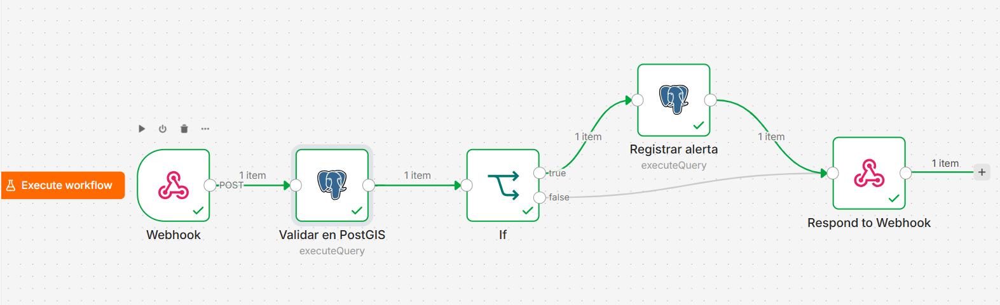

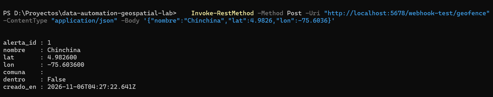

- En la respuesta JSON, `creado_en` sale en **UTC** (`...T04:27:22.641Z`, la `Z` indica UTC); en DBeaver la misma alerta se ve como `23:27 -0500`. Es el mismo instante: `TIMESTAMPTZ` guarda el momento absoluto y cada herramienta lo muestra en su zona (Proyecto 11).

### Punto dentro → sin alerta
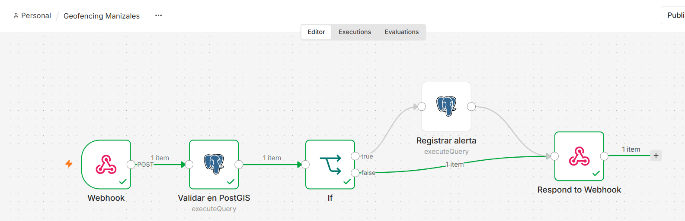

- La rama *false* va directo al Respond y *Registrar alerta* queda en gris: no se ejecutó.

### Verificación en DBeaver
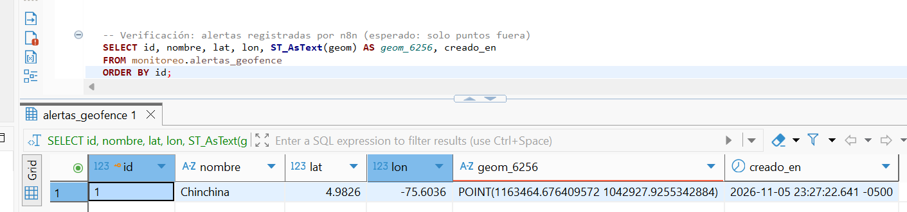

- Solo aparece el punto de afuera (Chinchiná); la Catedral no generó alerta.
- **`ST_AsText(geom)`:** PostGIS guarda la geometría en binario (**EWKB**, *Extended Well-Known Binary*, que incluye el SRID); sin `ST_AsText` la consulta devuelve un texto hexadecimal ilegible (`0101000020701800...`). `ST_AsText` la traduce a **WKT** (*Well-Known Text*), legible: `POINT(1163464.68 1042927.93)`, en metros (EPSG:6256), lo que confirma que el punto se guardó transformado. DBeaver puede mostrar la geometría legible aun sin `ST_AsText` (y dibujarla en su pestaña *Spatial*), pero `ST_AsText` funciona igual en cualquier herramienta.
- **Limpieza de datos de prueba:** `TRUNCATE TABLE monitoreo.alertas_geofence RESTART IDENTITY;` vacía la tabla y reinicia el `SERIAL` (la próxima alerta vuelve a ser `id = 1`); con `DELETE` el contador seguiría avanzando. Se usó antes de grabar el video del 12.5 y quedó comentado en el script.

### Workflow exportado
- [`workflows/geofencing-manizales.json`](../workflows/geofencing-manizales.json) (menú ⋯ → *Download*). Revisado: los dos nodos Postgres solo guardan la referencia a la credencial (`gisdb-local` y su id), sin contraseña.

## 12.5 — Demo del workflow funcionando

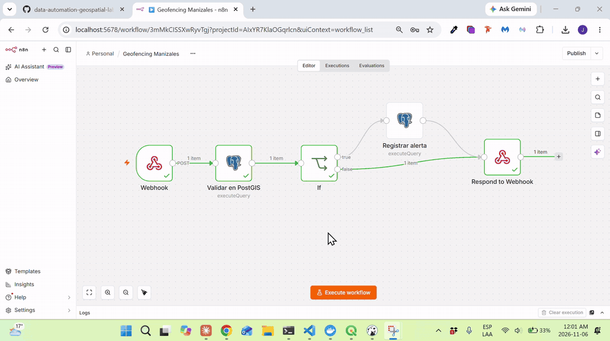

Video completo: [`12.5-demo-geofencing.mp4`](12.5-demo-geofencing.mp4).

Guion: **Execute workflow** → coordenada de la Catedral → rama *false*, respuesta `Comuna Cumanday` / `dentro = True` → **Execute workflow** → coordenada de Pereira → rama *true*, respuesta con `alerta_id` → la alerta aparece en `monitoreo.alertas_geofence` en DBeaver.

- Grabado con la Herramienta Recortes de Windows (**Windows + Shift + R**), sin instalar nada. El MP4 original (≈50 MB) se comprimió a 1280 px sin audio (≈1 MB) y se convirtió a GIF para que se vea animado en GitHub, que no reproduce MP4 dentro del README.

### Problema: se subió una grabación de prueba
El primer video subido no era la toma final: era un intento anterior en el que casi solo se veía PowerShell y la llamada de Pereira fallaba con `404 ... webhook "geofence" is not registered`, porque faltó hacer clic en *Execute workflow* antes de la segunda llamada (la **Test URL acepta una sola llamada por cada clic**). Causa de la confusión: la Herramienta Recortes guarda cada grabación en *Videos → Grabaciones de pantalla*, y al repo se copió la equivocada. Solución: reemplazarla por la toma final y revisar el video (no solo el nombre del archivo) antes de subirlo; `git status` mostrando el `.mp4` como *modified* confirma que el archivo cambió.
