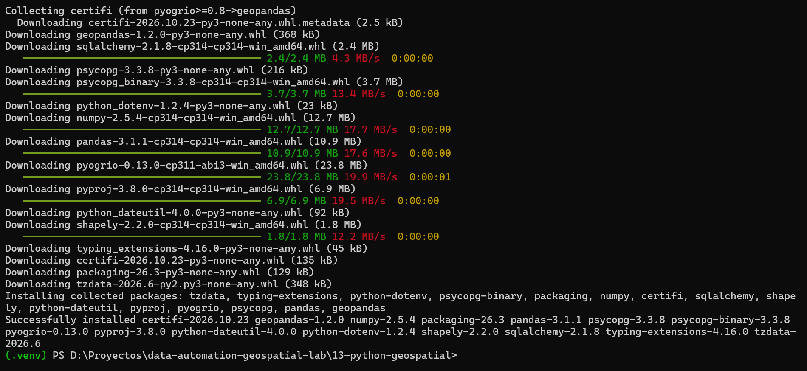
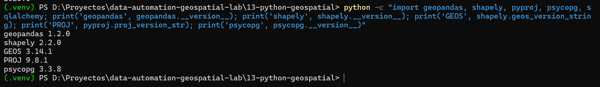
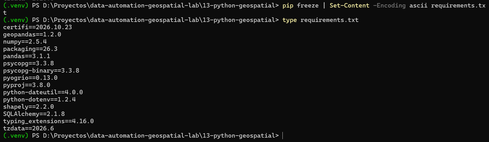

# Proyecto 13 — Hallazgos

## 13.1 — Librerías: geopandas, shapely y psycopg

```
PostGIS (Docker) ──psycopg──► Python ──geopandas──► GeoDataFrame
                  (conexión)            (la tabla)        │
                                                          └─ cada geometría es un objeto de shapely
                                                             (calcula área, centroide, contiene...)
```

| Librería | Qué es | Para qué sirve en este proyecto |
|---|---|---|
| **psycopg** | Driver de PostgreSQL para Python (versión 3) | Abrir la conexión a `gisdb` y ejecutar SQL desde un script |
| **SQLAlchemy** | Capa que estandariza conexiones a bases de datos | GeoPandas la usa para `read_postgis` y `to_postgis`; por dentro usa psycopg |
| **shapely** | Representa y opera geometrías individuales; usa GEOS, el mismo motor de PostGIS y QGIS | Calcular área, centroide y relaciones espaciales de cada comuna |
| **geopandas** | Extiende pandas: un GeoDataFrame es una tabla con columna de geometría y CRS | Leer `monitoreo.comunas`, calcular sobre todas las filas a la vez y escribir el resultado en PostGIS |

```python
# shapely: una sola geometría
from shapely.geometry import Point
p = Point(-75.5174, 5.0685)          # (lon, lat), igual que ST_MakePoint

# geopandas: la tabla completa, leída desde PostGIS
comunas = gpd.read_postgis("SELECT * FROM monitoreo.comunas", conexion, geom_col="geom")
comunas.geometry.iloc[0]             # ← un objeto de shapely (un polígono)
comunas.centroid                     # shapely calcula el centroide de cada fila
```

### Equivalencias
| QGIS / PostGIS | Python |
|---|---|
| Tabla de atributos | GeoDataFrame |
| `ST_Area`, `ST_Centroid` | `.area`, `.centroid` |
| `ST_Transform` | `.to_crs()` |
| `ST_Contains` / unión espacial | `gpd.sjoin(..., predicate="within")` |
| Conexión de DBeaver | `create_engine("postgresql+psycopg://...")` |

### Cuándo QGIS y cuándo Python
- QGIS: ver, explorar, verificar y hacer mapas; tareas de una sola vez.
- Python: procesos repetibles, automatizados o sobre muchos datos, documentados en el repo.

### Centroide
El **centroide** es el centro geométrico de un polígono (su punto de equilibrio). Sirve para representar una zona con un punto (etiquetas, marcadores, distancias entre zonas). En polígonos irregulares (forma de "C" o "L") puede caer **fuera** del polígono; cuando se necesita un punto que siempre quede dentro se usa `representative_point()` (GeoPandas) o `ST_PointOnSurface` (PostGIS).

## 13.2 — Entorno virtual e instalación de librerías

### Python
- Python **3.14.10** (instalador clásico de python.org, *Windows installer 64-bit*, con *Add python.exe to PATH*), instalado en C en la ruta por defecto.
- Se eligió la 3.14 (en *bugfix*, soporte hasta 2030) y no la 3.15 recién publicada: las librerías geoespaciales tardan en publicar versiones compiladas para una versión nueva de Python. Con la 3.14 todas se instalaron como *wheels* `cp314` ya compilados, en segundos.
- python.org ofrece ahora también el **Python install manager**; el instalador clásico dejará de publicarse con Python 3.16.

### Entorno virtual
Un **entorno virtual** (`venv`) es una carpeta con su propio Python y sus propias librerías, aislada del Python del sistema y de otros proyectos: un entorno por proyecto o repo.

```bash
cd D:\Proyectos\data-automation-geospatial-lab\13-python-geospatial
python -m venv .venv
.venv\Scripts\Activate.ps1
```

- `.venv` está en el `.gitignore` del repo (y Python crea además un `.gitignore` propio dentro de la carpeta): **no se sube a GitHub**.
- **Activar** pone `.venv\Scripts` al inicio del **PATH** solo en la ventana actual de PowerShell; por eso se activa en cada ventana nueva. `(.venv)` al inicio de la línea indica que está activo; `deactivate` lo desactiva.

### Lo que crece, en D
| Qué | Dónde |
|---|---|
| Python base | C (por defecto; no crece) |
| Librerías del proyecto | `13-python-geospatial\.venv` (D) |
| Caché de pip | `D:\AppsData\pip-cache`, con `python -m pip config set global.cache-dir "D:\AppsData\pip-cache"` (aplica a todos los proyectos; la configuración queda en `C:\Users\...\AppData\Roaming\pip\pip.ini`) |

### Instalación
```bash
python -m pip install --upgrade pip
pip install geopandas sqlalchemy "psycopg[binary]" python-dotenv
```



| Librería | Para qué |
|---|---|
| `geopandas` | Trae shapely, pyproj, pyogrio y pandas |
| `sqlalchemy` | Conexión que usa GeoPandas para leer y escribir en PostGIS |
| `psycopg[binary]` | Driver de PostgreSQL, versión ya compilada |
| `python-dotenv` | Lee usuario y contraseña desde `.env`, para que no queden en el código ni en GitHub |

### Verificación
```bash
python -c "import geopandas, shapely, pyproj, psycopg, sqlalchemy; print('geopandas', geopandas.__version__); print('shapely', shapely.__version__); print('GEOS', shapely.geos_version_string); print('PROJ', pyproj.proj_version_str); print('psycopg', psycopg.__version__)"
```



- geopandas 1.2.0, shapely 2.2.0, **GEOS 3.14.1**, **PROJ 9.8.1**, psycopg 3.3.8. GEOS y PROJ son los mismos motores que usan PostGIS y QGIS (cada uno con su propia copia).

### requirements.txt
```bash
pip freeze | Set-Content -Encoding ascii requirements.txt
```



- [`requirements.txt`](../requirements.txt) guarda las versiones exactas de las 15 librerías del entorno. El `.venv` no se versiona; la receta sí. Para recrear el entorno: `pip install -r requirements.txt`.
- Se usó `Set-Content -Encoding ascii` porque en Windows PowerShell 5.1 el operador `>` guarda en UTF-16, que GitHub puede mostrar como binario.

### Problema: `Activate.ps1 cannot be loaded because running scripts is disabled on this system`
Windows bloquea por defecto los scripts de PowerShell (*Execution Policy*). Solución, una sola vez y solo para el usuario actual:
```bash
Set-ExecutionPolicy -ExecutionPolicy RemoteSigned -Scope CurrentUser
```
`RemoteSigned` permite los scripts creados en el equipo (como `Activate.ps1`) y exige firma a los descargados de internet.

## 13.3 — Leer las comunas desde PostGIS con Python

### Problema: el script tardaba más de 2 minutos
El script tardaba **133,8 s** en ejecutarse, aunque solo lee 12 comunas. Se midió por partes con `Measure-Command` (PowerShell):

| Medición | Tiempo |
|---|---|
| Solo `import geopandas` | 3,1 s → las librerías no eran el problema |
| Script completo con `host="localhost"` | **133,8 s** |
| Script completo con `host="127.0.0.1"` | **3,8 s** |

```bash
Measure-Command { python -c "import geopandas" } | Select-Object TotalSeconds
Measure-Command { python scripts\comunas_centroides.py } | Select-Object TotalSeconds
```

**Qué pasaba.** `localhost` es un *nombre* que significa "este mismo computador", y en Windows tiene dos direcciones:

| Dirección | Versión | ¿Docker publica PostgreSQL ahí? |
|---|---|---|
| `::1` | IPv6 | **No** |
| `127.0.0.1` | IPv4 | **Sí**: `docker-compose.yml` publica `"127.0.0.1:5432:5432"` |

Es como una casa con dos puertas en la que Docker solo abrió una. Con `localhost`, el programa tocaba primero la puerta IPv6 (`::1`), donde no había nadie, y se quedaba esperando respuesta hasta rendirse; solo entonces probaba la puerta IPv4 (`127.0.0.1`), que respondía de inmediato. Escribiendo `127.0.0.1` va directo a la puerta correcta.

**Solución:** en `URL.create(...)`, `host="127.0.0.1"` en lugar de `host="localhost"`. Bajó de 133,8 s a 3,8 s.

- DBeaver no mostró el problema porque cada programa decide en qué orden prueba las direcciones de `localhost`.
- Lección: cuando un servicio de Docker se publica en `127.0.0.1`, conectarse a `127.0.0.1` y no a `localhost`. Y ante una demora, **medir por partes** antes de suponer la causa (la primera sospecha, el antivirus, resultó falsa).
