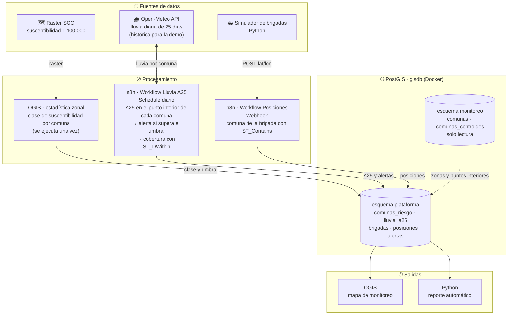

# Arquitectura del sistema

Diagrama del sistema de alerta temprana por deslizamientos (ejercicio 14.2). GitHub dibuja el diagrama a partir del código Mermaid; la imagen también está en [`evidence/14.2-arquitectura.png`](../evidence/14.2-arquitectura.png).

## Componentes

| Capa | Componente | Qué hace | Dónde corre |
|---|---|---|---|
| ① Fuentes | Raster SGC | Clase de susceptibilidad a deslizamientos de cada celda del país | Archivo local (`data/raw/sgc/`, fuera de GitHub) |
| ① Fuentes | Open-Meteo API | Lluvia diaria por coordenada, actual e histórica | Internet |
| ① Fuentes | Simulador de brigadas | Genera recorridos y envía cada posición como lo haría un GPS | Python en la laptop (`.venv`) |
| ② Procesamiento | QGIS · estadística zonal | Resume el raster por comuna (clase predominante) y asigna el umbral A25 | QGIS en la laptop |
| ② Procesamiento | n8n · Workflow Lluvia A25 | Cada día consulta la lluvia de los últimos 25 días en el punto interior de cada comuna, calcula el A25, registra alertas por umbral y evalúa la cobertura de brigadas | n8n en Docker |
| ② Procesamiento | n8n · Workflow Posiciones | Recibe cada posición por webhook, identifica la comuna con `ST_Contains` y la guarda | n8n en Docker |
| ③ Almacenamiento | Esquema `monitoreo` | Comunas y puntos interiores de proyectos anteriores; **solo lectura** | PostGIS en Docker |
| ③ Almacenamiento | Esquema `plataforma` | Datos propios del sistema: riesgo por comuna, lluvia, brigadas, posiciones y alertas | PostGIS en Docker |
| ④ Salidas | QGIS | Mapa de monitoreo: susceptibilidad, alertas, brigadas y cobertura | QGIS en la laptop |
| ④ Salidas | Python | Reporte automático con el resumen por comuna | Python en la laptop |

## Flujos de datos

| Flujo | Frecuencia | Recorrido |
|---|---|---|
| **A. Preparación del territorio** | Una vez | Raster SGC → QGIS (estadística zonal) → `plataforma` (clase y umbral por comuna) |
| **B. Lluvia y alertas** | Diario (schedule) | Puntos interiores (`monitoreo`) → n8n → Open-Meteo → A25 → `plataforma` (lluvia y alertas por umbral; cobertura con `ST_DWithin`) |
| **C. Posiciones de brigadas** | Tiempo real (webhook) | Simulador → n8n → `ST_Contains` contra las comunas → `plataforma` (posiciones) |
| **D. Consulta** | Bajo demanda | `plataforma` → QGIS (mapa) y Python (reporte) |

## Conexiones
- **n8n → PostGIS:** dentro de la red de Docker, host `postgis`, puerto `5432` (Proyecto 11).
- **QGIS, Python y DBeaver → PostGIS:** desde la laptop, host `127.0.0.1`, puerto `5432` (puerto publicado; Proyecto 13).
- **Simulador → n8n:** `http://localhost:5678/webhook/...` (Proyecto 12).
- **Credenciales:** `.env` (Python), credencial `gisdb-local` (n8n) y configuración de autenticación `gisdb-local` (QGIS); ninguna contraseña en el repo.

## Decisiones de diseño
- **Esquema propio `plataforma`:** los datos de proyectos anteriores no se modifican y el sistema se puede recrear o borrar de una vez.
- **Estadística zonal una sola vez:** la susceptibilidad del terreno no cambia día a día; se calcula al inicio y se guarda como atributo de cada comuna.
- **Dos workflows separados:** la lluvia se revisa con un horario (schedule) y las posiciones llegan cuando ocurren (webhook); son ritmos distintos.
- **Simulador en lugar de GPS reales:** permite probar el pipeline completo con datos controlados; una fuente real solo tendría que enviar el mismo JSON al mismo webhook.
