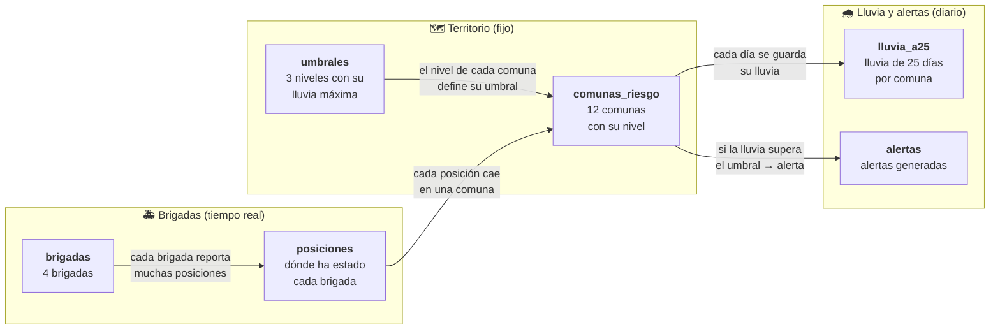

# Tablas del esquema `plataforma`

Descripción simple de cada tabla del sistema. Script de creación: [`sql/plataforma.sql`](../sql/plataforma.sql).

Las 6 tablas se agrupan en tres bloques según **cada cuánto cambian**. Cada flecha se lee como una frase:

La tabla central es **`comunas_riesgo`**: la lluvia, las alertas y las posiciones se refieren siempre a una comuna.

## `umbrales`
**Cuánta lluvia aguanta cada nivel de riesgo.** 3 filas. La llena el script.

| Columna | Qué es |
|---|---|
| `nivel` | `alta`, `media` o `baja` (llave primaria) |
| `umbral_mm` | Lluvia de 25 días (A25) a partir de la cual hay alerta: 150, 200 o 250 mm |
| `fuente` | De dónde sale el valor (oficial OMPAD o supuesto del proyecto) |

## `comunas_riesgo`
**El nivel de riesgo de cada comuna** (resultado del 14.3). 12 filas. La llena el script.

| Columna | Qué es |
|---|---|
| `id_comuna` | Número de la comuna, 1 a 12 (llave primaria) |
| `nombre` | Nombre de la comuna |
| `pct_alta` | % del área en susceptibilidad alta o muy alta, según el SGC |
| `nivel_sgc` | Nivel según el dato oficial |
| `nivel` | Nivel final, con el ajuste por evidencia histórica (apunta a `umbrales`) |
| `ajuste` | Motivo del ajuste; vacío si no hubo |
| `geom` | Polígono de la comuna |

## `brigadas`
**Las brigadas de emergencia.** 4 filas. La llena el script.

| Columna | Qué es |
|---|---|
| `id_brigada` | Número de la brigada (llave primaria) |
| `nombre` | Brigada Norte, Centro, Occidente u Oriente |
| `activa` | Si está en servicio |

## `posiciones`
**Dónde ha estado cada brigada.** Una fila por cada reporte; crece todo el tiempo. La llena n8n (14.7).

| Columna | Qué es |
|---|---|
| `id` | Número del reporte (llave primaria) |
| `id_brigada` | Qué brigada reportó (apunta a `brigadas`) |
| `id_comuna` | En qué comuna estaba; vacío si estaba fuera (apunta a `comunas_riesgo`) |
| `geom` | El punto reportado |
| `registrado_en` | Fecha y hora del reporte |

## `lluvia_a25`
**La lluvia de los últimos 25 días en cada comuna, día por día.** Una fila por comuna y día. La llena n8n (14.5).

| Columna | Qué es |
|---|---|
| `id` | Número del registro (llave primaria) |
| `id_comuna` | La comuna (apunta a `comunas_riesgo`) |
| `fecha` | El día del cálculo |
| `a25_mm` | Lluvia acumulada de los 25 días anteriores, en mm |
| `consultado_en` | Cuándo se consultó Open-Meteo |

## `alertas`
**Las alertas que genera el sistema.** Una por tipo, comuna y día. La llena n8n (14.5 y 14.8).

| Columna | Qué es |
|---|---|
| `id` | Número de la alerta (llave primaria) |
| `tipo` | `riesgo_lluvia` (la lluvia superó el umbral) o `sin_cobertura` (comuna en alerta sin brigada cerca) |
| `id_comuna` | La comuna (apunta a `comunas_riesgo`) |
| `fecha` | El día de la alerta |
| `a25_mm` | La lluvia que disparó la alerta |
| `umbral_mm` | El umbral que tenía la comuna ese día |
| `detalle` | Información adicional (por ejemplo, la brigada más cercana) |
| `creado_en` | Fecha y hora en que se registró |
