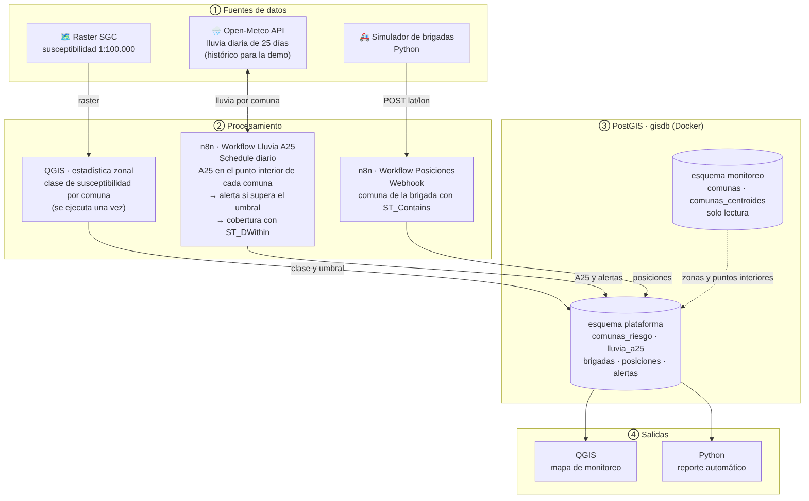
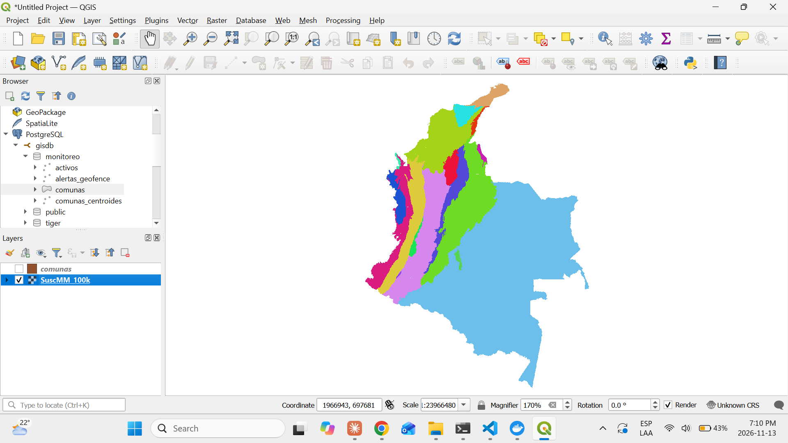
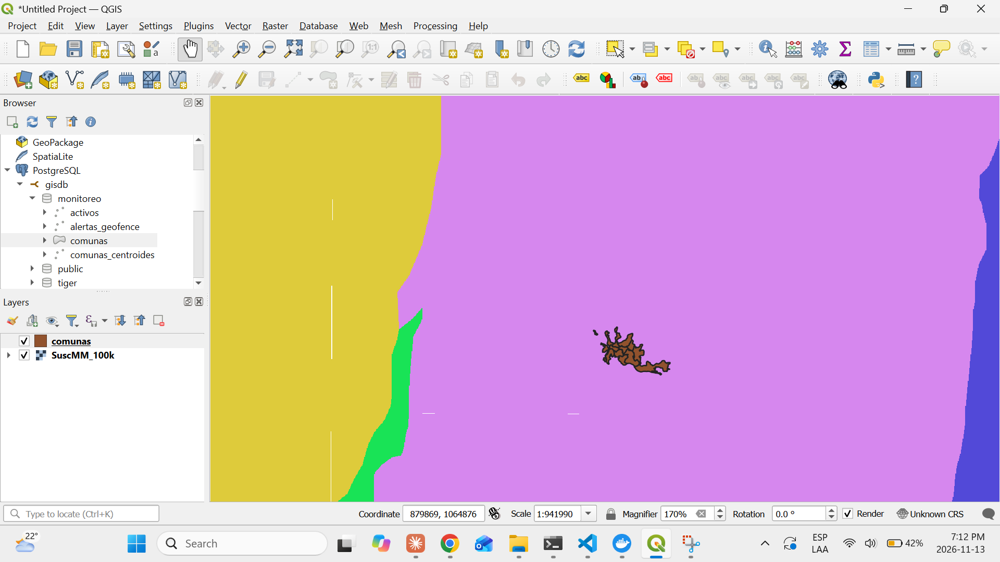
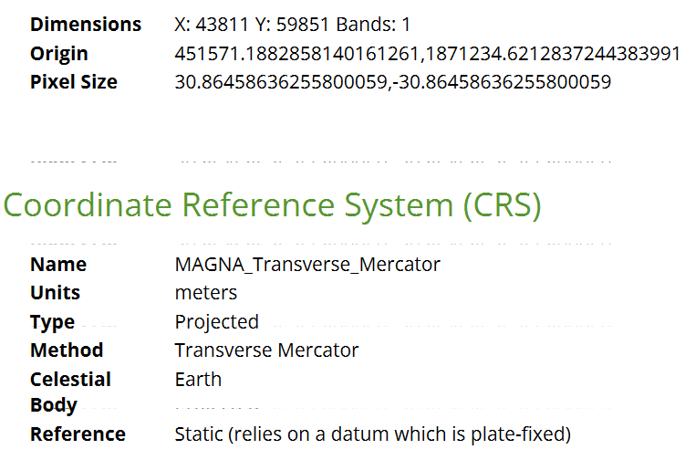
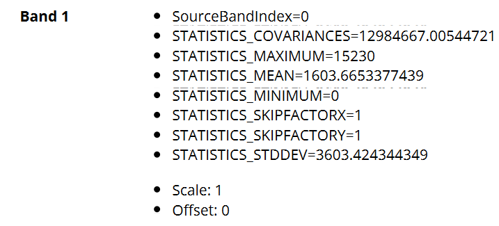
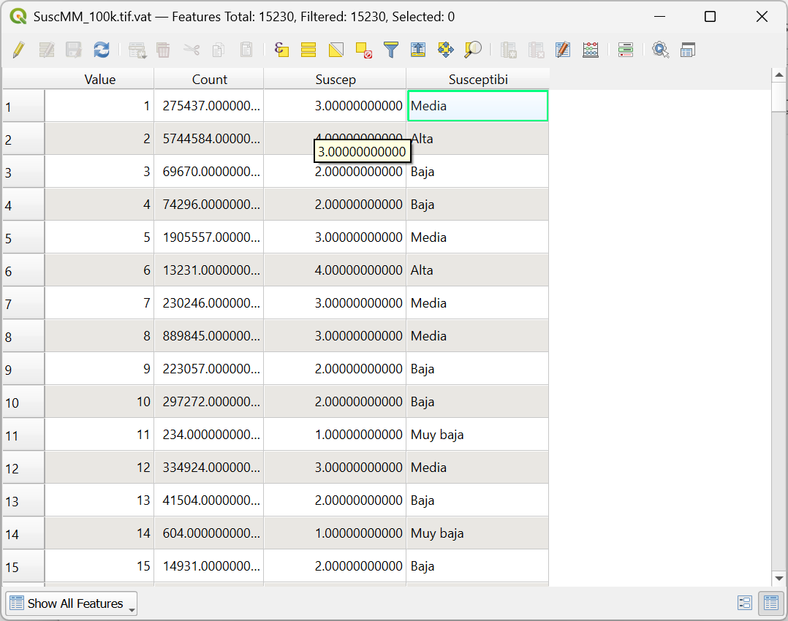

# Proyecto 14 — Hallazgos

## 14.1 — Escenario, datos y fuentes

Documento completo: [`docs/escenario-y-fuentes.md`](../docs/escenario-y-fuentes.md).

- **Escenario elegido:** sistema de alerta temprana por deslizamientos en Manizales. Se compararon tres escenarios (cuadrillas de mantenimiento, flota de domicilios y brigadas de gestión del riesgo); se eligió el tercero por ser el más rico en análisis espacial y el más ligado a un problema real de la ciudad.
- **Regla central:** riesgo = detonante (lluvia) × condición del terreno (susceptibilidad). La lluvia es casi igual en toda la ciudad (Open-Meteo usa una cuadrícula de varios km); lo que diferencia a las comunas es su terreno. Por eso el umbral de lluvia es **inverso** a la susceptibilidad: un terreno más frágil se desliza con menos lluvia.
- **Indicador oficial:** la ciudad (OMPAD) usa el **A25**, la lluvia acumulada de los últimos 25 días, con un umbral de **200 mm** (IDEA – UNAL). Los umbrales de 150 mm (susceptibilidad alta) y 250 mm (baja) son supuestos del proyecto.
- **Comunas con evidencia publicada de alta susceptibilidad:** 1 Atardeceres y 11 La Macarena (sector occidental, el más lluvioso) y 2 San José (ladera de Olivares). Se usarán para validar el resultado del 14.3.

### Búsqueda de la capa de susceptibilidad
- El directorio de servicios ArcGIS REST de la Alcaldía (`sig.manizales.gov.co/wadmzl/rest/services`, de donde salieron las comunas en el Proyecto 2) responde **`Error 403: The administrator has disabled the Services Directory`**: los servicios siguen publicados, pero no se puede listar cuáles existen, así que no se pudo buscar ahí una capa de amenaza.
- Fuente alternativa, oficial y nacional: **Mapa Nacional de Susceptibilidad por Movimientos en Masa del SGC** (v2, 2019, 1:100.000). Se eligió **susceptibilidad** y no **amenaza**: la amenaza ya incluye detonantes como la lluvia, que en este sistema aporta Open-Meteo; usarla contaría la lluvia dos veces.

## 14.2 — Arquitectura

Documento y diagrama: [`docs/arquitectura.md`](../docs/arquitectura.md).

- Cuatro capas: fuentes (raster SGC, Open-Meteo, simulador), procesamiento (QGIS, dos workflows de n8n), almacenamiento (PostGIS: `monitoreo` solo lectura y `plataforma`) y salidas (mapa en QGIS y reporte en Python).
- Diagrama en **Mermaid** dentro del Markdown: GitHub lo dibuja y se versiona como texto.
- **Puerto publicado y seguridad:** PostgreSQL y n8n se publican en `127.0.0.1` (por ejemplo `"127.0.0.1:5432:5432"`), así que solo los programas de la propia laptop pueden conectarse; con `"5432:5432"` quedarían accesibles desde la red local. Escribir en la documentación `127.0.0.1` y el puerto estándar `5432` no expone nada: no son secretos y las credenciales siguen en `.env`.

## 14.3 — Susceptibilidad por comuna (en progreso)

### Organización de datos pesados
- El raster del SGC (`SuscMM_100k.tif`, **180 MB**) supera el límite de **100 MB por archivo** de GitHub. Convención adoptada: los datos crudos van en `data/raw/` dentro de cada proyecto y Git los ignora con la regla `**/data/raw/` en el `.gitignore` de la raíz; al repo solo suben los datos procesados y livianos. La fuente de descarga queda documentada en `docs/escenario-y-fuentes.md`.
- Ubicación local: `14-capstone-geospatial-monitoring/data/raw/sgc/`. `git status` confirma que Git no la ve (*nothing to commit, working tree clean*).

| Archivo del SGC | Qué es |
|---|---|
| `SuscMM_100k.tif` | El raster: una cuadrícula con un código por celda |
| `.tfw` | Georreferencia: dónde va ubicada la imagen |
| `.tif.ovr` | Pirámides: versiones reducidas para dibujar rápido al alejar el zoom |
| `.tif.vat.dbf` | Tabla de valores (*Value Attribute Table*): qué significa cada código |
| `.aux.xml`, `.tif.xml` | Metadatos: estadísticas, CRS, descripción |
| `Susceptibilidad.lyr` | Simbología en formato de ArcGIS (QGIS no la usa) |

### El raster en QGIS
QGIS lo dibuja en colores porque lee la paleta guardada en los archivos acompañantes.

### Ficha técnica (Properties → Information)

| Dato | Valor | Qué significa |
|---|---|---|
| Dimensiones | 43.811 × 59.851 celdas, 1 banda | ~2.600 millones de celdas: todo el país |
| Tamaño de celda | **30,86 m** | Cada celda cubre ~31 × 31 m: una comuna de 1 km² tiene ~1.000 celdas |
| CRS | `MAGNA_Transverse_Mercator`, metros, **sin código EPSG** | Personalizado. Por su origen (451.571 / 1.871.234) parece MAGNA-SIRGAS Colombia Bogotá (EPSG:3116), pero es una deducción, no está declarado. Las comunas están en **EPSG:6256**: hay que unificar el CRS antes de calcular |
| Valores de la banda | mínimo 0, máximo **15.230**, media 1.603 | No pueden ser clases de susceptibilidad: son **códigos** |

### La tabla de valores (`SuscMM_100k.tif.vat.dbf`)
Se abrió como capa vectorial sin geometría (Añadir capa vectorial → *All files*) y se revisó su tabla de atributos.

| Columna | Qué es | Ejemplo |
|---|---|---|
| `Value` | Código que guarda cada celda (15.230 códigos) | `2` |
| `Count` | Cuántas celdas del país tienen ese código | 5.744.584 |
| `Suscep` | Clase en número: 1 muy baja · 2 baja · 3 media · 4 alta · 5 muy alta | `4` |
| `Susceptibi` | La misma clase en texto (el formato `.dbf` corta los nombres de columna a 10 caracteres) | `Alta` |

- Cada código tiene una sola clase y varios códigos comparten clase (por ejemplo 1, 5, 7, 8 y 12 son *Media*). Como un código de barras y su categoría: miles de códigos, 5 categorías.
- **Qué son los 15.230 códigos (hipótesis, no confirmada por el archivo):** probablemente cada código es un **polígono** del mapa original del SGC, una zona homogénea del terreno resultante de cruzar factores como geología, geomorfología, pendiente y cobertura, que luego se convirtió a raster. Pistas: los códigos son consecutivos (1 … 15.230), como identificadores, y `Count` varía enormemente (de 234 a 5,7 millones de celdas), como polígonos de tamaños muy distintos. No son 15.230 tipos de suelo: un tipo de suelo es un solo factor; una unidad combina varios.
- **Consecuencia:** promediar los códigos no tiene sentido (el código 9.000 no es "más susceptible" que el 2). Antes de la estadística zonal hay que **reclasificar** cada código a su clase.

### Plan del cálculo
1. **Recortar** el raster a las comunas y **reproyectarlo** a EPSG:6256 con remuestreo por **vecino más cercano**: los valores son categóricos y otros métodos promediarían códigos vecinos, inventando valores.
2. **Reclasificar** código → clase (1–5) con la tabla de valores.
3. **Estadística zonal:** clase predominante de cada comuna, y comparación con las comunas que señala la literatura.
