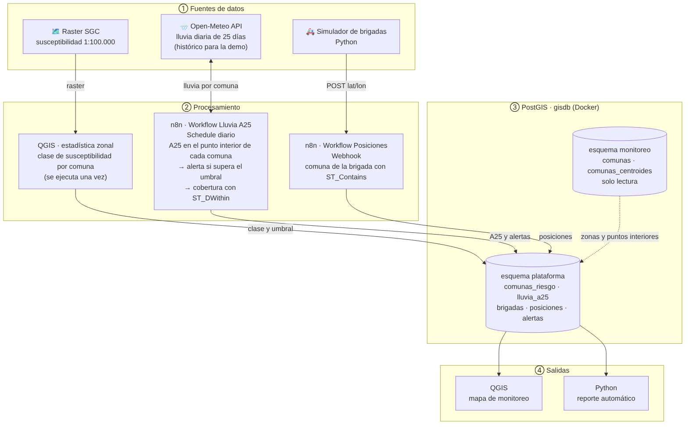
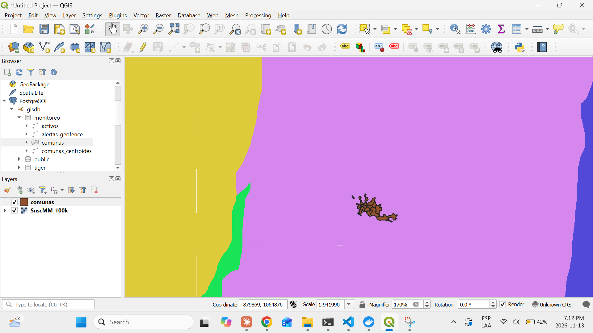
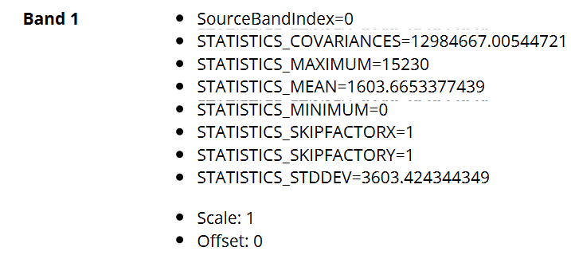
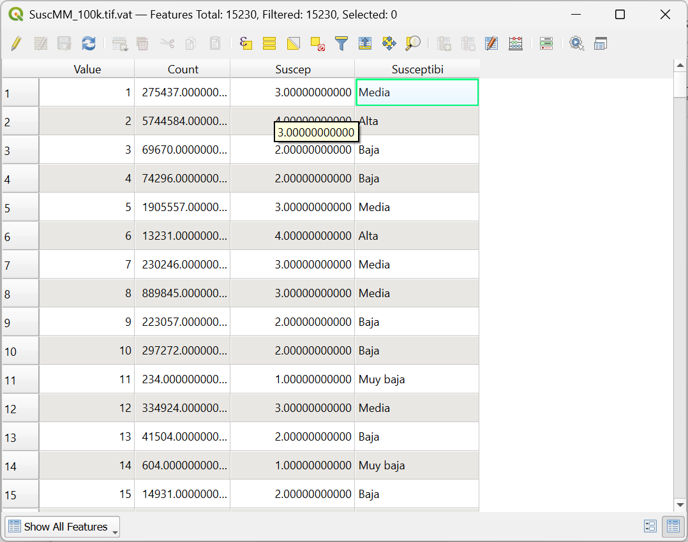
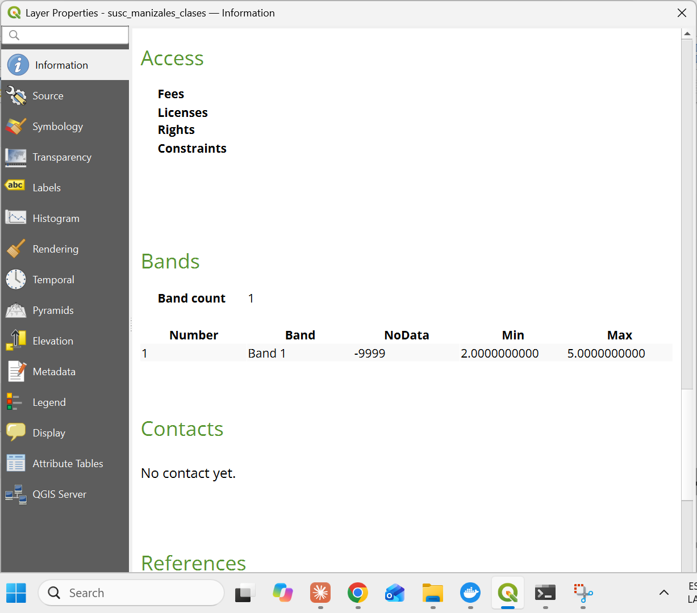

# Proyecto 14 — Hallazgos

## 14.1 — Escenario, datos y fuentes

Documento completo: [`docs/escenario-y-fuentes.md`](../docs/escenario-y-fuentes.md).

- **Escenario elegido:** sistema de alerta temprana por deslizamientos en Manizales. Se compararon tres escenarios (cuadrillas de mantenimiento, flota de domicilios y brigadas de gestión del riesgo); se eligió el tercero por ser el más rico en análisis espacial y el más ligado a un problema real de la ciudad.
- **Regla central:** riesgo = detonante (lluvia) × condición del terreno (susceptibilidad). La lluvia es casi igual en toda la ciudad (Open-Meteo usa una cuadrícula de varios km); lo que diferencia a las comunas es su terreno. Por eso el umbral de lluvia es **inverso** a la susceptibilidad: un terreno más frágil se desliza con menos lluvia.
- **Indicador oficial:** la ciudad (OMPAD) usa el **A25**, la lluvia acumulada de los últimos 25 días, con un umbral de **200 mm** (IDEA – UNAL). Los umbrales de 150 mm (susceptibilidad alta) y 250 mm (baja) son supuestos del proyecto.
- **Comunas con evidencia publicada de alta susceptibilidad:** 1 Atardeceres y 11 La Macarena (sector occidental, el más lluvioso) y 2 San José (ladera de Olivares). Se usarán para validar el resultado del 14.3.

### Búsqueda de la capa de susceptibilidad
- El directorio de servicios ArcGIS REST de la Alcaldía (`sig.manizales.gov.co/wadmzl/rest/services`, de donde salieron las comunas en el Proyecto 2) responde **`Error 403: The administrator has disabled the Services Directory`**: los servicios siguen publicados, pero no se puede listar cuáles existen, así que no se pudo buscar ahí una capa de amenaza.
- Fuente alternativa, oficial y nacional: **Mapa Nacional de Susceptibilidad por Movimientos en Masa del SGC** (v2, 2019, 1:100.000). Se eligió **susceptibilidad** y no **amenaza**: la amenaza ya incluye detonantes como la lluvia, que en este sistema aporta Open-Meteo; usarla contaría la lluvia dos veces.

## 14.2 — Arquitectura

Documento y diagrama: [`docs/arquitectura.md`](../docs/arquitectura.md).



- Cuatro capas: fuentes (raster SGC, Open-Meteo, simulador), procesamiento (QGIS, dos workflows de n8n), almacenamiento (PostGIS: `monitoreo` solo lectura y `plataforma`) y salidas (mapa en QGIS y reporte en Python).
- Diagrama en **Mermaid** dentro del Markdown: GitHub lo dibuja y se versiona como texto.
- **Puerto publicado y seguridad:** PostgreSQL y n8n se publican en `127.0.0.1` (por ejemplo `"127.0.0.1:5432:5432"`), así que solo los programas de la propia laptop pueden conectarse; con `"5432:5432"` quedarían accesibles desde la red local. Escribir en la documentación `127.0.0.1` y el puerto estándar `5432` no expone nada: no son secretos y las credenciales siguen en `.env`.

## 14.3 — Susceptibilidad por comuna (en progreso)

### Organización de datos pesados
- El raster del SGC (`SuscMM_100k.tif`, **180 MB**) supera el límite de **100 MB por archivo** de GitHub. Convención adoptada: los datos crudos van en `data/raw/` dentro de cada proyecto y Git los ignora con la regla `**/data/raw/` en el `.gitignore` de la raíz; al repo solo suben los datos procesados y livianos. La fuente de descarga queda documentada en `docs/escenario-y-fuentes.md`.
- Ubicación local: `14-capstone-geospatial-monitoring/data/raw/sgc/`. `git status` confirma que Git no la ve (*nothing to commit, working tree clean*).

| Archivo del SGC | Qué es |
|---|---|
| `SuscMM_100k.tif` | El raster: una cuadrícula con un código por celda |
| `.tfw` | Georreferencia: dónde va ubicada la imagen |
| `.tif.ovr` | Pirámides: versiones reducidas para dibujar rápido al alejar el zoom |
| `.tif.vat.dbf` | Tabla de valores (*Value Attribute Table*): qué significa cada código |
| `.aux.xml`, `.tif.xml` | Metadatos: estadísticas, CRS, descripción |
| `Susceptibilidad.lyr` | Simbología en formato de ArcGIS (QGIS no la usa) |

### El raster en QGIS
QGIS lo dibuja en colores porque lee la paleta guardada en los archivos acompañantes.




### Ficha técnica (Properties → Information)




| Dato | Valor | Qué significa |
|---|---|---|
| Dimensiones | 43.811 × 59.851 celdas, 1 banda | ~2.600 millones de celdas: todo el país |
| Tamaño de celda | **30,86 m** | Cada celda cubre ~31 × 31 m: una comuna de 1 km² tiene ~1.000 celdas |
| CRS | `MAGNA_Transverse_Mercator`, metros, **sin código EPSG** | Personalizado. Por su origen (451.571 / 1.871.234) parece MAGNA-SIRGAS Colombia Bogotá (EPSG:3116), pero es una deducción, no está declarado. Las comunas están en **EPSG:6256**: hay que unificar el CRS antes de calcular |
| Valores de la banda | mínimo 0, máximo **15.230**, media 1.603 | No pueden ser clases de susceptibilidad: son **códigos** |

### La tabla de valores (`SuscMM_100k.tif.vat.dbf`)
Se abrió como capa vectorial sin geometría (Añadir capa vectorial → *All files*) y se revisó su tabla de atributos.



| Columna | Qué es | Ejemplo |
|---|---|---|
| `Value` | Código que guarda cada celda (15.230 códigos) | `2` |
| `Count` | Cuántas celdas del país tienen ese código | 5.744.584 |
| `Suscep` | Clase en número: 1 muy baja · 2 baja · 3 media · 4 alta · 5 muy alta | `4` |
| `Susceptibi` | La misma clase en texto (el formato `.dbf` corta los nombres de columna a 10 caracteres) | `Alta` |

- Cada código tiene una sola clase y varios códigos comparten clase (por ejemplo 1, 5, 7, 8 y 12 son *Media*). Como un código de barras y su categoría: miles de códigos, 5 categorías.
- **Qué son los 15.230 códigos (hipótesis, no confirmada por el archivo):** probablemente cada código es un **polígono** del mapa original del SGC, una zona homogénea del terreno resultante de cruzar factores como geología, geomorfología, pendiente y cobertura, que luego se convirtió a raster. Pistas: los códigos son consecutivos (1 … 15.230), como identificadores, y `Count` varía enormemente (de 234 a 5,7 millones de celdas), como polígonos de tamaños muy distintos. No son 15.230 tipos de suelo: un tipo de suelo es un solo factor; una unidad combina varios.
- **Consecuencia:** promediar los códigos no tiene sentido (el código 9.000 no es "más susceptible" que el 2). Antes de la estadística zonal hay que **reclasificar** cada código a su clase.

### Procedimiento
```
raster SGC (códigos, todo el país) → recortar y reproyectar → reclasificar código → clase
→ estadística zonal (clase predominante) → histograma zonal (% por clase) → nivel por comuna
```

### Paso 4 — Recortar y reproyectar
**Raster → Extraction → Clip Raster by Mask Layer**: entrada `SuscMM_100k`, máscara `comunas`, **CRS de destino EPSG:6256**, *Match the extent…* y *Keep resolution…* activados. Salida: [`data/susc_manizales_codigos.tif`](../data/susc_manizales_codigos.tif) (dato procesado y liviano, sí se versiona).

- **Recortar:** de ~2.600 millones de celdas a ~138.000; los cálculos siguientes son instantáneos.
- **Reproyectar en el mismo paso:** raster y comunas quedan en el mismo CRS.
- **Remuestreo por vecino más cercano** (el predeterminado de la herramienta; la opción no aparece en *Advanced Parameters*): al reproyectar se recalcula la cuadrícula, y como los valores son **códigos categóricos** cada celda nueva debe copiar el código más cercano. Un método que promedie (bilineal, cúbico) inventaría códigos: el promedio de 2 y 8 es 5, que no corresponde a esa zona.


**Verificación (Properties → Information):**


| Verificación | Resultado |
|---|---|
| CRS | **EPSG:6256 – MAGNA-SIRGAS / Manizales urban grid**, el de las comunas |
| Tamaño de celda | 30,86 m, igual al original |
| Valores | 8.814 a 9.228, tipo `UInt32`, *DataType = Thematic*: siguen siendo códigos enteros (no hubo promedios). De los 15.230 códigos del país, Manizales usa un rango pequeño |
| Área con datos | 469 × 294 = 137.886 celdas, **27,26 %** válidas ≈ 37.600 celdas × 952 m² ≈ **35,8 km²**; la suma de `area_km2` de las 12 comunas es **35,77 km²** → el recorte cubre exactamente las comunas |
| NoData | `2,14748e+09`: valor especial (gigante a propósito) para las celdas fuera de las comunas |

### Paso 6 — Reclasificar código → clase
**Processing Toolbox → Reclassify by layer** (la Caja de herramientas se abre en *Processing → Toolbox*).

| Parámetro | Valor | Por qué |
|---|---|---|
| Raster layer | `susc_manizales_codigos` | El recorte |
| Layer containing class breaks | `SuscMM_100k.tif.vat` | La tabla de valores es la regla |
| Minimum / Maximum class value field | `Value` / `Value` | La herramienta trabaja con rangos; un código exacto es un rango que empieza y termina en el mismo número |
| Output value field | `Suscep` | La clase 1–5 |
| Range boundaries | **`min <= value <= max`** | Con mínimo = máximo, ambos extremos deben incluirse; con `<` ningún código cumpliría y el resultado saldría vacío |
| Use NoData when no range matches | ✅ | Un código ausente de la tabla queda sin dato, no conserva el código |
| Output data type | `Int16` | Clases enteras pequeñas |

Salida: [`data/susc_manizales_clases.tif`](../data/susc_manizales_clases.tif).


- El Log lista una regla por código (`9977 ≤ x ≤ 9977 → 5`).
- **Error evitado:** en la primera configuración *Maximum class value field* quedó en `Suscep`; la regla habría sido "de 8.814 a 4" y ningún código habría coincidido. Se corrigió a `Value` antes de ejecutar.



- Valores de **2 a 5**, NoData `-9999`: los códigos se convirtieron en clases. **No hay clase 1 (muy baja)** en las comunas: coherente con una ciudad sobre un filo de montaña.
- Un raster nuevo no trae paleta: QGIS lo dibuja en grises (negro = valor bajo, blanco = alto). Se simbolizó con **Paletted/Unique values** (equivalente raster de la simbología categorizada) con la paleta RdYlGn: `#1A9641` baja, `#FFFFBF` media, `#FDAE61` alta, `#D7191C` muy alta. Las comunas se dibujan encima con *Fill style = No Brush* (solo borde); bajar la opacidad de la capa haría transparente también el borde.


### Paso 8a — Estadística zonal (clase predominante)
**Processing Toolbox → Zonal statistics** (zonas = polígonos; no *Raster layer zonal statistics*, que usa otro raster como zonas, ni *(in place)*, que modifica la capa de entrada). Entrada `comunas`, raster `susc_manizales_clases`, prefijo `susc_`, estadísticas **Count, Majority, Variety**. Salida: [`data/comunas_susceptibilidad.gpkg`](../data/comunas_susceptibilidad.gpkg).

- Sobre clases categóricas se usa la **mayoría** (la clase que más se repite), no el promedio: el promedio de "media" y "muy alta" no es "alta". Por eso se desmarcaron *Mean* y *Sum*.


- `susc_majority`: **media (3) en 10 comunas** y **alta (4) en 7 Tesorito y 9 Universitaria**. `susc_count` coincide con el área (comuna 7: 7,89 km² ≈ 8.285 celdas esperadas, 8.129 contadas, 98 %; las celdas de borde solo cuentan si su centro cae dentro).
- **No coincide con la literatura:** las comunas 1, 2 y 11 quedan en "media". La mayoría esconde la variación interna de cada comuna; hace falta el porcentaje por clase.

### Paso 8b — Histograma zonal (% por clase)
**Processing Toolbox → Zonal histogram** sobre `comunas_susceptibilidad` (así se conservan las columnas del 8a), prefijo `clase_`. Salida: [`data/comunas_susceptibilidad_hist.gpkg`](../data/comunas_susceptibilidad_hist.gpkg), que es la **capa final** del ejercicio.


| Columna | Origen | Significado |
|---|---|---|
| `fid` | GeoPackage | Identificador interno de fila |
| `id_comuna`, `nombre`, `area_km2` | `monitoreo.comunas` | Datos de la comuna |
| `susc_count` | 8a | Celdas **con dato** dentro de la comuna (~952 m² cada una) |
| `susc_majority` | 8a | Clase que más se repite |
| `susc_variety` | 8a | Número de clases distintas |
| `clase_NODATA` | 8b | Celdas sin dato (bordes del recorte) |
| `clase_2` … `clase_5` | 8b | Celdas de susceptibilidad baja, media, alta y muy alta |

Las cuentas cuadran: en la comuna 1, 0 + 2.416 + 927 + 0 = 3.343 = `susc_count`. Ejemplo de lo que esconde la mayoría: Palogrande tiene mayoría "media", pero 2.201 de sus 5.042 celdas (43,7 %) son alta o muy alta.

### Paso 9 — Nivel por comuna (criterio C)
Se evaluaron tres criterios: **A** clase predominante (10 comunas iguales, no diferencia), **B** % del área en alta + muy alta con cortes, y **C** = B + ajuste por evidencia histórica. Se eligió **C**.

Columnas creadas con la **calculadora de campos** (Ctrl + I) en `comunas_susceptibilidad_hist`, guardadas con *Save edits*:

| Columna | Expresión |
|---|---|
| `pct_alta` | `round(("clase_4" + "clase_5") * 100.0 / "susc_count", 1)` |
| `nivel_sgc` | `CASE WHEN "pct_alta" >= 40 THEN 'alta' WHEN "pct_alta" >= 20 THEN 'media' ELSE 'baja' END` |
| `nivel` | `CASE WHEN "id_comuna" IN (1, 11) THEN 'alta' WHEN "id_comuna" = 2 THEN 'media' ELSE "nivel_sgc" END` |
| `ajuste` | Motivo del ajuste en texto; `NULL` si no hubo ajuste |

- `CASE WHEN` evalúa las condiciones en orden y se queda con la primera que se cumple. Comillas dobles = columna; comillas simples = texto.
- Los cortes de **20 % y 40 %** son **supuestos del proyecto**. `nivel_sgc` (dato oficial) y `nivel` (con ajuste) quedan en columnas separadas para que se vea qué viene de cada lado.


| Comuna | % alta + muy alta | `nivel_sgc` | `nivel` | Ajuste |
|---|---|---|---|---|
| 7 Tesorito | 93,1 | alta | **alta** | |
| 9 Universitaria | 75,4 | alta | **alta** | |
| 8 Palogrande | 43,7 | alta | **alta** | |
| 11 La Macarena | 29,1 | media | **alta** | Sector occidental, el más lluvioso (IDEA – UNAL) |
| 1 Atardeceres | 27,7 | media | **alta** | Sector occidental, el más lluvioso (IDEA – UNAL) |
| 6 Ecoturístico Cerro de Oro | 26,6 | media | **media** | |
| 5 Ciudadela del Norte | 25,5 | media | **media** | |
| 2 San José | 10,6 | baja | **media** | Ladera de Olivares, deslizamientos históricos |
| 10 La Fuente | 9,4 | baja | **baja** | |
| 12 Nuevo Horizonte | 6,5 | baja | **baja** | |
| 4 Estación | 2,6 | baja | **baja** | |
| 3 Cumanday | 0,2 | baja | **baja** | |

**Comparación con la literatura:** el mapa del SGC respalda parcialmente a Atardeceres y La Macarena (~30 % de su territorio en alta). San José tiene solo 10,6 %: su historial (ladera de Olivares) probablemente responde a factores que un mapa regional 1:100.000 no capta (una ladera puntual, ocupación urbana, cortes de taludes).

**Cómo sustentarlo:**
> La susceptibilidad de cada comuna sale del mapa oficial del Servicio Geológico Colombiano: medimos qué porcentaje de su territorio es de alta susceptibilidad. Como ese mapa es regional y no capta detalles locales, subimos un nivel a las tres comunas donde estudios locales documentan más deslizamientos. Es un criterio conservador: en un sistema de alerta es preferible alertar de más que de menos.

Si se pregunta por qué solo un nivel: el mapa oficial no muestra tanta área de alta susceptibilidad en esas comunas; el ajuste complementa el dato, no lo reemplaza.

### Problema: el GeoPackage subió sin las columnas nuevas
El primer `push` de `comunas_susceptibilidad_hist.gpkg` llegó a GitHub sin `pct_alta`, `nivel_sgc`, `nivel` ni `ajuste`, aunque en QGIS se veían guardadas. Causa: un GeoPackage es una base de datos SQLite; al guardar, SQLite escribe los cambios primero en un archivo `.gpkg-wal` (*Write-Ahead Log*) y solo los pasa al `.gpkg` principal cuando QGIS cierra la capa. El `.gitignore` ignora `*.gpkg-wal` (correcto: es temporal), así que se subió el archivo principal sin los cambios. Solución: **cerrar QGIS antes de subir un GeoPackage editado**; `git status` muestra entonces el `.gpkg` como *modified*. Verificado leyendo el archivo de GitHub: las 12 comunas tienen sus cuatro columnas.

### Archivos generados
| Archivo | Qué es | ¿Final? |
|---|---|---|
| `data/susc_manizales_codigos.tif` | Raster recortado y reproyectado, con códigos | Intermedio |
| `data/susc_manizales_clases.tif` | Raster reclasificado, clases 2–5 | Sí (para el mapa) |
| `data/comunas_susceptibilidad.gpkg` | Comunas con estadística zonal (8a) | Intermedio |
| `data/comunas_susceptibilidad_hist.gpkg` | Comunas con histograma, `pct_alta`, `nivel_sgc`, `nivel` y `ajuste` | **Sí: se carga a PostGIS en el 14.4** |
