# Proyecto 14 — Hallazgos

## 14.1 — Escenario, datos y fuentes

Documento completo: [`docs/escenario-y-fuentes.md`](../docs/escenario-y-fuentes.md).

- **Escenario elegido:** sistema de alerta temprana por deslizamientos en Manizales. Se compararon tres escenarios (cuadrillas de mantenimiento, flota de domicilios y brigadas de gestión del riesgo); se eligió el tercero por ser el más rico en análisis espacial y el más ligado a un problema real de la ciudad.
- **Regla central:** riesgo = detonante (lluvia) × condición del terreno (susceptibilidad). La lluvia es casi igual en toda la ciudad (Open-Meteo usa una cuadrícula de varios km); lo que diferencia a las comunas es su terreno. Por eso el umbral de lluvia es **inverso** a la susceptibilidad: un terreno más frágil se desliza con menos lluvia.
- **Indicador oficial:** la ciudad (OMPAD) usa el **A25**, la lluvia acumulada de los últimos 25 días, con un umbral de **200 mm** (IDEA – UNAL). Los umbrales de 150 mm (susceptibilidad alta) y 250 mm (baja) son supuestos del proyecto.
- **Comunas con evidencia publicada de alta susceptibilidad:** 1 Atardeceres y 11 La Macarena (sector occidental, el más lluvioso) y 2 San José (ladera de Olivares). Se usarán para validar el resultado del 14.3.

### Búsqueda de la capa de susceptibilidad
- El directorio de servicios ArcGIS REST de la Alcaldía (`sig.manizales.gov.co/wadmzl/rest/services`, de donde salieron las comunas en el Proyecto 2) responde **`Error 403: The administrator has disabled the Services Directory`**: los servicios siguen publicados, pero no se puede listar cuáles existen, así que no se pudo buscar ahí una capa de amenaza.
- Fuente alternativa, oficial y nacional: **Mapa Nacional de Susceptibilidad por Movimientos en Masa del SGC** (v2, 2019, 1:100.000). Se eligió **susceptibilidad** y no **amenaza**: la amenaza ya incluye detonantes como la lluvia, que en este sistema aporta Open-Meteo; usarla contaría la lluvia dos veces.

## 14.2 — Arquitectura

Documento y diagrama: [`docs/arquitectura.md`](../docs/arquitectura.md).


- Cuatro capas: fuentes (raster SGC, Open-Meteo, simulador), procesamiento (QGIS, dos workflows de n8n), almacenamiento (PostGIS: `monitoreo` solo lectura y `plataforma`) y salidas (mapa en QGIS y reporte en Python).
- Diagrama en **Mermaid** dentro del Markdown: GitHub lo dibuja y se versiona como texto.
- **Puerto publicado y seguridad:** PostgreSQL y n8n se publican en `127.0.0.1` (por ejemplo `"127.0.0.1:5432:5432"`), así que solo los programas de la propia laptop pueden conectarse; con `"5432:5432"` quedarían accesibles desde la red local. Escribir en la documentación `127.0.0.1` y el puerto estándar `5432` no expone nada: no son secretos y las credenciales siguen en `.env`.

## 14.3 — Susceptibilidad por comuna

### Organización de datos pesados
- El raster del SGC (`SuscMM_100k.tif`, **180 MB**) supera el límite de **100 MB por archivo** de GitHub. Convención adoptada: los datos crudos van en `data/raw/` dentro de cada proyecto y Git los ignora con la regla `**/data/raw/` en el `.gitignore` de la raíz; al repo solo suben los datos procesados y livianos. La fuente de descarga queda documentada en `docs/escenario-y-fuentes.md`.
- Ubicación local: `14-capstone-geospatial-monitoring/data/raw/sgc/`. `git status` confirma que Git no la ve (*nothing to commit, working tree clean*).

| Archivo del SGC | Qué es |
|---|---|
| `SuscMM_100k.tif` | El raster: una cuadrícula con un código por celda |
| `.tfw` | Georreferencia: dónde va ubicada la imagen |
| `.tif.ovr` | Pirámides: versiones reducidas para dibujar rápido al alejar el zoom |
| `.tif.vat.dbf` | Tabla de valores (*Value Attribute Table*): qué significa cada código |
| `.aux.xml`, `.tif.xml` | Metadatos: estadísticas, CRS, descripción |
| `Susceptibilidad.lyr` | Simbología en formato de ArcGIS (QGIS no la usa) |

### El raster en QGIS
QGIS lo dibuja en colores porque lee la paleta guardada en los archivos acompañantes.

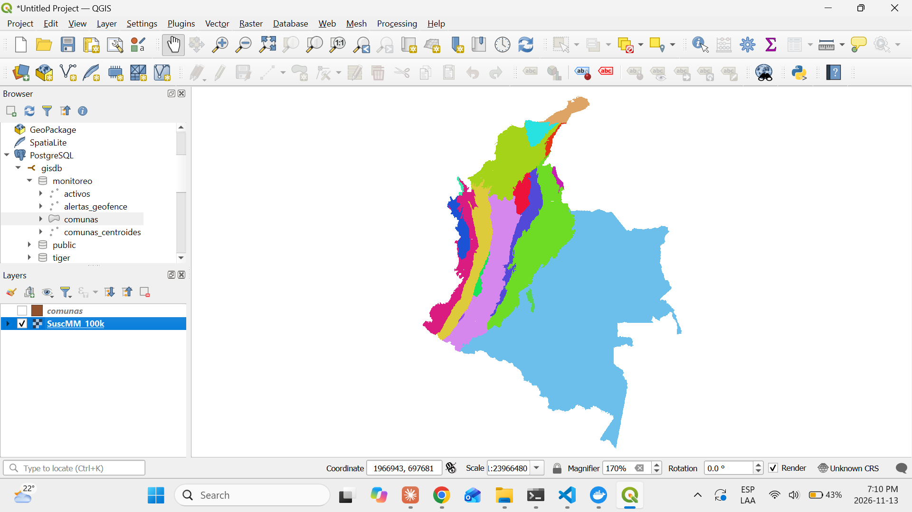


### Ficha técnica (Properties → Information)

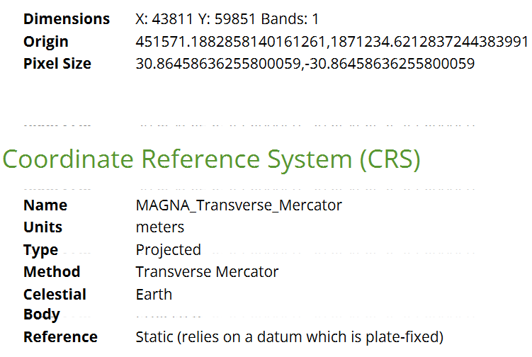


| Dato | Valor | Qué significa |
|---|---|---|
| Dimensiones | 43.811 × 59.851 celdas, 1 banda | ~2.600 millones de celdas: todo el país |
| Tamaño de celda | **30,86 m** | Cada celda cubre ~31 × 31 m: una comuna de 1 km² tiene ~1.000 celdas |
| CRS | `MAGNA_Transverse_Mercator`, metros, **sin código EPSG** | Personalizado. Por su origen (451.571 / 1.871.234) parece MAGNA-SIRGAS Colombia Bogotá (EPSG:3116), pero es una deducción, no está declarado. Las comunas están en **EPSG:6256**: hay que unificar el CRS antes de calcular |
| Valores de la banda | mínimo 0, máximo **15.230**, media 1.603 | No pueden ser clases de susceptibilidad: son **códigos** |

### La tabla de valores (`SuscMM_100k.tif.vat.dbf`)
Se abrió como capa vectorial sin geometría (Añadir capa vectorial → *All files*) y se revisó su tabla de atributos.


| Columna | Qué es | Ejemplo |
|---|---|---|
| `Value` | Código que guarda cada celda (15.230 códigos) | `2` |
| `Count` | Cuántas celdas del país tienen ese código | 5.744.584 |
| `Suscep` | Clase en número: 1 muy baja · 2 baja · 3 media · 4 alta · 5 muy alta | `4` |
| `Susceptibi` | La misma clase en texto (el formato `.dbf` corta los nombres de columna a 10 caracteres) | `Alta` |

- Cada código tiene una sola clase y varios códigos comparten clase (por ejemplo 1, 5, 7, 8 y 12 son *Media*). Como un código de barras y su categoría: miles de códigos, 5 categorías.
- **Qué son los 15.230 códigos (hipótesis, no confirmada por el archivo):** probablemente cada código es un **polígono** del mapa original del SGC, una zona homogénea del terreno resultante de cruzar factores como geología, geomorfología, pendiente y cobertura, que luego se convirtió a raster. Pistas: los códigos son consecutivos (1 … 15.230), como identificadores, y `Count` varía enormemente (de 234 a 5,7 millones de celdas), como polígonos de tamaños muy distintos. No son 15.230 tipos de suelo: un tipo de suelo es un solo factor; una unidad combina varios.
- **Consecuencia:** promediar los códigos no tiene sentido (el código 9.000 no es "más susceptible" que el 2). Antes de la estadística zonal hay que **reclasificar** cada código a su clase.

### Procedimiento
```
raster SGC (códigos, todo el país) → recortar y reproyectar → reclasificar código → clase
→ estadística zonal (clase predominante) → histograma zonal (% por clase) → nivel por comuna
```

### Paso 4 — Recortar y reproyectar
**Raster → Extraction → Clip Raster by Mask Layer**: entrada `SuscMM_100k`, máscara `comunas`, **CRS de destino EPSG:6256**, *Match the extent…* y *Keep resolution…* activados. Salida: [`data/susc_manizales_codigos.tif`](../data/susc_manizales_codigos.tif) (dato procesado y liviano, sí se versiona).

- **Recortar:** de ~2.600 millones de celdas a ~138.000; los cálculos siguientes son instantáneos.
- **Reproyectar en el mismo paso:** raster y comunas quedan en el mismo CRS.
- **Remuestreo por vecino más cercano** (el predeterminado de la herramienta; la opción no aparece en *Advanced Parameters*): al reproyectar se recalcula la cuadrícula, y como los valores son **códigos categóricos** cada celda nueva debe copiar el código más cercano. Un método que promedie (bilineal, cúbico) inventaría códigos: el promedio de 2 y 8 es 5, que no corresponde a esa zona.

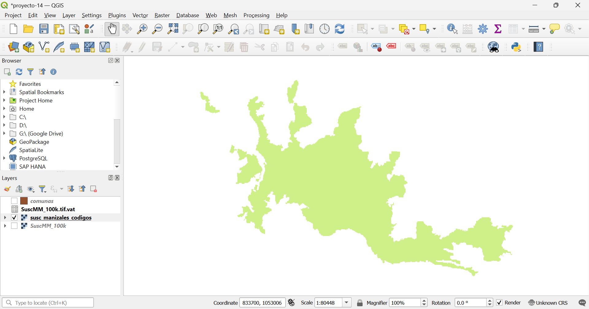

**Verificación (Properties → Information):**

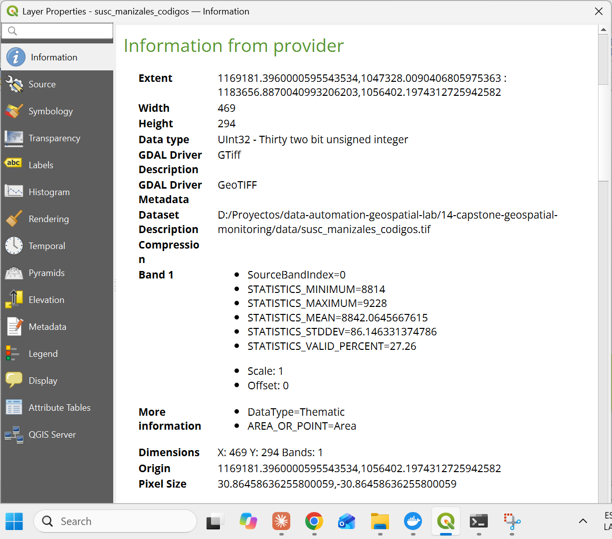

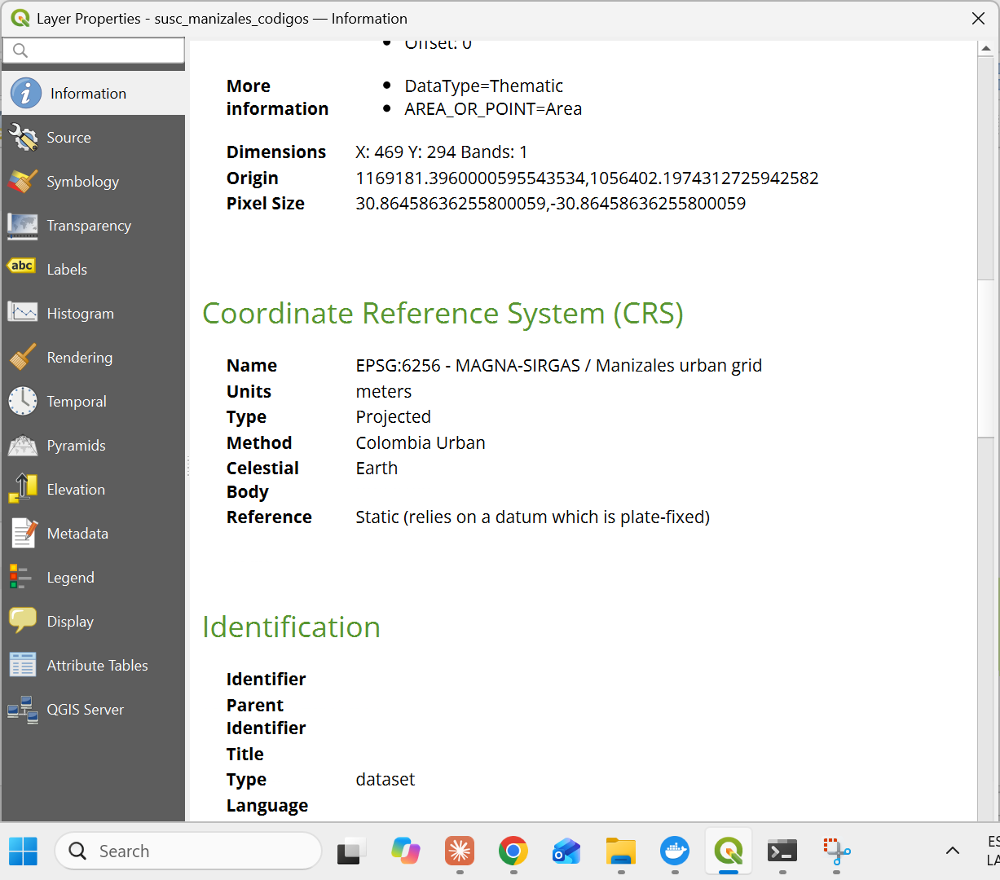

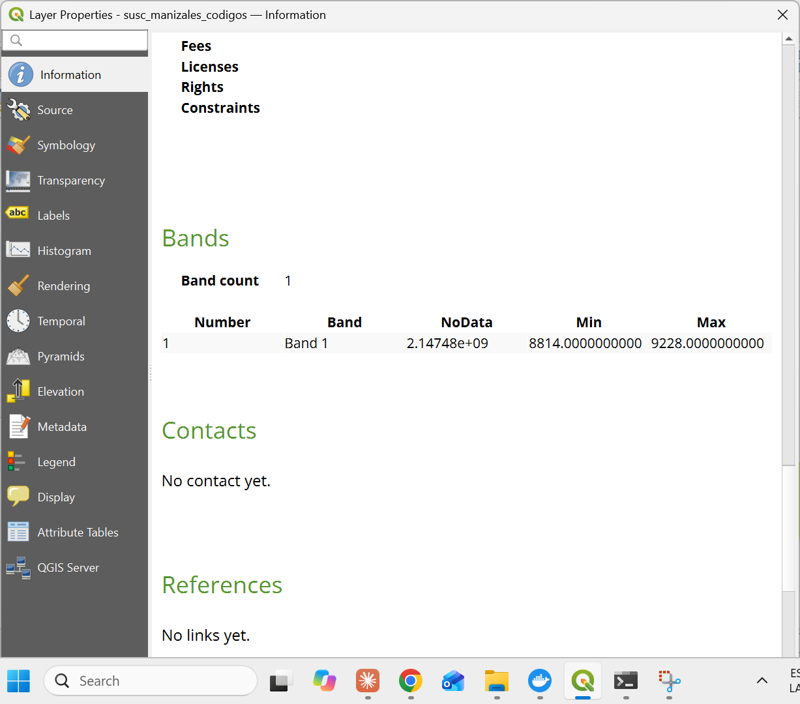

| Verificación | Resultado |
|---|---|
| CRS | **EPSG:6256 – MAGNA-SIRGAS / Manizales urban grid**, el de las comunas |
| Tamaño de celda | 30,86 m, igual al original |
| Valores | 8.814 a 9.228, tipo `UInt32`, *DataType = Thematic*: siguen siendo códigos enteros (no hubo promedios). De los 15.230 códigos del país, Manizales usa un rango pequeño |
| Área con datos | 469 × 294 = 137.886 celdas, **27,26 %** válidas ≈ 37.600 celdas × 952 m² ≈ **35,8 km²**; la suma de `area_km2` de las 12 comunas es **35,77 km²** → el recorte cubre exactamente las comunas |
| NoData | `2,14748e+09`: valor especial (gigante a propósito) para las celdas fuera de las comunas |

### Paso 6 — Reclasificar código → clase
**Processing Toolbox → Reclassify by layer** (la Caja de herramientas se abre en *Processing → Toolbox*).

| Parámetro | Valor | Por qué |
|---|---|---|
| Raster layer | `susc_manizales_codigos` | El recorte |
| Layer containing class breaks | `SuscMM_100k.tif.vat` | La tabla de valores es la regla |
| Minimum / Maximum class value field | `Value` / `Value` | La herramienta trabaja con rangos; un código exacto es un rango que empieza y termina en el mismo número |
| Output value field | `Suscep` | La clase 1–5 |
| Range boundaries | **`min <= value <= max`** | Con mínimo = máximo, ambos extremos deben incluirse; con `<` ningún código cumpliría y el resultado saldría vacío |
| Use NoData when no range matches | ✅ | Un código ausente de la tabla queda sin dato, no conserva el código |
| Output data type | `Int16` | Clases enteras pequeñas |

Salida: [`data/susc_manizales_clases.tif`](../data/susc_manizales_clases.tif).

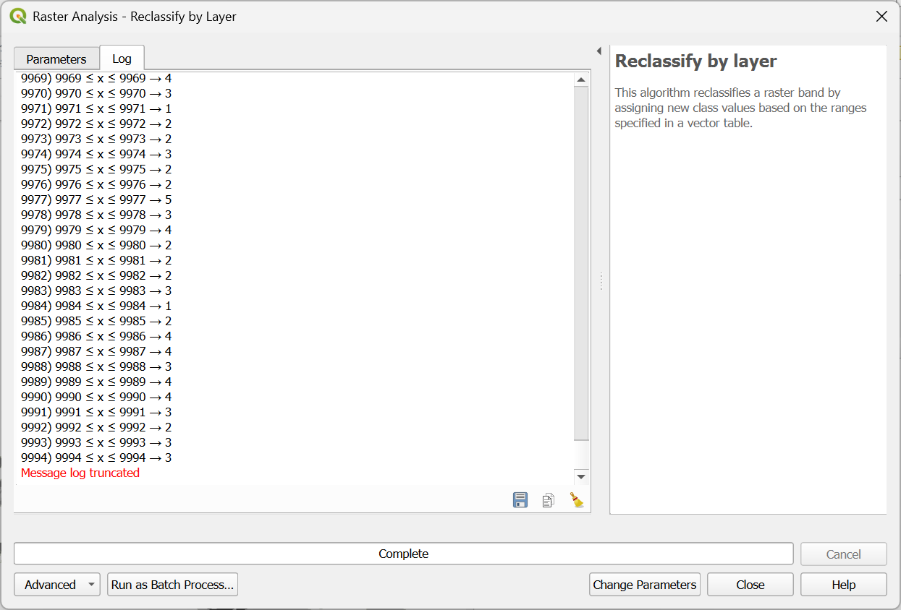

- El Log lista una regla por código (`9977 ≤ x ≤ 9977 → 5`).
- **Error evitado:** en la primera configuración *Maximum class value field* quedó en `Suscep`; la regla habría sido "de 8.814 a 4" y ningún código habría coincidido. Se corrigió a `Value` antes de ejecutar.


- Valores de **2 a 5**, NoData `-9999`: los códigos se convirtieron en clases. **No hay clase 1 (muy baja)** en las comunas: coherente con una ciudad sobre un filo de montaña.
- Un raster nuevo no trae paleta: QGIS lo dibuja en grises (negro = valor bajo, blanco = alto). Se simbolizó con **Paletted/Unique values** (equivalente raster de la simbología categorizada) con la paleta RdYlGn: `#1A9641` baja, `#FFFFBF` media, `#FDAE61` alta, `#D7191C` muy alta. Las comunas se dibujan encima con *Fill style = No Brush* (solo borde); bajar la opacidad de la capa haría transparente también el borde.

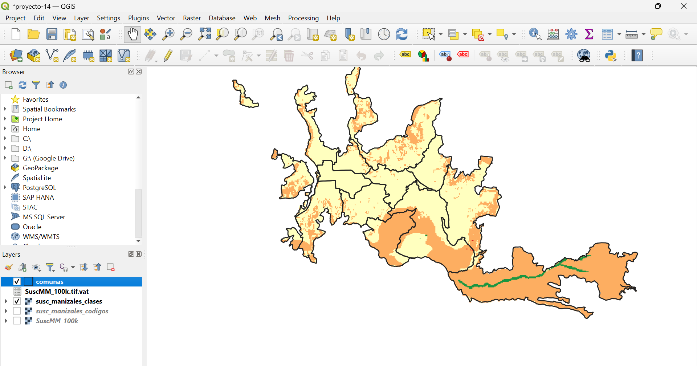

### Paso 8a — Estadística zonal (clase predominante)
**Processing Toolbox → Zonal statistics** (zonas = polígonos; no *Raster layer zonal statistics*, que usa otro raster como zonas, ni *(in place)*, que modifica la capa de entrada). Entrada `comunas`, raster `susc_manizales_clases`, prefijo `susc_`, estadísticas **Count, Majority, Variety**. Salida: [`data/comunas_susceptibilidad.gpkg`](../data/comunas_susceptibilidad.gpkg).

- Sobre clases categóricas se usa la **mayoría** (la clase que más se repite), no el promedio: el promedio de "media" y "muy alta" no es "alta". Por eso se desmarcaron *Mean* y *Sum*.

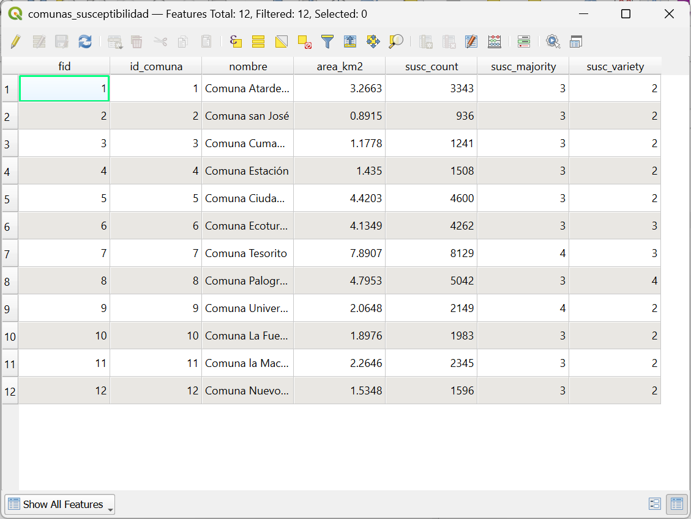

- `susc_majority`: **media (3) en 10 comunas** y **alta (4) en 7 Tesorito y 9 Universitaria**. `susc_count` coincide con el área (comuna 7: 7,89 km² ≈ 8.285 celdas esperadas, 8.129 contadas, 98 %; las celdas de borde solo cuentan si su centro cae dentro).
- **No coincide con la literatura:** las comunas 1, 2 y 11 quedan en "media". La mayoría esconde la variación interna de cada comuna; hace falta el porcentaje por clase.

### Paso 8b — Histograma zonal (% por clase)
**Processing Toolbox → Zonal histogram** sobre `comunas_susceptibilidad` (así se conservan las columnas del 8a), prefijo `clase_`. Salida: [`data/comunas_susceptibilidad_hist.gpkg`](../data/comunas_susceptibilidad_hist.gpkg), que es la **capa final** del ejercicio.

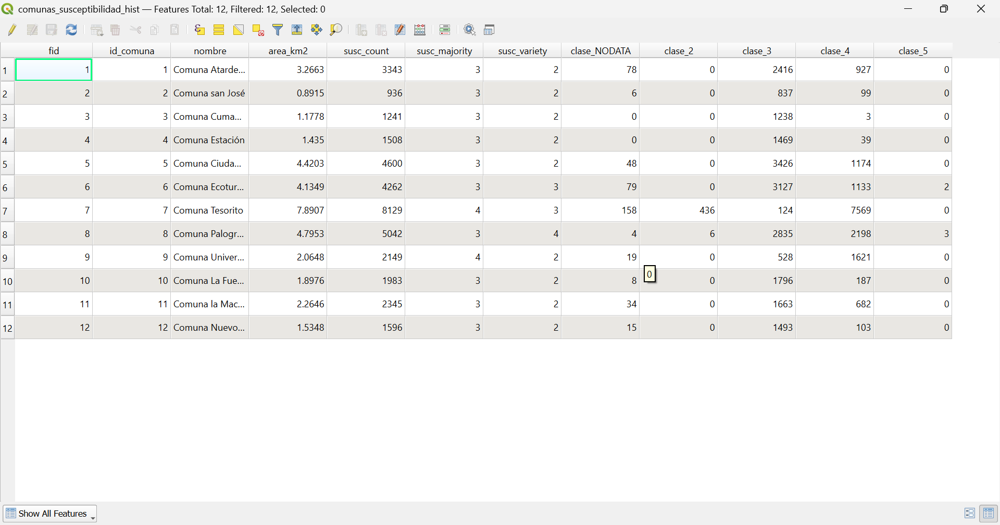

| Columna | Origen | Significado |
|---|---|---|
| `fid` | GeoPackage | Identificador interno de fila |
| `id_comuna`, `nombre`, `area_km2` | `monitoreo.comunas` | Datos de la comuna |
| `susc_count` | 8a | Celdas **con dato** dentro de la comuna (~952 m² cada una) |
| `susc_majority` | 8a | Clase que más se repite |
| `susc_variety` | 8a | Número de clases distintas |
| `clase_NODATA` | 8b | Celdas sin dato (bordes del recorte) |
| `clase_2` … `clase_5` | 8b | Celdas de susceptibilidad baja, media, alta y muy alta |

Las cuentas cuadran: en la comuna 1, 0 + 2.416 + 927 + 0 = 3.343 = `susc_count`. Ejemplo de lo que esconde la mayoría: Palogrande tiene mayoría "media", pero 2.201 de sus 5.042 celdas (43,7 %) son alta o muy alta.

### Paso 9 — Nivel por comuna (criterio C)
Se evaluaron tres criterios: **A** clase predominante (10 comunas iguales, no diferencia), **B** % del área en alta + muy alta con cortes, y **C** = B + ajuste por evidencia histórica. Se eligió **C**.

Columnas creadas con la **calculadora de campos** (Ctrl + I) en `comunas_susceptibilidad_hist`, guardadas con *Save edits*:

| Columna | Expresión |
|---|---|
| `pct_alta` | `round(("clase_4" + "clase_5") * 100.0 / "susc_count", 1)` |
| `nivel_sgc` | `CASE WHEN "pct_alta" >= 40 THEN 'alta' WHEN "pct_alta" >= 20 THEN 'media' ELSE 'baja' END` |
| `nivel` | `CASE WHEN "id_comuna" IN (1, 11) THEN 'alta' WHEN "id_comuna" = 2 THEN 'media' ELSE "nivel_sgc" END` |
| `ajuste` | Motivo del ajuste en texto; `NULL` si no hubo ajuste |

- `CASE WHEN` evalúa las condiciones en orden y se queda con la primera que se cumple. Comillas dobles = columna; comillas simples = texto.
- Los cortes de **20 % y 40 %** son **supuestos del proyecto**. `nivel_sgc` (dato oficial) y `nivel` (con ajuste) quedan en columnas separadas para que se vea qué viene de cada lado.

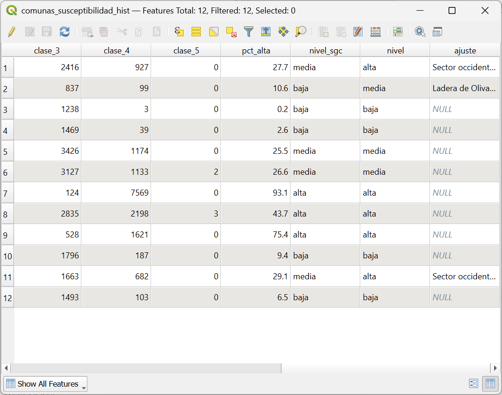

| Comuna | % alta + muy alta | `nivel_sgc` | `nivel` | Ajuste |
|---|---|---|---|---|
| 7 Tesorito | 93,1 | alta | **alta** | |
| 9 Universitaria | 75,4 | alta | **alta** | |
| 8 Palogrande | 43,7 | alta | **alta** | |
| 11 La Macarena | 29,1 | media | **alta** | Sector occidental, el más lluvioso (IDEA – UNAL) |
| 1 Atardeceres | 27,7 | media | **alta** | Sector occidental, el más lluvioso (IDEA – UNAL) |
| 6 Ecoturístico Cerro de Oro | 26,6 | media | **media** | |
| 5 Ciudadela del Norte | 25,5 | media | **media** | |
| 2 San José | 10,6 | baja | **media** | Ladera de Olivares, deslizamientos históricos |
| 10 La Fuente | 9,4 | baja | **baja** | |
| 12 Nuevo Horizonte | 6,5 | baja | **baja** | |
| 4 Estación | 2,6 | baja | **baja** | |
| 3 Cumanday | 0,2 | baja | **baja** | |

**Comparación con la literatura:** el mapa del SGC respalda parcialmente a Atardeceres y La Macarena (~30 % de su territorio en alta). San José tiene solo 10,6 %: su historial (ladera de Olivares) probablemente responde a factores que un mapa regional 1:100.000 no capta (una ladera puntual, ocupación urbana, cortes de taludes).

**Cómo sustentarlo:**
> La susceptibilidad de cada comuna sale del mapa oficial del Servicio Geológico Colombiano: medimos qué porcentaje de su territorio es de alta susceptibilidad. Como ese mapa es regional y no capta detalles locales, subimos un nivel a las tres comunas donde estudios locales documentan más deslizamientos. Es un criterio conservador: en un sistema de alerta es preferible alertar de más que de menos.

Si se pregunta por qué solo un nivel: el mapa oficial no muestra tanta área de alta susceptibilidad en esas comunas; el ajuste complementa el dato, no lo reemplaza.

### Paso 10 — Mapa de nivel por comuna
`comunas_susceptibilidad_hist` con simbología **categorizada** por `nivel` (baja `#1A9641`, media `#FFD92F`, alta `#D7191C`) y etiquetas con la expresión `"id_comuna" || if("ajuste" IS NOT NULL, '*', '')`: el número de la comuna, con `*` si su nivel se ajustó por evidencia histórica (`||` une textos; `if(condición, sí, no)`).

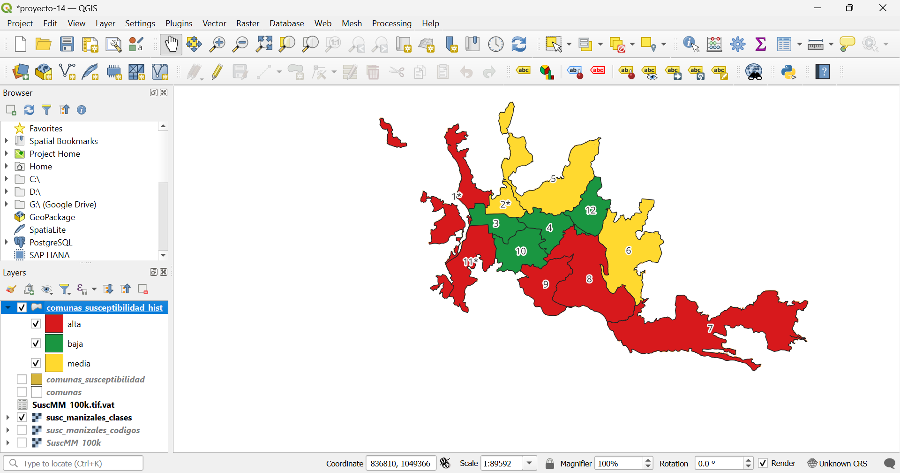

- **Alta** (rojo): 1\*, 7, 8, 9, 11\* · **Media** (amarillo): 2\*, 5, 6 · **Baja** (verde): 3, 4, 10, 12.
- Las comunas de nivel alto se concentran en el **occidente** (1, 11) y en el **sur–oriente** (7, 8, 9); el centro (3, 4, 10, 12) es de nivel bajo.

### Archivos generados
| Archivo | Qué es | ¿Final? |
|---|---|---|
| `data/susc_manizales_codigos.tif` | Raster recortado y reproyectado, con códigos | Intermedio |
| `data/susc_manizales_clases.tif` | Raster reclasificado, clases 2–5 | Sí (para el mapa) |
| `data/comunas_susceptibilidad.gpkg` | Comunas con estadística zonal (8a) | Intermedio |
| `data/comunas_susceptibilidad_hist.gpkg` | Comunas con histograma, `pct_alta`, `nivel_sgc`, `nivel` y `ajuste` | **Sí: se carga a PostGIS en el 14.4** |

## 14.4 — Esquema `plataforma` y modelo de datos

Script: [`sql/plataforma.sql`](../sql/plataforma.sql). Se puede ejecutar varias veces sin errores ni duplicados (`IF NOT EXISTS`, `ON CONFLICT`). Requiere lo creado en el Proyecto 9: EPSG:6256 registrado en `spatial_ref_sys` y `monitoreo.comunas` cargada.

### Modelo de datos
```
umbrales ◄── comunas_riesgo ◄── lluvia_a25
                    ▲
                    ├────────── alertas
                    │
brigadas ◄── posiciones ──► (comuna donde está la brigada)
```

| Tabla | Qué guarda | La llena |
|---|---|---|
| `umbrales` | Umbral A25 por nivel (alta 150, media 200, baja 250 mm) y su fuente | Script (14.4) |
| `comunas_riesgo` | Nivel de cada comuna (resultado del 14.3) y su geometría | Script (14.4) |
| `brigadas` | 4 brigadas ficticias: Norte, Centro, Occidente, Oriente | Script (14.4) |
| `posiciones` | Cada posición reportada por una brigada (`Point`, 6256) | n8n (14.7) |
| `lluvia_a25` | A25 diario de cada comuna | n8n (14.5) |
| `alertas` | Alertas `riesgo_lluvia` y `sin_cobertura` | n8n (14.5 y 14.8) |

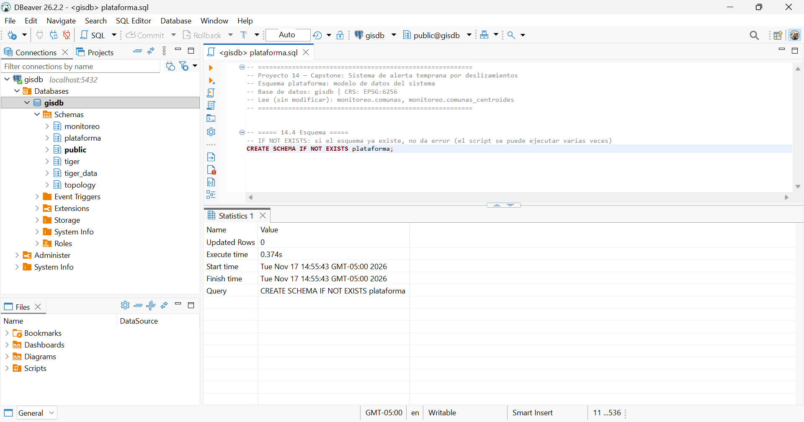

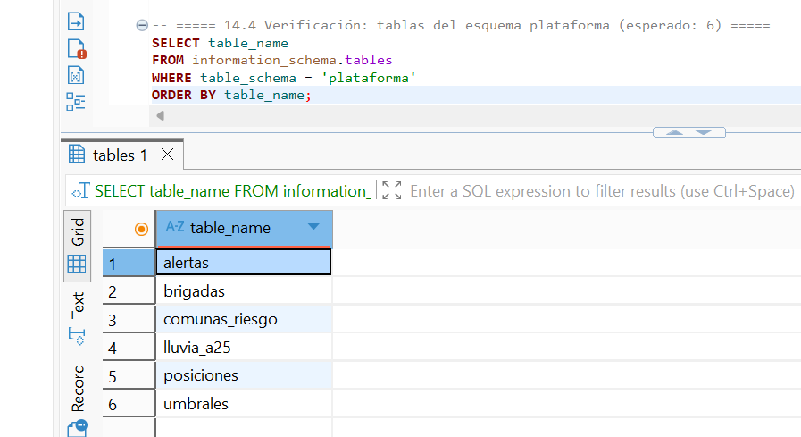

### Decisiones de diseño
- **Esquema propio:** el capstone queda separado de `monitoreo`, que solo se lee.
- **Normalización:** el umbral vive en `umbrales`, no repetido por comuna; cambiar un umbral es editar una fila. Excepción deliberada: `alertas` guarda el umbral **vigente** al momento de la alerta, para conservar el historial aunque el umbral cambie después.
- **`comunas_riesgo` con su propia geometría** (copiada de `monitoreo.comunas`): el capstone es independiente y QGIS puede pintar el riesgo directamente desde esta tabla.
- **Calidad del dato en la base:** `CHECK` limita los valores permitidos (`nivel IN ('alta','media','baja')`, `pct_alta BETWEEN 0 AND 100`, `tipo IN ('riesgo_lluvia','sin_cobertura')`); las **llaves foráneas** impiden, por ejemplo, una comuna con un nivel sin umbral o una posición de una brigada inexistente.
- **Sin duplicados:** `UNIQUE (id_comuna, fecha)` en `lluvia_a25` y `UNIQUE (tipo, id_comuna, fecha)` en `alertas`; si n8n se ejecuta dos veces el mismo día, la base no duplica registros.
- **Índices:** GiST en las geometrías (`ST_Contains`, `ST_DWithin`) y `(id_brigada, registrado_en DESC)` para consultar la última posición de cada brigada. El índice de la llave primaria (B-tree) se crea solo y sirve para buscar por valor (por ejemplo, la comuna 7); el GiST organiza las geometrías por su rectángulo envolvente y sirve para buscar por ubicación, porque las geometrías no tienen un orden natural.
- **Tipos:** `BIGSERIAL` en las tablas que crecen sin parar (`posiciones`, `lluvia_a25`, `alertas`); `posiciones.id_comuna` admite `NULL` (brigada fuera de las comunas).
- **Nombres:** `riesgo_lluvia` en lugar de `lluvia` (ambiguo) o `riesgo_x_lluvia` (abreviatura informal): snake_case con palabras completas.

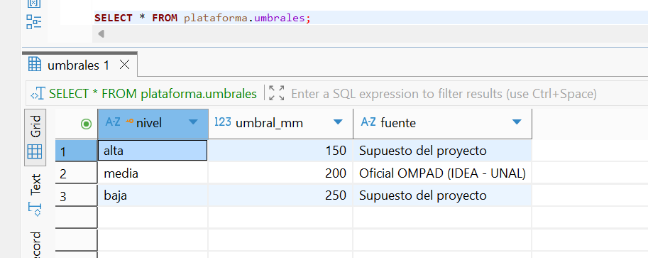

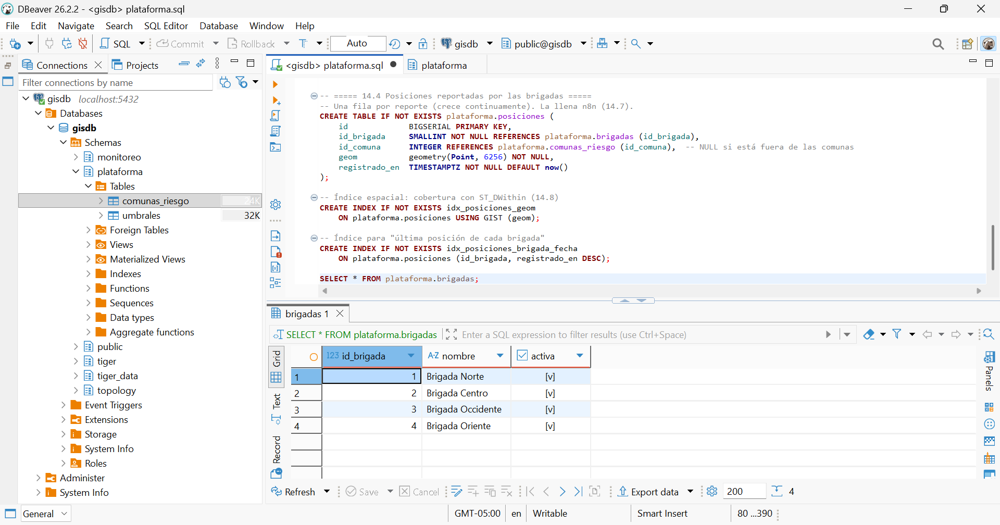

### Carga de `comunas_riesgo`
**Problema:** al importar `comunas_susceptibilidad_hist.gpkg` con DB Manager a una tabla de paso (*staging*), QGIS respondió `AddGeometryColumn() - SRID must be <= 998999`. Es el mismo problema del 9.5 ([`09-postgis/problemas-srid.md`](../../09-postgis/problemas-srid.md)): el GeoPackage guarda el SRID 6256 con definición `undefined` (el método *Colombia Urban* no cabe en WKT1), QGIS lo trata como CRS personalizado con un número interno muy alto y PostGIS lo rechaza.

**Solución:** no importar el GeoPackage. La geometría ya estaba en PostGIS (`monitoreo.comunas`, SRID 6256); del 14.3 solo hacían falta los atributos. El script los escribe en una tabla temporal dentro de la consulta (`WITH resultado_14_3 AS (VALUES ...)`, leídos del GeoPackage) y los une con la geometría por `id_comuna`:

```
GeoPackage del 14.3 ──► solo atributos (12 filas) ──┐
                                                   ├──► plataforma.comunas_riesgo
monitoreo.comunas ────► geometría (SRID 6256) ─────┘
```

- La carga queda **reproducible** dentro del script, sin pasos manuales en QGIS.
- `ON CONFLICT (id_comuna) DO UPDATE ... EXCLUDED` (*upsert*): si la comuna ya existe, actualiza sus valores en lugar de fallar.

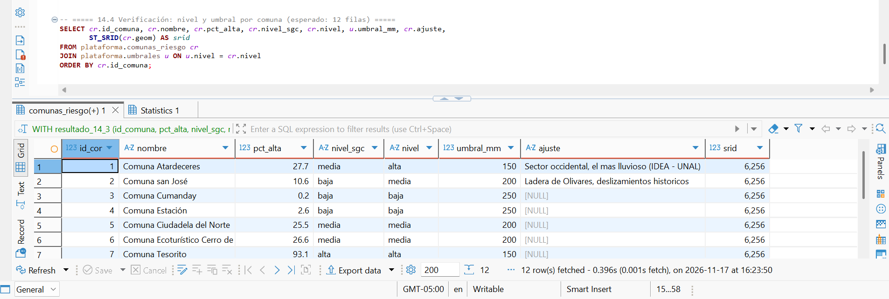

- 12 comunas, cada una con su nivel, su umbral (vía `JOIN` con `umbrales`) y SRID 6256.

### Verificación en QGIS
`plataforma.comunas_riesgo` cargada desde PostGIS, con el estilo copiado de la capa del 14.3 (*Styles → Copy Style / Paste Style*): coincide con el mapa del 14.3 en ubicación, colores y etiquetas.

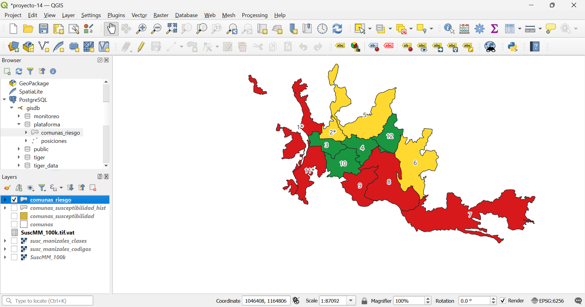

- Las etiquetas de las comunas 1, 5 y 11 cambian ligeramente de posición entre las dos capas: QGIS no guarda la posición de las etiquetas, la calcula al dibujar, y en polígonos irregulares o con varias partes puede elegir otro lugar. No es una diferencia en los datos.

## 14.5 — Workflow de lluvia A25 en n8n

Workflow **Lluvia A25 por comuna**: cada día a las 6 a. m. consulta la lluvia de los últimos 25 días en cada comuna, calcula el A25, lo guarda y registra una alerta si supera el umbral de la comuna.

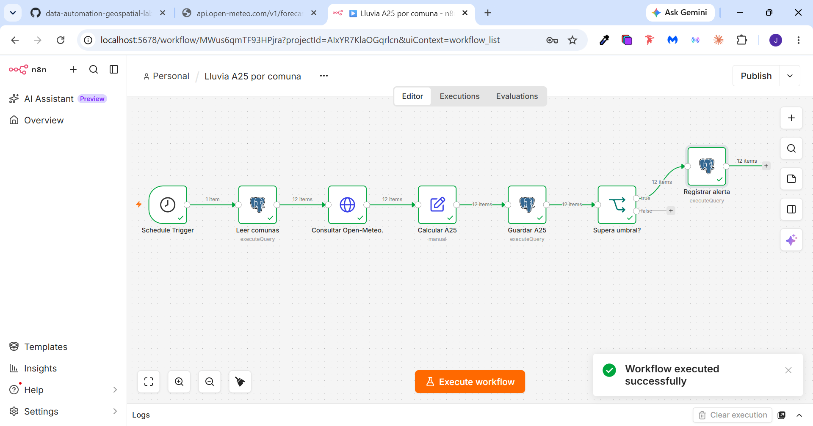

```
Schedule Trigger → Leer comunas → Consultar Open-Meteo → Calcular A25 → Guardar A25 → Supera umbral? ─true→ Registrar alerta
   (6 a. m.)        (12 items)      (1 llamada x comuna)                  (upsert)                    └false→ (nada)
```

Scripts: [`sql/lluvia_a25.sql`](../sql/lluvia_a25.sql) · Workflow exportado: [`workflows/lluvia-a25.json`](../workflows/lluvia-a25.json)

### Paso 1 — Un punto por comuna en latitud/longitud
Open-Meteo pide coordenadas WGS 84 (EPSG:4326). Se usa el **punto interior** de cada comuna (Proyecto 13), que siempre cae dentro del polígono, transformado de EPSG:6256 a 4326. La misma consulta trae el nivel y el umbral de cada comuna (`JOIN` con `umbrales`).

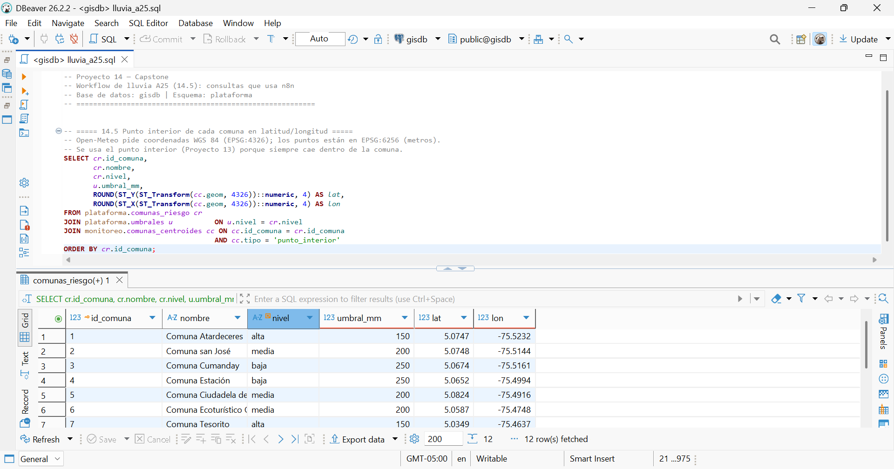

### Paso 2 — Probar la API antes de usarla
Se probó la URL de Open-Meteo en el navegador con el punto de una comuna: devuelve `daily.precipitation_sum`, una lista con la lluvia de cada día (mm).

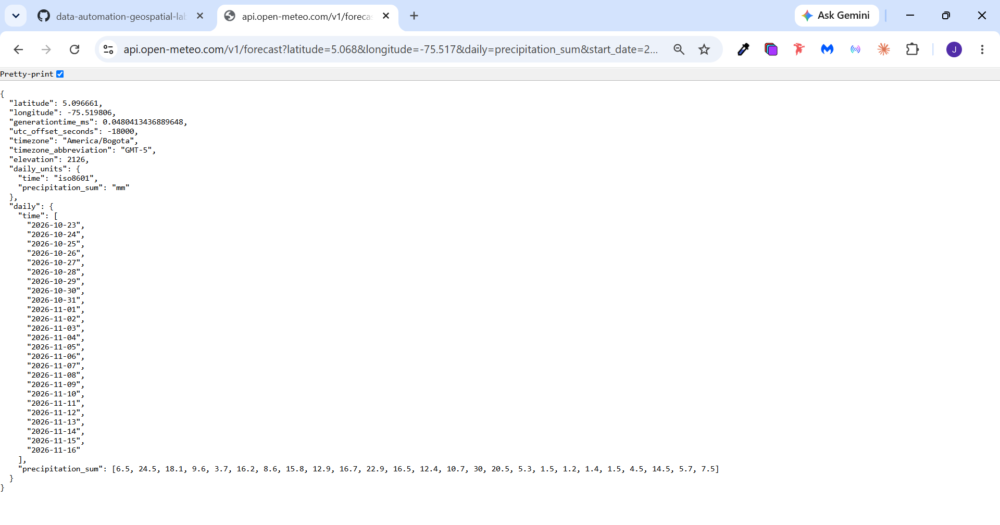

### Paso 3 — Nodos del workflow

| Nodo | Tipo | Qué hace |
|---|---|---|
| Schedule Trigger | Schedule | Ejecuta el workflow todos los días a las 6:00 |
| Leer comunas | Postgres (*Execute Query*) | Devuelve 12 items: comuna, nivel, umbral, lat, lon |
| Consultar Open-Meteo | HTTP Request (GET) | Una llamada por comuna con su lat/lon y el rango de 25 días |
| Calcular A25 | Edit Fields | Suma la lluvia diaria y arma los campos a guardar |
| Guardar A25 | Postgres | *Upsert* en `plataforma.lluvia_a25` |
| Supera umbral? | IF | `a25_mm > umbral_mm` |
| Registrar alerta | Postgres | *Upsert* en `plataforma.alertas` con tipo `riesgo_lluvia` |

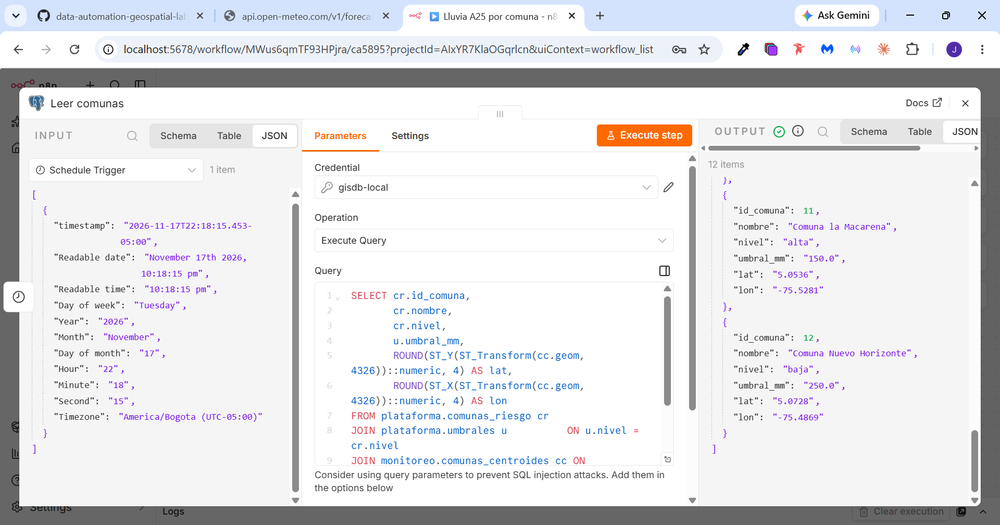

**Rango de fechas (Luxon).** El A25 suma los **25 días completos anteriores a hoy**: desde hoy − 25 hasta ayer (hoy aún no termina). Las fechas se calculan en hora de Colombia:

```
start_date = {{ $now.setZone('America/Bogota').minus({ days: 25 }).toFormat('yyyy-MM-dd') }}
end_date   = {{ $now.setZone('America/Bogota').minus({ days: 1 }).toFormat('yyyy-MM-dd') }}
```

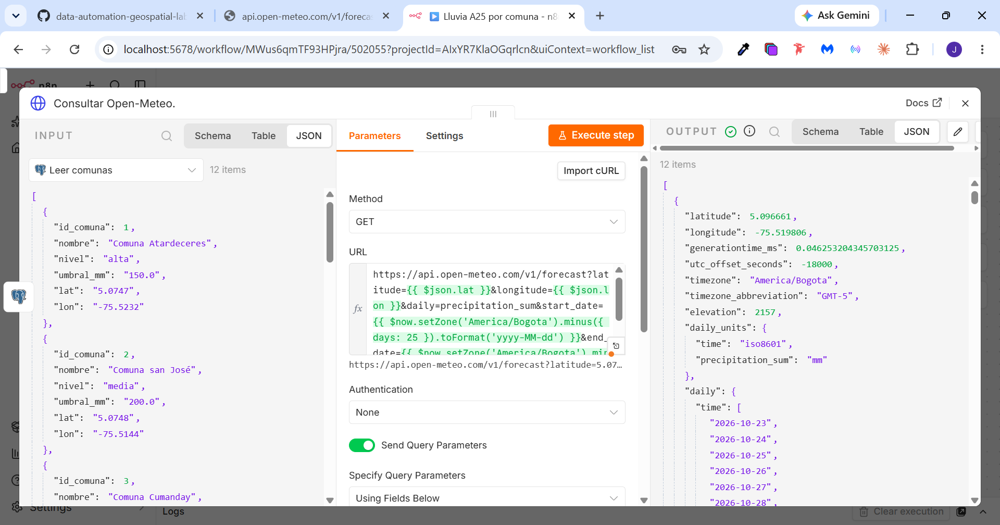

**Cálculo del A25.** `reduce` recorre la lista de 25 valores y los suma; `?? 0` trata un día sin dato como 0 mm; el resultado se redondea a 1 decimal:

```
{{ Math.round($json.daily.precipitation_sum.reduce((suma, mm) => suma + (mm ?? 0), 0) * 10) / 10 }}
```

- Los datos de la comuna (id, nombre, umbral) se leen de un nodo anterior con `$('Leer comunas').item.json`, porque la salida del HTTP Request solo trae la respuesta de la API.
- PostgreSQL devuelve los `NUMERIC` como texto; `Number(...)` convierte `umbral_mm` a número para poder compararlo.
- El campo `dias` (cantidad de valores recibidos) permite verificar que llegaron 25 días.

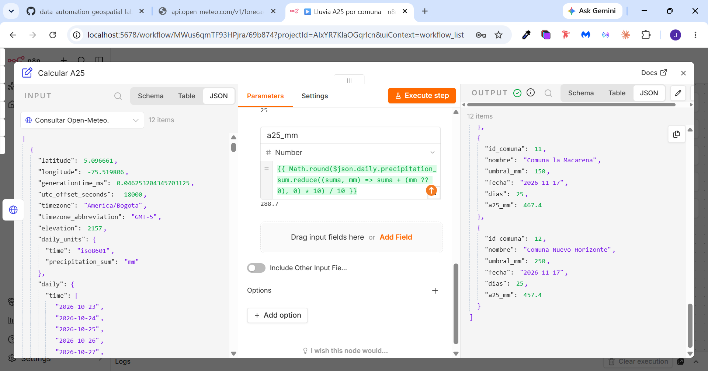

**Guardar con *upsert* y parámetros.** Los valores van como parámetros (`$1`, `$2`, `$3`), no pegados dentro del SQL. `ON CONFLICT (id_comuna, fecha) DO UPDATE` hace que ejecutar el workflow dos veces el mismo día actualice la fila en lugar de duplicarla o fallar.

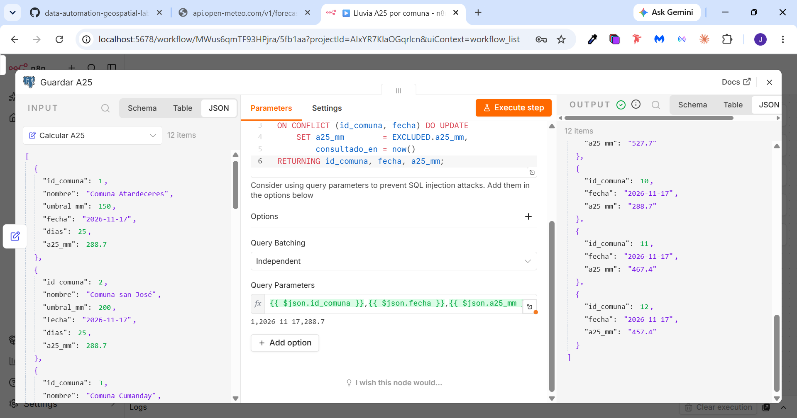

**Comparar y alertar.** El IF compara `a25_mm` con `umbral_mm`; solo la rama *true* llega a *Registrar alerta*, que también usa *upsert* (`UNIQUE (tipo, id_comuna, fecha)`).

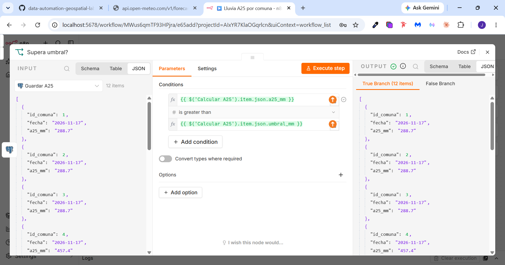

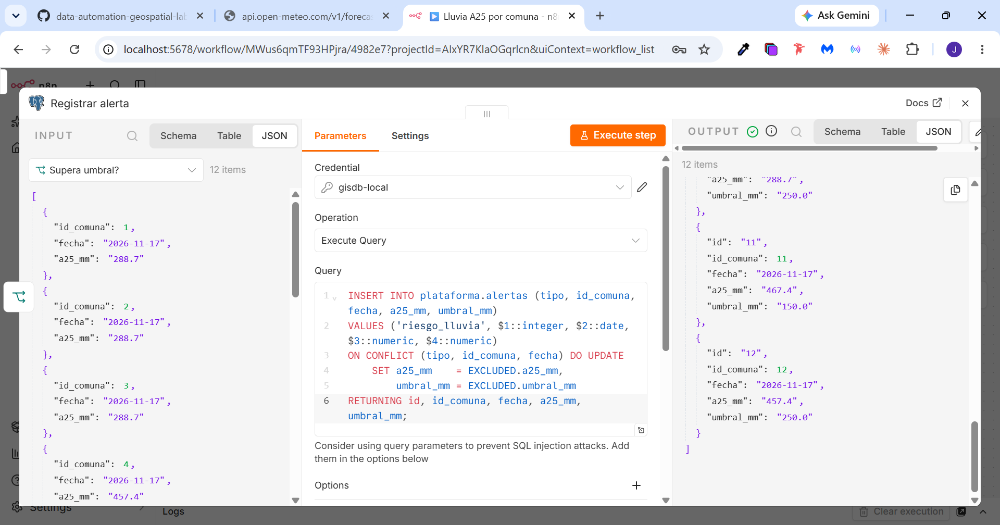

### Paso 4 — Verificación en DBeaver
Las consultas filtran por la fecha **en hora de Colombia** (`(now() AT TIME ZONE 'America/Bogota')::date`): PostgreSQL corre en UTC y, de noche, `CURRENT_DATE` ya sería el día siguiente.

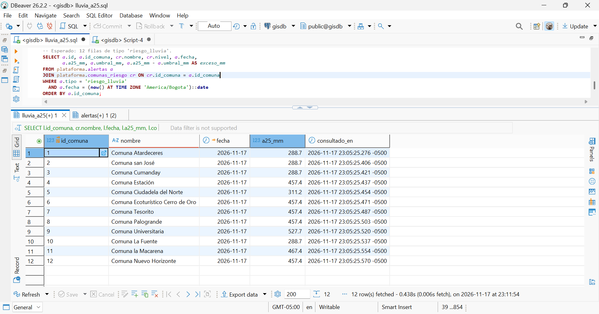

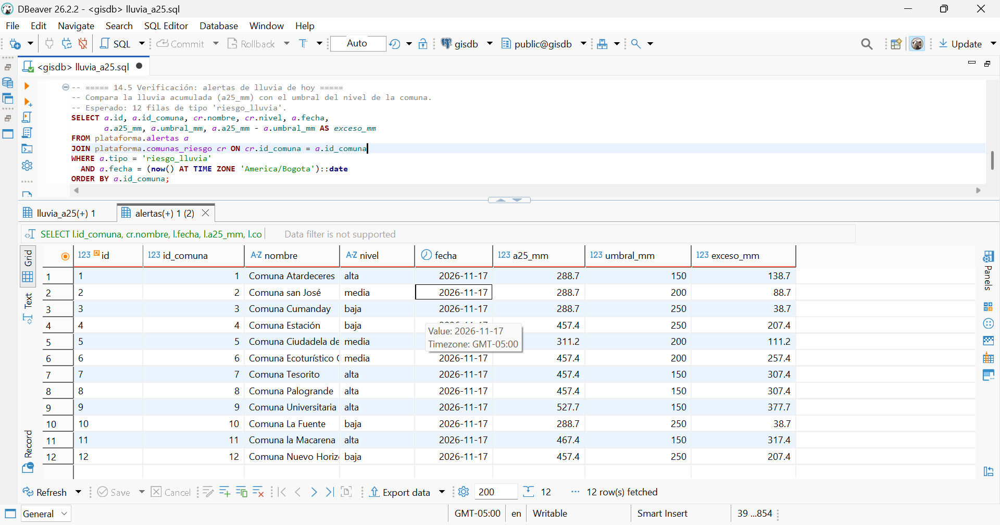

Resultado del 17-nov-2026: 12 filas en `lluvia_a25` y 12 alertas `riesgo_lluvia`; todas las comunas superan su umbral. El caso más ajustado son las comunas 3 y 10 (nivel bajo): 288.7 mm contra 250 mm.

### Hallazgo: la lluvia varía entre comunas
Se esperaba casi el mismo valor en toda la ciudad, pero Open-Meteo devolvió **5 valores distintos**:

| A25 (mm) | Comunas |
|---|---|
| 288.7 | 1, 2, 3, 10 |
| 311.2 | 5 |
| 457.4 | 4, 6, 7, 8, 12 |
| 467.4 | 11 |
| 527.7 | 9 |

Open-Meteo entrega la lluvia en una **cuadrícula** (celdas de varios kilómetros): las comunas cuyo punto cae en la misma celda reciben el mismo valor. El valor de la comuna 3 (288.7 mm) coincidió con la prueba manual en el navegador.

### Problema: inserciones en lote
Al probar *Guardar A25*, n8n avisó *Inserts were batched*: por defecto envía todos los items en una sola operación, y la salida ya no se puede emparejar item por item con la entrada. Solución: en *Options → Query Batching*, elegir **Independently** (una consulta por item), en *Guardar A25* y en *Registrar alerta*.

### Workflow exportado
- [`workflows/lluvia-a25.json`](../workflows/lluvia-a25.json), exportado desde el menú ⋯ → *Download*.
- Se revisó antes de subirlo: los tres nodos Postgres solo guardan la referencia a la credencial (`gisdb-local` y su id), sin contraseña.

## 14.6 — Simulador de brigadas en Python

Script: [`scripts/simulador_brigadas.py`](../scripts/simulador_brigadas.py) · Consulta de apoyo: [`sql/simulador_brigadas.sql`](../sql/simulador_brigadas.sql) · Librerías: [`requirements.txt`](../requirements.txt)

El simulador hace de GPS de las 4 brigadas: cada brigada recorre en círculo 3 comunas de su zona y, en cada paso, envía su posición (lat/lon) al webhook de n8n (14.7), como lo haría un GPS real.

```
PostGIS ──► simulador_brigadas.py ──► webhook de n8n (14.7)
 punto interior     mueve cada brigada       recibe cada posición
 de cada comuna     un paso cada 5 s
```

### Entorno virtual propio
El proyecto 14 tiene su propio `.venv`, separado del Proyecto 13: el simulador necesita otras librerías y así lo que se instala aquí no cambia el otro proyecto. Sin geopandas, porque el simulador solo mueve puntos.

| Librería | Para qué |
|---|---|
| `psycopg[binary]` | Leer de PostGIS los puntos de las comunas y las brigadas |
| `python-dotenv` | Leer usuario, contraseña y URL del webhook del `.env` de la raíz |
| `requests` | Enviar cada posición al webhook con un POST |

### Reparto de comunas entre brigadas
Se ordenaron los puntos interiores de occidente a oriente (longitud) para repartir 3 comunas a cada brigada según su ubicación:

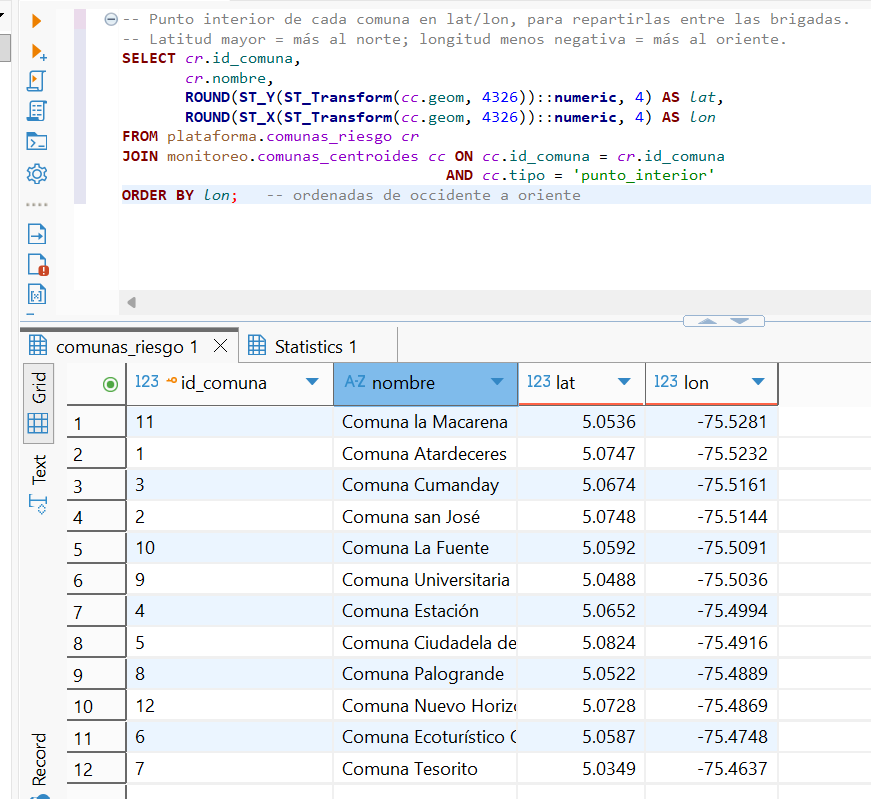

| Brigada | Ruta (en círculo) | Criterio |
|---|---|---|
| Norte (1) | 2 San José → 5 Ciudadela del Norte → 12 Nuevo Horizonte | Latitud más alta |
| Centro (2) | 4 Estación → 10 La Fuente → 9 Universitaria | Franja central |
| Occidente (3) | 1 Atardeceres → 3 Cumanday → 11 La Macarena | Las más al occidente |
| Oriente (4) | 8 Palogrande → 6 Cerro de Oro → 7 Tesorito | Las más al oriente |

El trayecto entre dos comunas es una línea recta, así que una brigada puede cruzar otra comuna en el camino; en el 14.7, `ST_Contains` dirá en qué comuna está cada posición.

### Cómo se mueve una brigada

| Decisión | Valor | Por qué |
|---|---|---|
| Movimiento | Línea recta de una comuna a la siguiente, en 10 pasos | Simple y visible como recorrido en QGIS |
| Ruido GPS | Hasta ±0.0002° (≈ 20 m) al azar en cada eje | Un GPS real nunca da una línea perfecta |
| Frecuencia | Cada 5 s, las 4 brigadas avanzan un paso | Para la demo; un GPS real enviaría cada 30-60 s |
| Hora | Con zona explícita (`-05:00`) | Se guarda bien en una columna `TIMESTAMPTZ` |

- **Interpolación lineal:** `lat = lat_A + (lat_B − lat_A) × avance`, con `avance` de 0.0 a 0.9.
- **Paso, tramo y vuelta:** en cada paso las 4 brigadas avanzan al mismo tiempo; un tramo (de una comuna a la siguiente) son 10 pasos y una vuelta completa son 3 tramos = 30 pasos (~2.5 min cada 5 s).
- **Ruta en círculo:** el residuo (`%`) reinicia la vuelta; después de la última comuna, vuelve a la primera.
- **Si el envío falla**, el script imprime el error y sigue con la siguiente posición, como un GPS real.

Mensaje que envía cada brigada:
```json
{"id_brigada": 1, "lat": 5.075534, "lon": -75.512116, "registrado_en": "2026-11-18T21:50:12-05:00"}
```

### Opciones de la línea de comandos
Con `argparse`, el comportamiento cambia sin editar el código:

| Opción | Qué hace | Por defecto |
|---|---|---|
| `--prueba` | Solo imprime; no envía al webhook | Envía (requiere `N8N_WEBHOOK_URL` en el `.env`) |
| `--pasos N` | Cantidad de pasos; en cada paso las 4 brigadas avanzan (0 = sin límite, hasta Ctrl + C) | 12 |
| `--intervalo S` | Segundos entre pasos | 5 |

### Prueba sin webhook
```powershell
python scripts\simulador_brigadas.py --prueba --pasos 3 --intervalo 1
```

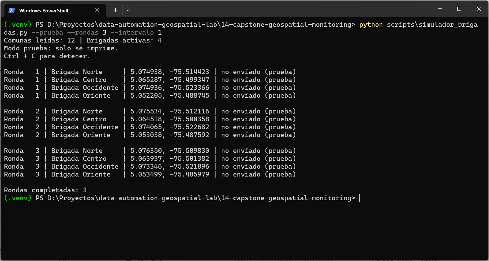

- Leyó 12 comunas y 4 brigadas activas.
- Cada brigada sale de su primera comuna y avanza ~250 m por paso. Ejemplo, Brigada Norte (comuna 2 → 5): la longitud pasa de −75.5144 a −75.5121 y −75.5098 (hacia el oriente) y la latitud sube (hacia el norte).
- Los decimales finales cambian en cada ejecución por el ruido GPS.

### Problema: `requirements.txt` en UTF-16
`pip freeze > requirements.txt` en Windows PowerShell 5 guarda el archivo en **UTF-16**, y GitHub lo mostraba como binario (letras separadas por espacios). Solución: convertirlo a UTF-8. Para la próxima vez, generarlo con:
```powershell
pip freeze | Out-File -Encoding ascii requirements.txt
```

## 14.7 — Workflow de posiciones en n8n

Workflow **Posiciones de brigadas**: recibe cada posición del simulador (14.6) por webhook, identifica con `ST_Contains` en qué comuna está la brigada, la guarda en `plataforma.posiciones` y responde con la comuna.

```
simulador_brigadas.py ──POST──► Webhook ──► Guardar posición ──► Respond to Webhook
                                (n8n)       ST_Contains + INSERT     {"comuna": "...", "dentro": true}
```

Script: [`sql/simulador_brigadas.sql`](../sql/simulador_brigadas.sql) · Workflow exportado: [`workflows/posiciones-brigadas.json`](../workflows/posiciones-brigadas.json)

### Paso 1 — Probar la consulta en DBeaver
Antes de n8n, la consulta se probó con valores fijos:
- **Punto del GPS:** `ST_MakePoint(lon, lat)` (primero la longitud) → `ST_SetSRID(..., 4326)` → `ST_Transform(..., 6256)`, el CRS de las comunas.
- **`LEFT JOIN ... ON ST_Contains(comuna, punto)`:** una posición fuera de todas las comunas **igual se guarda**, con `id_comuna` NULL. Con `INNER JOIN` se perdería.
- **`LIMIT 1`:** si un punto cae justo en el borde de dos comunas, se guarda una sola fila.
- **`INSERT ... RETURNING`:** devuelve lo guardado sin otra consulta.

| Prueba | Punto | Resultado |
|---|---|---|
| Dentro | Brigada Norte en San José (5.0748, −75.5144) | `id_comuna = 2` |
| Fuera | Brigada Centro en el parque de Villamaría (5.0447, −75.5145) | `id_comuna = NULL` |

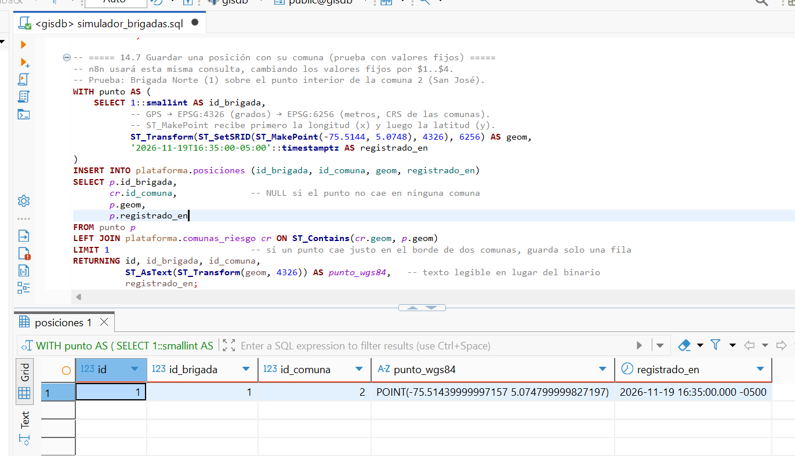

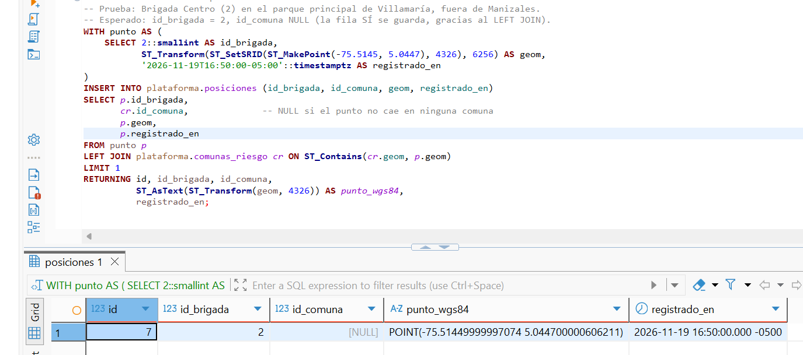

El punto devuelto (`-75.51439999997157`) difiere del enviado (`-75.5144`) en millonésimas de milímetro: es el redondeo de transformar 4326 → 6256 → 4326.

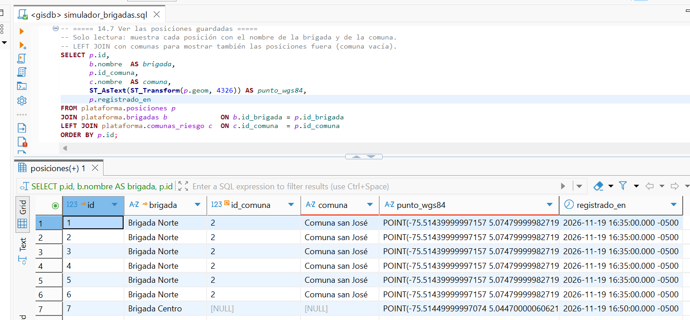

Las filas de prueba se borraron con `TRUNCATE plataforma.posiciones RESTART IDENTITY` (borra todas las filas y reinicia el `id` en 1).

### Paso 2 — Webhook
| Campo | Valor | Por qué |
|---|---|---|
| HTTP Method | POST | El simulador **entrega** datos; GET es para **pedirlos** |
| Path | `posiciones-brigadas` | Dice qué recibe |
| Respond | *Using 'Respond to Webhook' Node* | Responder después de guardar |

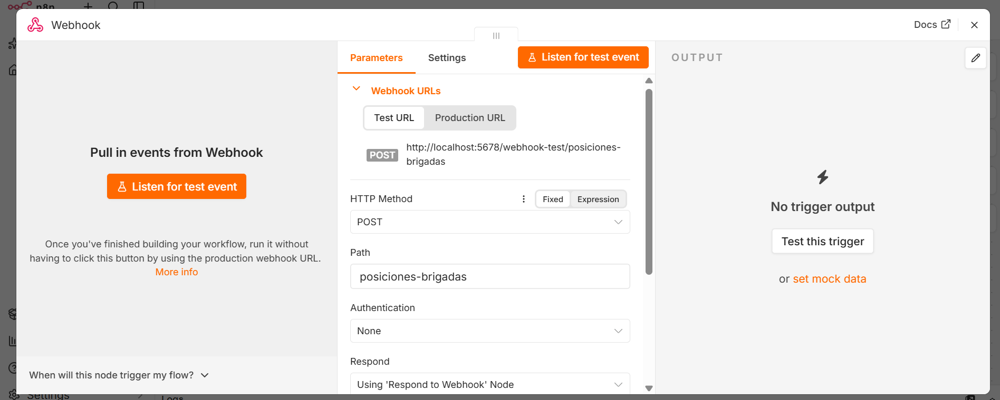

Primero se conectó el *Respond to Webhook* directo al Webhook (eco) y se envió una posición desde PowerShell con `Invoke-RestMethod`, en el mismo formato del simulador. Los datos llegan en `$json.body`.

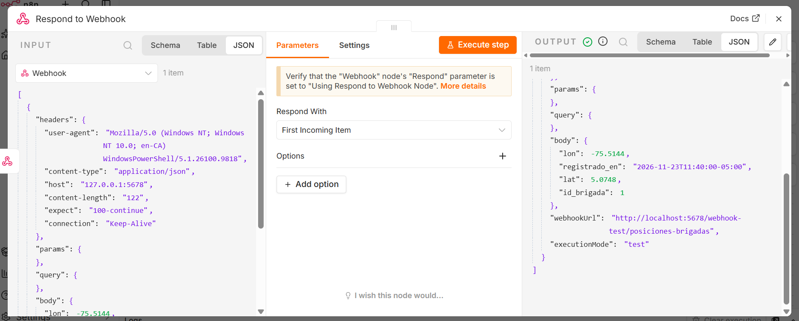

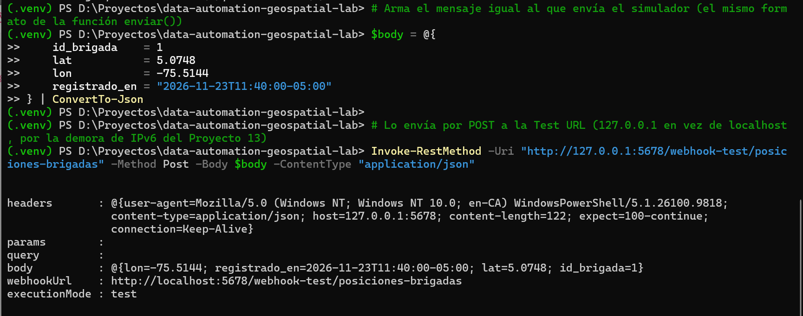

### Paso 3 — Nodo *Guardar posición*
Postgres, *Execute a SQL query*, con la consulta probada en DBeaver y tres cambios:
- Los valores fijos pasan a **parámetros** `$1..$4` (*Query Parameters*: `{{ $json.body.id_brigada }},{{ $json.body.lat }},{{ $json.body.lon }},{{ $json.body.registrado_en }}`), que PostgreSQL trata siempre como datos y nunca como código.
- El `INSERT` va dentro de un `WITH` (`nueva AS (INSERT ... RETURNING ...)`) y el `SELECT` final le agrega el **nombre** de la comuna.
- Devuelve `dentro` (`id_comuna IS NOT NULL`), como en el Proyecto 12.

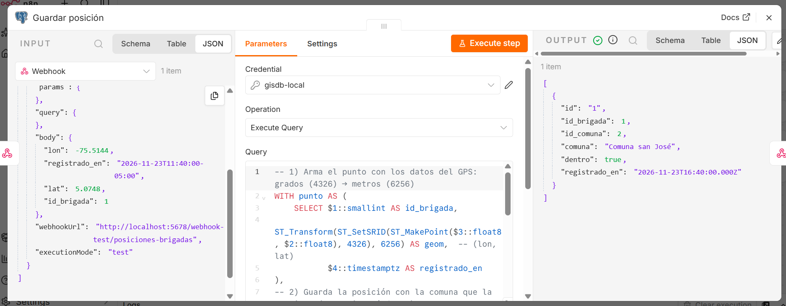

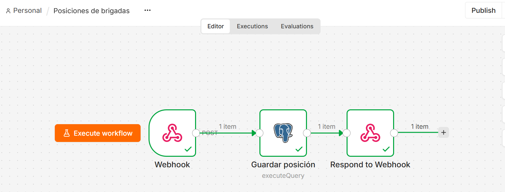

| Prueba | Respuesta en PowerShell |
|---|---|
| Brigada Norte en San José | `comuna : Comuna san José`, `dentro : True` |
| Brigada Centro en Villamaría | `comuna` vacía, `dentro : False` |

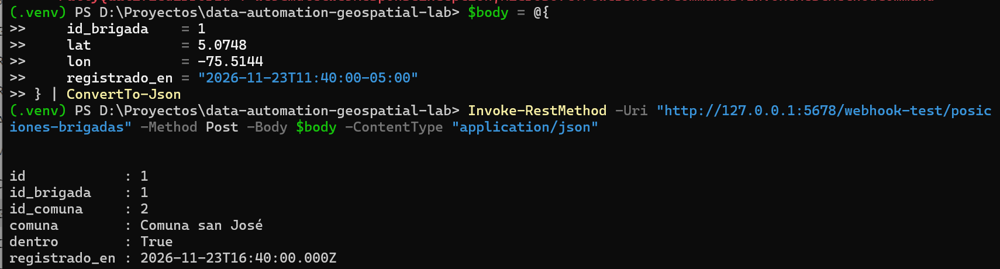

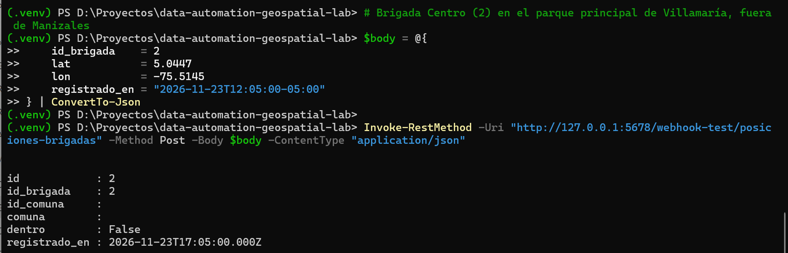

### Paso 4 — Publicar y usar la Production URL
| | Test URL | Production URL |
|---|---|---|
| Dirección | `/webhook-test/posiciones-brigadas` | `/webhook/posiciones-brigadas` |
| Escucha | Una llamada por cada clic en *Execute workflow* | Siempre, mientras el workflow esté publicado |
| Ejecuciones | En el lienzo | En la pestaña **Executions** |

El simulador envía 4 posiciones por paso, así que necesita la Production URL. Se publicó el workflow como versión **v1 - recibir y guardar posiciones** (n8n guarda cada publicación como una versión) y la URL se agregó al `.env` de la raíz como `N8N_WEBHOOK_URL`, con `127.0.0.1` en lugar de `localhost`.

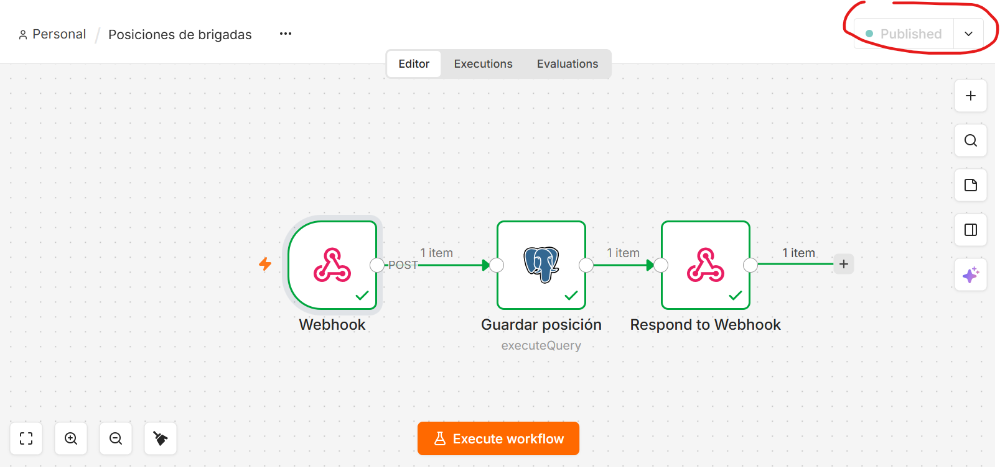

### Paso 5 — Simulador conectado
```powershell
python scripts\simulador_brigadas.py --pasos 3 --intervalo 2
```

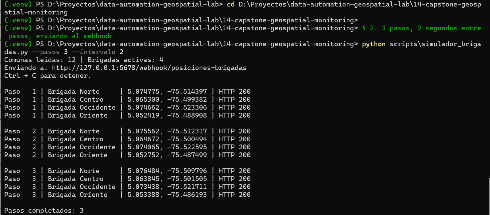

Las 12 posiciones respondieron `HTTP 200`. En **Executions** aparece una ejecución por posición, todas *Succeeded* en unos 100-200 ms.

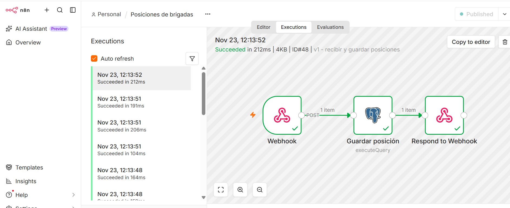

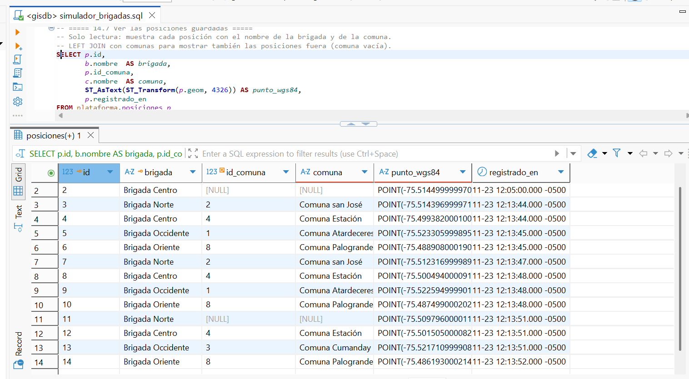

- Cada brigada aparece en su primera comuna: Norte en San José, Centro en Estación, Occidente en Atardeceres, Oriente en Palogrande.
- **Fila 13:** la Brigada Occidente ya está en Cumanday en el paso 3. Atardeceres y Cumanday son vecinas: la comuna se calcula para cada posición, no se copia de la ruta.
- **Fila 11:** la Brigada Norte queda en `NULL` en el paso 3, en (5.0763, −75.5098). El trayecto recto entre San José y Ciudadela del Norte cruza una zona que no pertenece a ninguna de las 12 comunas; gracias al `LEFT JOIN` la posición no se perdió.
- Las 4 posiciones de un paso tienen 1-2 s de diferencia: el simulador las envía una tras otra y espera cada respuesta.

### Problema: el script completo repetía las pruebas
Al ejecutar `simulador_brigadas.sql` completo (Alt + X), cada vez se volvía a correr la prueba de San José, y la tabla terminó con 6 filas idénticas. Solución: ejecutar cada bloque por separado, seleccionándolo con el mouse y **Ctrl + Enter**, y dejar una advertencia en el encabezado del script. Las filas repetidas se borraron con `TRUNCATE`.

### Workflow exportado
- [`workflows/posiciones-brigadas.json`](../workflows/posiciones-brigadas.json), exportado desde el menú ⋯ → *Download*.
- Se revisó antes de subirlo: el nodo Postgres solo guarda la referencia a la credencial (`gisdb-local` y su id), sin contraseña. La URL del webhook va en el `.env`, fuera del repo.
